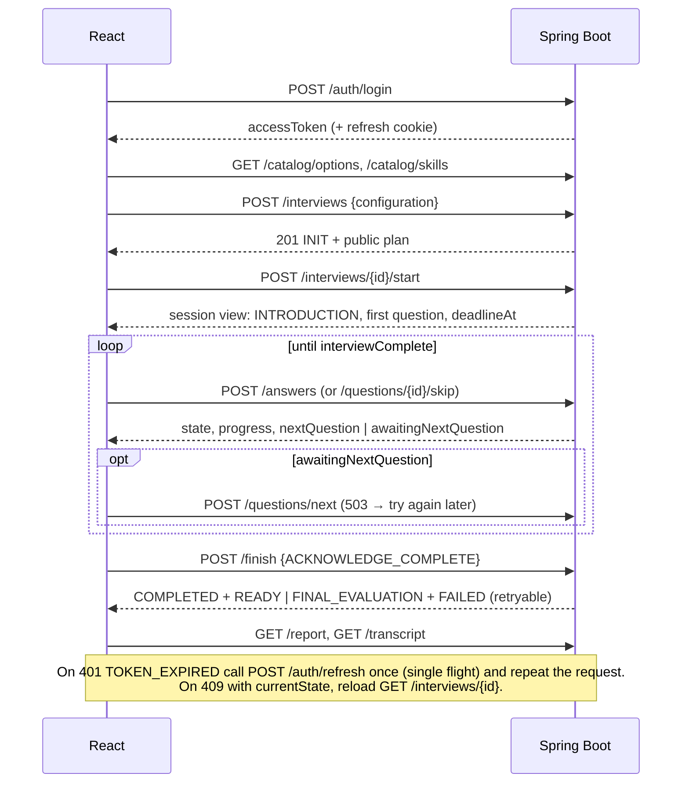

# API Design

> REST over HTTPS, JSON, versioned under `/api/v1`. This document describes the API as **implemented**. The authoritative machine-readable contract is the OpenAPI 3.1 document the backend serves at `/v3/api-docs` (Swagger UI at `/swagger-ui.html`, local profile only); the frontend generates its TypeScript types from it with `pnpm gen:api`.
> Design decisions behind it: [ARCHITECTURE.md](ARCHITECTURE.md) (sections 4 to 7 and the change log in section 10), [AI_ARCHITECTURE.md](AI_ARCHITECTURE.md).

---

## 1. Conventions

| Topic | Rule |
|---|---|
| Base path | `/api/v1` |
| Authentication | `Authorization: Bearer <access token>` on every endpoint except the public ones (section 2), `/api/v1/health`, the catalog, and the cookie-authenticated `/auth/refresh` and `/auth/logout`. Every other path, including unknown ones, answers `401`. |
| Content types | Requests with a body are `application/json` **only** (any other content type is `415`). Responses are `application/json`, errors `application/problem+json`. |
| Strict requests | Unknown properties, wrongly typed values (`"45"` for a number, `0` or `"hard"` for an enum, `5` for a text), fractions for integers, duplicate keys and trailing content are all `400 MALFORMED_JSON` or `VALIDATION_FAILED`. Nothing is coerced. |
| Request size | At most 256 KiB per body (16 KiB on the public `/auth/*` endpoints, 2,112 KiB on the résumé upload), checked before the body is read: `413 PAYLOAD_TOO_LARGE`. |
| IDs | UUIDs (version 7) for user data; the catalog uses slugs in URLs. |
| Time | ISO-8601 UTC instants. The server clock is authoritative: responses that depend on time carry `serverTime`; the client never computes deadlines. |
| Pagination | `?page=0&size=20` (`page` 0 to 10 000, `size` 1 to 100) answers `{ items, page, size, totalItems, totalPages }`. Out-of-range values are `400`. |
| Correlation | Every response carries `X-Request-Id` (a valid client value is echoed, otherwise generated). It is the `traceId` of problem documents and of the log lines of the request. |
| Ownership | A resource of another user is `404`, indistinguishable from a missing one. |
| Hidden data | Expected key points, rubrics, the adaptive difficulty level, scores and evaluation results are never returned while an interview runs. After `COMPLETED` the transcript and the report carry the feedback. |
| Server owns state | No endpoint accepts a state, sequence number, score, evaluation or deadline. The interview changes only through the commands below, and the backend decides the outcome. |
| Idempotency | Resubmitting an answer, `questions/next` and `finish` are safe to repeat; `report/retry` is safe to repeat while the interview is in `FINAL_EVALUATION` (a repeat after `COMPLETED` answers `409 ILLEGAL_STATE_TRANSITION` with `currentState: COMPLETED`: read the report instead). Details per endpoint. `start`, `abandon` and `delete` answer `409` the second time. |
| Rate limits | Per client address: `register`, `login`, `refresh` 10 per minute (shared). Per e-mail address: 10 failed logins per 15 minutes. Per user: answers 20 per minute; code runs (`POST .../runs`) 10 per minute; résumé uploads 10 per hour; every other `POST`/`PUT`/`DELETE` except `/auth/*` 60 per minute; 10 interviews per UTC day. Over the limit: `429` with `Retry-After` (seconds). |
| Response headers | Every `/api/**` response carries `Content-Security-Policy: default-src 'none'; frame-ancestors 'none'; base-uri 'none'; form-action 'none'`, `Referrer-Policy: no-referrer`, `Permissions-Policy`, `Cross-Origin-Resource-Policy: same-origin`, `X-Content-Type-Options: nosniff`, `X-Frame-Options: DENY` and `Cache-Control: no-store` (SECURITY.md WEB-1). |
| CORS | Allowed origins come from `app.cors.allowed-origins` (credentials allowed). Readable response headers: `X-Request-Id`, `Retry-After`, `Location`, `ETag`, `WWW-Authenticate`. |

---

## 2. Authentication

| Method | Path | Auth | Description |
|---|---|---|---|
| `POST` | `/auth/register` | public, rate-limited | Create a `CANDIDATE` account and sign in: `201` |
| `POST` | `/auth/login` | public, rate-limited | Sign in: `200` |
| `POST` | `/auth/refresh` | refresh cookie + `X-Requested-With: XMLHttpRequest` | Rotate the refresh token, issue a new access token: `200` |
| `POST` | `/auth/logout` | refresh cookie + `X-Requested-With` | Revoke the session: `204` (idempotent) |
| `GET` | `/users/me` | bearer | The signed-in account (re-checked against the database) |

```http
POST /api/v1/auth/register
Content-Type: application/json

{ "email": "ada@example.com", "password": "correct-horse-battery", "displayName": "Ada" }
```
```http
201 Created
Set-Cookie: refresh_token=…; Path=/api/v1/auth; Max-Age=1209600; HttpOnly; Secure; SameSite=Lax

{ "accessToken": "eyJ…", "tokenType": "Bearer", "expiresIn": 900,
  "user": { "id": "01a11b6f-e978-77d1-8b36-beb2d9b5b25e", "email": "ada@example.com", "displayName": "Ada", "role": "CANDIDATE" } }
```

- **Email**: ASCII address, at most 254 characters, trimmed and lower-cased; unique ignoring case (`409 EMAIL_TAKEN`). Registration reveals whether an address is registered, which is the usual trade-off of a clear sign-up form.
- **Password**: 10 to 72 bytes in UTF-8, after Unicode NFC normalisation (so a password typed decomposed or composed is the same password). Registration also refuses (`400 VALIDATION_FAILED`, field `password`, a message that quotes nothing) one of the most common passwords (compared ignoring case and punctuation), a password of one or two distinct characters, and one that contains the part of the e-mail address before `@` or the display name (SECURITY.md AUTH-3). **Display name**: 1 to 80 characters, no control, line-separator or bidirectional-override characters.
- **Login failures** (unknown address, wrong password, disabled account, malformed address) are the same `401 INVALID_CREDENTIALS` and cost the same hashing time. After **ten failed attempts for one address within 15 minutes** (whether or not the address has an account), login for that address answers `429 RATE_LIMITED` with `Retry-After`, even with the right password, until the window after the first failure ends; a success clears the count (SECURITY.md AUTH-2).
- **Access token**: JWT (HS256), 15 minutes, claims `sub` (user id), `role`, `iss`, `iat`, `exp`, `jti`. An expired token answers `401 TOKEN_EXPIRED` (call `/auth/refresh`); anything else wrong with it is `401 UNAUTHENTICATED`. Every `401` carries `WWW-Authenticate: Bearer`. Keep the access token in memory only.
- **Refresh token**: opaque, `HttpOnly` cookie scoped to `/api/v1/auth`, 14 days, **rotated on every use**. Presenting an already used (rotated or revoked) token revokes the whole session family and answers `401`; two tabs refreshing at the same instant therefore end the session, so a client must refresh through a single flight. The cookie is `Secure` except in the local profile.
- Disabling an account or changing its role takes effect at the latest when the access token expires; `/users/me`, login and refresh re-check it.

---

## 3. Catalog (public, cacheable)

`Cache-Control: public, max-age=3600` with an `ETag` (`304` on `If-None-Match`).

| Method | Path | Description |
|---|---|---|
| `GET` | `/catalog/options` | Everything the setup form offers: roles, experience levels, difficulties, durations, interview types with their sections, coding languages |
| `GET` | `/catalog/skills` | Active skills: `id`, `slug`, `name`, `category`, `description` (v1: Java, Spring Boot, PostgreSQL, System Design, React, TypeScript) |
| `GET` | `/catalog/skills/{slug}/topics` | Topics of a skill with their difficulty range (`404` for an unknown or inactive skill) |

```json
GET /api/v1/catalog/options → 200
{
  "roles": ["BACKEND", "FRONTEND", "FULL_STACK"],
  "experienceLevels": ["INTERN", "JUNIOR", "MID", "SENIOR", "STAFF"],
  "difficulties": ["EASY", "MEDIUM", "HARD"],
  "durationsMinutes": [15, 30, 45, 60, 90],
  "interviewTypes": [
    { "value": "TECHNICAL", "sections": ["INTRODUCTION", "QUESTIONING"] },
    { "value": "CODING", "sections": ["INTRODUCTION", "CODING"] },
    { "value": "SYSTEM_DESIGN", "sections": ["INTRODUCTION", "SYSTEM_DESIGN"] },
    { "value": "FULL_LOOP", "sections": ["INTRODUCTION", "QUESTIONING", "CODING", "SYSTEM_DESIGN"] }
  ],
  "codingLanguages": ["java", "javascript", "typescript", "python", "go"],
  "executableLanguages": ["java", "javascript", "typescript"],
  "strategies": [
    { "value": "FUNDAMENTALS_FIRST", "mix": { "fundamentals": 60, "practical": 25, "project": 15 }, "requiresResume": false },
    { "value": "BALANCED", "mix": { "fundamentals": 40, "practical": 30, "project": 30 }, "requiresResume": false },
    { "value": "RESUME_FOCUSED", "mix": { "fundamentals": 20, "practical": 20, "project": 60 }, "requiresResume": true },
    { "value": "CUSTOM", "mix": null, "requiresResume": false }
  ]
}
```
`executableLanguages` are the coding languages whose solutions this server runs against tests (empty when code execution is off); answers in the other languages are reviewed by the AI only and their correctness counts as unverified (AI_ARCHITECTURE.md §2.11). `strategies` are the ways the technical questions can be divided between fundamentals, practical scenarios and the candidate's own projects (AI_ARCHITECTURE.md §2.15), the default first, with each preset's shares in percent.

---

## 4. Candidate profile

| Method | Path | Description |
|---|---|---|
| `GET` | `/profile` | The caller's profile (created empty on first access) |
| `PUT` | `/profile` | **Replace** the profile: `headline` (≤ 120), `yearsExperience` (0 to 60), `jobTitle` (≤ 60), `skills: [{ skill: <slug>, selfRating: 1..5 }]` (≤ 20, no duplicates, active skills). An absent text or number field is cleared; blank text is stored as absent. |

There is no id in the URL: the profile is the caller's.

### 4.1 Résumé (AI_ARCHITECTURE.md §2.13)

| Method | Path | Description |
|---|---|---|
| `PUT` | `/profile/resume` | **Upload** the résumé (`multipart/form-data`, part `file`): PDF, Word `.docx` or plain text/Markdown, at most 2 MB, 10 pages and 30,000 characters of text. Replaces the previous résumé. Reads it with a model (seconds with Gemini, up to a few minutes with a small local model) and answers `200` with the verified profile. Rate limited: 10 uploads per user per hour. |
| `GET` | `/profile/resume` | The stored profile, or `404 NOT_FOUND` when none was uploaded |
| `DELETE` | `/profile/resume` | Deletes it (`204`, also when there was none). Interviews personalised from it continue without personalisation. |

No endpoint returns the file or its text: they are not stored. Response:

```json
{ "fileName": "ada-cv.pdf", "fileType": "PDF", "sizeBytes": 48211, "pageCount": 2, "uploadedAt": "2026-10-12T09:00:00Z",
  "injectionSuspected": false, "droppedItems": 1,
  "profile": {
    "yearsOfExperience": { "years": 8, "basis": "STATED", "evidence": "Backend engineer with 8 years of experience …" },
    "positions": [{ "title": "Senior Software Engineer", "organization": "Acme Payments", "start": "2021-03", "end": null,
                    "evidence": "Senior Software Engineer, Acme Payments - Mar 2021 to Present" }],
    "technologies": [{ "name": "Kafka", "evidence": "Java, Spring Boot, Kafka, PostgreSQL" }],
    "skills": [], "domains": [{ "name": "Payments", "evidence": "payment systems" }],
    "experiences": [{ "id": "x1", "kind": "PROJECT", "context": "Acme Payments", "technologies": ["Spring Boot", "Kafka"],
                      "text": "Built a Spring Boot microservice using Kafka to process card payment events." }] } }
```
`fileType` is decided from the content (never the name or declared type). `basis` is `STATED` (the résumé says so) or `POSITIONS` (computed from the roles). `injectionSuspected`: text addressed to the AI was removed before the model read the résumé. `droppedItems`: what the model proposed that the résumé does not say, left out. Upload errors: `413 PAYLOAD_TOO_LARGE`, `415 UNSUPPORTED_FILE_TYPE`, `422 DOCUMENT_UNREADABLE` (damaged, encrypted), `422 DOCUMENT_EMPTY` (no text, a scan), `422 DOCUMENT_TOO_LONG`, `422 NOT_A_RESUME` (no role, technology or experience could be verified), `503 AI_PROVIDER_UNAVAILABLE` (nothing stored; retry).

---

## 5. Interview configurations

A configuration is what the candidate chose: role, experience, skills, difficulty, duration, type and coding language. It is immutable once created and can be reused for several interviews.

| Method | Path | Description |
|---|---|---|
| `POST` | `/interview-configurations` | Save a configuration: `201` + `Location` |
| `GET` | `/interview-configurations` | The caller's configurations, newest first (paged) |
| `GET` | `/interview-configurations/{id}` | One configuration |
| `DELETE` | `/interview-configurations/{id}` | `204`, or `409 CONFIGURATION_IN_USE` when an interview uses it |

```json
POST /api/v1/interview-configurations
{ "role": "BACKEND", "experienceLevel": "MID", "skills": ["java", "spring-boot", "postgresql"],
  "difficulty": "MEDIUM", "durationMinutes": 45, "interviewType": "FULL_LOOP", "codingLanguage": "java" }
```
Optional fields: `useResume` (default `false`), `strategy` (default `FUNDAMENTALS_FIRST`) and `stageMix` (`{ "fundamentals": 50, "practical": 30, "project": 20 }`, whole percent). The response always carries `strategy` and the `stageMix` it uses (the preset's, or the candidate's for `CUSTOM`).

Rules: 1 to 6 distinct active skill slugs; `durationMinutes` one of 15, 30, 45, 60, 90; `strategy` `CUSTOM` needs a `stageMix` whose shares add up to 100, the other strategies refuse one (`stageMix`); `RESUME_FOCUSED` needs `useResume: true` (`strategy`); the strategy shapes only the technical questions, so `CODING` and `SYSTEM_DESIGN` interviews accept and ignore it; `codingLanguage` (one of the catalog's languages) is **required** for `CODING` and `FULL_LOOP` and refused otherwise; `useResume: true` personalises the interview from the candidate's résumé (AI_ARCHITECTURE.md §2.13); a configuration may be saved with it before a résumé exists, but **creating an interview** from it without an uploaded résumé is `400 VALIDATION_FAILED` on `configuration.useResume` (inline) or `configurationId`. Violations are `400 VALIDATION_FAILED` with field-level `errors`.

---

## 6. Interviews

### 6.1 Endpoints

| Method | Path | Description |
|---|---|---|
| `POST` | `/interviews` | Create from `{ configurationId }` **or** an inline `{ configuration }` (saved for the caller): `201` + `Location`, state `INIT`, plan built. `429 DAILY_INTERVIEW_LIMIT` after 10 per UTC day |
| `GET` | `/interviews` | The caller's interviews, newest first, paged, optional `?state=` |
| `GET` | `/interviews/{id}` | **Session view**: everything needed to show or resume the interview |
| `GET` | `/interviews/{id}/state` | The lightweight version: state, progress, deadline, version, flags |
| `POST` | `/interviews/{id}/start` | `INIT → INTRODUCTION`; starts the clock; the first question is the fixed introduction |
| `GET` | `/interviews/{id}/questions` | The questions asked so far (candidate view) |
| `GET` | `/interviews/{id}/questions/current` | The open question (`404` when none is open) |
| `GET` | `/interviews/{id}/questions/{questionId}` | One question |
| `POST` | `/interviews/{id}/answers` | Answer the current question; returns the next turn |
| `POST` | `/interviews/{id}/questions/{questionId}/skip` | Skip the current question |
| `POST` | `/interviews/{id}/questions/{questionId}/runs` | Run a draft solution of the open coding question against its visible examples (section 6.4.1) |
| `POST` | `/interviews/{id}/questions/next` | Recovery: produce the next question when it could not be generated after an answer |
| `POST` | `/interviews/{id}/finish` | End the interview if it is still running, evaluate what is pending and build the report |
| `POST` | `/interviews/{id}/abandon` | `INIT → ABANDONED` (only before the interview was started) |
| `GET` | `/interviews/{id}/transcript` | Questions and answers; feedback only once `COMPLETED` |
| `GET` | `/interviews/{id}/report` | The report (section 6.6) |
| `POST` | `/interviews/{id}/report/retry` | Repeat a failed report attempt |

### 6.2 State machine (what the client sees)

`INIT → INTRODUCTION → QUESTIONING ⇄ FOLLOW_UP → (CODING ⇄ FOLLOW_UP) → (SYSTEM_DESIGN ⇄ FOLLOW_UP) → FINAL_EVALUATION → COMPLETED`, with `ABANDONED` reachable from `INIT`. Which sections occur depends on the interview type; which transition happens after an answer is decided by the backend (follow-up, next topic, next section, or the end). The full diagram and guards are in [ARCHITECTURE.md §5](ARCHITECTURE.md). A command that is not legal in the current state answers `409 ILLEGAL_STATE_TRANSITION` with `currentState`.

### 6.3 Views

**Session view** (`GET /interviews/{id}`, and the result of `start` and `questions/next`):

```json
{
  "id": "01a11b6f-ea6e-77cd-a217-eac609713be5",
  "state": "QUESTIONING",
  "serverTime": "2026-10-08T12:14:41.989Z",
  "startedAt": "2026-10-08T12:14:41.825Z",
  "deadlineAt": "2026-10-08T12:44:41.825Z",
  "endReason": null,
  "progress": { "section": "QUESTIONING", "sectionIndex": 1, "sectionCount": 2,
                "questionsAnswered": 0, "plannedQuestionsInSection": 6, "remainingSeconds": 1799 },
  "currentQuestion": null,
  "awaitingNextQuestion": true,
  "interviewComplete": false,
  "version": 4,
  "configuration": { "id": "…", "role": "BACKEND", "difficulty": "MEDIUM", "durationMinutes": 30, "…": "…" }
}
```
`awaitingNextQuestion` means the interview accepts answers, no question is open and the next one is decided but not produced yet: call `POST /questions/next`. `interviewComplete` means the question phase is over (`FINAL_EVALUATION` or `COMPLETED`): call `POST /finish`. `progress.sectionIndex` is zero-based and counts the introduction.

**Question** (candidate view; never the key points, rubric, difficulty or origin):

```json
{ "id": "…", "sequenceNo": 1, "kind": "INTRO", "isFollowUp": false, "section": "INTRODUCTION",
  "topic": null, "prompt": "Welcome to your backend interview. To begin, please introduce yourself …",
  "answerFormat": "TEXT", "suggestedMinutes": 3, "details": null, "answered": false, "design": null, "resume": null }
```
`answerFormat` is `CODE` for coding questions and their follow-ups; coding questions carry `details` (`language`, `constraints`, `examples`, `starterCode`, `title`, `testable`). `title` names a problem from the curated bank; `testable` is true when the solution is run against tests (a bank problem, an executable language, execution on): its examples can then be run before submitting and hidden tests decide its correctness. `topic` is `{ skill, name }` when the question has one. Questions of the system design section carry `design` (AI_ARCHITECTURE.md §2.12): for the problem, `title` (a bank problem) and `facts` (what the interviewer states up front: scale, latency, constraints); for a follow-up, `probe`, the dimension the engine chose to ask about (for example `CACHING`), and empty `facts`. A question of a personalised interview that the engine anchored on the résumé carries `resume`: `{ kind, text, context }`, the résumé statement it is about (read from the stored résumé, so absent once it is deleted). A question of the technical section carries `questionType` (AI_ARCHITECTURE.md §2.15): `CONCEPT` or `INTERNALS` (fundamentals), `SCENARIO` or `DEBUGGING` (practical), `EXPERIENCE` (the candidate's own work); a follow-up has its question's type, a follow-up about a claimed experience `EXPERIENCE`; `null` elsewhere and for questions of interviews created before 2026-10-14.

### 6.4 Answering

```http
POST /api/v1/interviews/{id}/answers
{ "questionId": "…", "content": "Because Spring uses proxies, a self-invocation bypasses the proxy, so …",
  "codeLanguage": null, "timeTakenSeconds": 185 }
```
```json
200 OK
{ "accepted": true, "state": "FOLLOW_UP",
  "progress": { "…": "…" },
  "nextQuestion": { "id": "…", "kind": "FOLLOW_UP", "isFollowUp": true, "prompt": "…", "answerFormat": "TEXT", "…": "…" },
  "awaitingNextQuestion": false, "interviewComplete": false }
```
- `content` is required and non-blank, at most 8 000 characters for a `TEXT` question and 20 000 for a `CODE` question; tab and line breaks are allowed, other control characters are not. A `CODE` answer must name the interview's language in `codeLanguage`; a `TEXT` answer must not carry one.
- `questionId` must be the open question (`409 QUESTION_NOT_CURRENT` otherwise, with `currentState`). **Resubmitting an already answered question is an idempotent `200`** that returns the current state without evaluating again; a question that does not belong to the interview is `404`.
- **Time**: an answer up to 30 seconds after the deadline is accepted (the interview then ends); later it is `409 INTERVIEW_EXPIRED` and the interview is in `FINAL_EVALUATION`. The deadline is enforced lazily on every request, there is no background job.
- **The answer is accepted even when the AI layer is unavailable.** The evaluation attempt is then counted and retried (at most three attempts in all, the rest at `finish`; see 6.5), the next question is chosen deterministically at the same difficulty, and if the next question cannot be generated the response has `nextQuestion: null` and `awaitingNextQuestion: true`. Nothing about attempts is returned.
- **A generated question is only used when it is what the engine asked for**: its topic and difficulty equal the decided ones, it does not give away its own expected key points and does not repeat an earlier question. Otherwise it counts as "cannot be generated" (above), and `POST /questions/next` answers `503 AI_PROVIDER_UNAVAILABLE` until a usable one is produced.
- **Response time**: with the AI layer on, an answer request waits for the evaluation and for the next question. Each AI step is bounded by its configured budget (by default 75 s for an evaluation and 45 s for a question, retries included; typically a few seconds), and a coding answer first runs its tests (up to 45 s with the queue). A turn can therefore take about three minutes with the default budgets, and far longer with the raised budgets of the `local-ollama` profile (up to about eight minutes); `finish` may also retry pending evaluations before the report. Clients should allow ten minutes before they time out, and after a timeout or a lost connection re-read the session rather than assume the answer was lost: a stored answer is processed even when its reply never arrives, and re-posting it is safe (it returns the current state).
- **A coding solution is tested before it is evaluated.** When the question is a bank problem and its language is executable, the submitted code is run on every test (examples and hidden tests) once, in the sandbox, and the result is stored; the tests decide its correctness (AI_ARCHITECTURE.md §2.11). This adds a few seconds to the answer request. Nothing about the result is returned until the interview is completed.
- **A system design answer may carry its architecture diagram** in `architecture`: `{ "components": [ { "id": "orders-db", "kind": "DATABASE", "name": "Orders database", "notes": "primary + 2 replicas" } ], "connections": [ { "from": "api", "to": "orders-db", "label": "writes orders", "async": false } ] }`. `kind` is one of `CLIENT`, `CDN`, `LOAD_BALANCER`, `API_GATEWAY`, `SERVICE`, `WORKER`, `CACHE`, `QUEUE`, `DATABASE`, `OBJECT_STORAGE`, `SEARCH`, `EXTERNAL`. At most 24 components (ids `[a-z0-9-]{1,20}`, ids and names unique, names at most 40 characters, notes 160) and 48 connections (between two different existing components, one per ordered pair, labels at most 60). It is accepted only for a question of the design section; a violation is a `400` on the field `architecture`. The diagram is stored with the answer, given to the evaluator and the probe writer, and returned in the transcript; send it with every answer of the thread in which it is meant to count (the latest one sent is the current design).
- `skip` takes an optional `{ "timeTakenSeconds" }`, behaves like an answer, and counts as 0 for a skipped main question; a skipped follow-up adds nothing.
- Turn processing is three short transactions; no transaction is held while the AI layer is called. Two concurrent submissions of the same question resolve to one evaluation and one next question; a conflicting concurrent turn answers `409 CONCURRENT_MODIFICATION`.

### 6.4.1 Running examples

```http
POST /api/v1/interviews/{id}/questions/{questionId}/runs
{ "code": "class Solution { public int[] twoSum(int[] nums, int target) { ... } }", "language": "java" }
```
```json
200 OK
{ "status": "COMPLETED", "passed": 1, "total": 2, "durationMs": 1830, "compileOutput": null, "output": "debug line",
  "results": [ { "name": "Example 1", "category": "EXAMPLE", "status": "PASSED", "input": "nums = [2,7,11,15], target = 9",
                 "expected": "[0,1]", "actual": "[0,1]", "message": null, "timeMs": 3 },
               { "name": "Example 2", "category": "EXAMPLE", "status": "FAILED", "input": "nums = [3,2,4], target = 6",
                 "expected": "[1,2]", "actual": "[0,0]", "message": "Wrong answer.", "timeMs": 1 } ] }
```
Runs the draft in the sandbox against the problem's visible examples only. Nothing is stored or evaluated and the interview does not change. `status` is `COMPLETED`, `COMPILATION_ERROR` (`compileOutput` holds the compiler's message), `TIMED_OUT`, `CRASHED` or `OUTPUT_LIMIT`; a test is `PASSED`, `FAILED`, `ERROR` (an exception, in `message` with its line), `TIMEOUT` or `NOT_RUN`. `output` is what the code printed itself. The question must be the open one (`409 QUESTION_NOT_CURRENT`) and a bank problem (`409 CONFLICT` otherwise); `language` must be the interview's (`400`). `503 CODE_EXECUTION_UNAVAILABLE` when execution is off, the language is not executed here, or every sandbox is busy (with `Retry-After`). At most 10 runs per minute per user.

### 6.5 Finishing

```http
POST /api/v1/interviews/{id}/finish
{ "reason": "CANDIDATE_ENDED" }          // or "ACKNOWLEDGE_COMPLETE" once interviewComplete is true
→ 200 { "state": "COMPLETED", "reportStatus": "READY", "retryable": false, "reportUrl": "/api/v1/interviews/{id}/report" }
→ 200 { "state": "FINAL_EVALUATION", "reportStatus": "FAILED", "retryable": true }   // only while an evaluation of another request is still running
```
`CANDIDATE_ENDED` ends a running interview; `ACKNOWLEDGE_COMPLETE` is valid only once the question phase is over. `INIT` and `ABANDONED` answer `409`. The call evaluates pending answers, computes the report and completes the interview. **An answer that cannot be evaluated does not keep the interview open**: each answer is evaluated at most three times in all (waiting 2 s, then 4 s, shared by all answers; a safety refusal is final at once), after which it is *unassessable* and the report is made from the rest: `COMPLETE`, `PARTIAL` or `INCONCLUSIVE` (6.6). The call returns `FAILED` with `retryable: true` only while an attempt of another request is still running for one of the answers (repeat `finish` or `POST /report/retry` shortly, the claim ends within 90 seconds at most). Concurrent calls are serialised; a caller that arrives while another is generating waits (up to 90 seconds) and gets the same result. Finishing a completed interview is a no-op.

### 6.6 Report

`GET /interviews/{id}/report` → `200` for `READY` and `FAILED`, `202` for `PENDING` and `GENERATING`, `409 INTERVIEW_NOT_FINISHED` before the question phase is over.

```json
{ "interviewId": "…", "status": "READY", "outcome": "PARTIAL", "overallScore": 72.5, "recommendation": "PROFICIENT",
  "sections": [ { "section": "QUESTIONING", "score": 76.0 } ],
  "skills": [ { "skill": "Spring Boot", "slug": "spring-boot", "score": 81.0, "confidence": "HIGH", "evidenceCount": 4, "avgDifficulty": 3.25 } ],
  "summary": "…", "strengths": [ { "text": "…", "evidence": [ { "questionId": "…", "excerpt": "…" } ] } ],
  "improvementAreas": [], "studyPlan": [ "…" ],
  "furtherReading": [ { "title": "Java concurrency", "section": "Java concurrency › Race conditions and atomicity", "source": "java/concurrency.md" } ],
  "integrityNotes": [],
  "coverage": { "questionsAnswered": 9, "skipped": 1, "followUps": 3, "minutesUsed": 28 },
  "assessment": { "assessedShare": 0.85, "assessedWeight": 17, "intendedWeight": 20,
                  "unassessableAnswers": [ { "questionId": "…", "sequenceNo": 4, "section": "QUESTIONING", "reason": "SAFETY_BLOCK" } ] },
  "knowledgeGaps": {
    "missedConcepts": [ { "concept": "count++ is a read-modify-write …", "status": "MISSING",
                          "topic": { "key": "java/concurrency", "name": "Java / Concurrency" }, "questionId": "…" } ],
    "misconceptions": [ { "claim": "volatile makes count++ atomic", "correction": "…", "topic": { "key": "…", "name": "…" }, "questionId": "…" } ],
    "weakTopics": [ { "topic": { "key": "java/collections", "name": "Java / Collections" }, "score": 22.5, "evidenceCount": 1 } ],
    "repeatedMistakes": [ { "description": "…", "kind": "MISCONCEPTION", "basis": [ "EVALUATOR_LINK" ], "questionIds": [ "…", "…" ],
                            "topics": [ { "key": "…", "name": "…" } ] } ] },
  "generatedAt": "…", "attempts": 1, "retryable": false, "errorMessage": null }
```
Scores are computed deterministically from validated rubric ratings, weighted by question difficulty. `overallScore` and `recommendation` are `null` when there is not enough evidence (nothing answered, or only the introduction); a single scored turn gives a score without a recommendation. `summary` and the narrative lists come from the AI layer and are empty when it was unavailable; they never contain references to evaluations of another interview. A `FAILED` report has `retryable: true` and an `errorMessage`. `furtherReading` lists the knowledge-base sections the study plan cites (the narrator may cite only material retrieved for the interview's knowledge gaps, RAG_ARCHITECTURE.md); it is empty when the narrative was written without reference material, and it never exposes internal ids.

**Knowledge gaps** (READY reports; `null` otherwise and for reports made before 2026-10-10) are computed without a model from the evaluations (AI_ARCHITECTURE.md §2.10): `missedConcepts` are the expected key points an answer missed (`MISSING`) or covered only partly (`PARTIAL`), after the server checked the evaluator's quotes; `misconceptions` are the wrong statements with their corrections; `weakTopics` are the topics whose score is below 45, weakest first; `repeatedMistakes` are gaps that showed up in more than one question, with how they were linked (`EVALUATOR_LINK`: the evaluator said a mistake repeats an earlier one; `SHARED_SOURCE`: the gaps rest on the same knowledge-base section; `SAME_WORDING`). A READY report belongs to a `COMPLETED` interview, whose transcript shows the same key points with their status (6.7), so the report reveals nothing the candidate cannot already see; a pending or failed report has `knowledgeGaps: null`. `integrityNotes` may carry `LOW_EVALUATOR_CONFIDENCE`: the evaluator was not confident in its judgement of that answer (its own, uncalibrated estimate) and a human review is recommended; the score is unchanged.

**Assessment areas** (READY reports; `null` otherwise and for reports made before 2026-10-14; AI_ARCHITECTURE.md §2.15): `assessmentAreas.areas` lists `FUNDAMENTALS`, `PRACTICAL`, `PROBLEM_SOLVING`, `PROJECT` and `COMMUNICATION` in that order, each with `planned` (the plan meant to assess it), `score` (`null` without evidence), `evidenceCount`, `confidence`, `shareOfOverall` (the part of the overall score's weight it carries, 0 to 1; `null` for `COMMUNICATION`, a rating of every answer rather than a part of the score) and `lowConfidenceAnswers`. `skillsNotAssessed` and `topicsNotAssessed` (`{ key, name }`) are what the interview meant to ask and could not assess (not reached, skipped or unassessable). `recommendationCap` explains a band capped at `DEVELOPING` because the fundamentals scored below 45 over at least two answers; `null` otherwise.

**Outcome and assessment.** `outcome` (READY reports; `null` otherwise) says how much of the interview the scores stand on. `COMPLETE`: every answer was assessed. `PARTIAL`: some answers could not be assessed (`reason` `PROVIDER_FAILURE`, `INVALID_OUTPUT` or `SAFETY_BLOCK`), but at least 70 % of the intended assessment weight was (the threshold `app.evaluation.min-coverage` is configurable; exactly 70 % is enough): the scores, recommendation and narrative are computed from the assessed answers only and `assessment` lists the others. `INCONCLUSIVE`: less than that could be assessed, or nothing: `overallScore` and `recommendation` are `null` and there is no narrative; sections and skills with evidence are still returned, each with its `evidenceCount`. An unassessable answer is never scored zero and never counted as a skip; it says nothing about its quality. `assessment.assessedShare` is the assessed share of the intended weight (0 to 1, two decimals, rounded down), the weight of a question being its difficulty level; `assessment` is always present on a READY report (`assessedShare: 1.0` and an empty list for `COMPLETE`). A client must treat `overallScore: null` as "no verdict", not as a score of zero.

### 6.7 Transcript

`GET /interviews/{id}/transcript` returns `[ { question, answer | null, feedback | null } ]` in question order. `feedback` (overall score, criteria ratings with rationale, key point statuses, summary) appears **only** when the interview is `COMPLETED` and the answer was evaluated. A technical answer is rated on six criteria (`CORRECTNESS`, `COMPLETENESS`, `DEPTH`, `PRACTICAL_UNDERSTANDING`, `REASONING`, `COMMUNICATION`); answers evaluated before 2026-10-10 have the four of the first rubric. A system design answer (rubric `system-design.v2`, from 2026-10-11) is rated on thirteen dimensions of the design as it stands after that answer (`REQUIREMENTS`, `HIGH_LEVEL_DESIGN`, `API_DESIGN`, `DATA_MODEL`, `CACHING`, `MESSAGING`, `SCALABILITY`, `AVAILABILITY`, `RELIABILITY`, `FAILURE_HANDLING`, `SECURITY`, `OBSERVABILITY`, `TRADE_OFFS`); each criterion carries `evidence`, the candidate's own words (answers or diagram) it rests on, as quoted by the evaluator and found by the server; earlier design answers have the six criteria of `system-design.v1`. Answers carry `architecture` when one was sent. A coding answer (rubric `coding.v2`, from 2026-10-11) is rated on `CORRECTNESS`, `ALGORITHM`, `TIME_COMPLEXITY`, `SPACE_COMPLEXITY`, `EDGE_CASES`, `READABILITY` and `MAINTAINABILITY`. Every criterion carries its `basis`: `MODEL` (the evaluator's rating), `TESTS` (decided by the test results: the correctness of a tested solution) or `CAPPED` (lowered by a rule), the evaluator's own `modelRating` when it differs, and a `note` written by the server that says why. A tested solution's feedback has `codeTests` (`status`, `language`, `passed`, `total`, `results`, `compileOutput`, `durationMs`; hidden tests show their name, category, status and message but never their input, expected value or output) and every coding answer has `codeAnalysis` (`approach`, `timeComplexity`, `spaceComplexity`, and the reference solution's `referenceTimeComplexity` and `referenceSpaceComplexity` for a bank problem). The score is weighted with the question's skill profile, so the same ratings can count differently in a Java and a React question; the weights themselves are not returned.

---

## 7. Operational

| Method | Path | Access |
|---|---|---|
| `GET` | `/api/v1/health` | public: `{ status, service, version, serverTime, database }`; `200`, or `503` with the same body when the database does not answer within 2 seconds |
| `GET` | `/actuator/health`, `/actuator/health/liveness`, `/actuator/health/readiness` | public probes, no details |
| `GET` | `/actuator/info` | public: build name and version |
| `GET` | `/v3/api-docs`, `/swagger-ui.html` | local profile only (404 elsewhere) |

`HEAD` is allowed wherever `GET` is public.

---

## 8. Error model

Every error the application sees is `application/problem+json`, whatever the `Accept` header says (even an unparseable one yields a `406` problem document):

```json
HTTP/1.1 409 Conflict
Content-Type: application/problem+json

{ "type": "https://techinterviewer.dev/problems/question-not-current",
  "title": "Question is not the current question", "status": 409,
  "detail": "The interview has moved on; reload the session.",
  "instance": "/api/v1/interviews/01a1…/answers",
  "code": "QUESTION_NOT_CURRENT", "traceId": "4bf92f3577b34da6", "currentState": "QUESTIONING" }
```
`errors: [{ "field": "skills", "message": "…" }]` accompanies a `400` about fields; `currentState` accompanies a `409` about an interview, so the client can resynchronise.

| Status | `code` |
|---|---|
| 400 | `VALIDATION_FAILED`, `MALFORMED_JSON` (also unknown properties and wrong types), `BAD_REQUEST` (a path or query parameter) |
| 401 | `UNAUTHENTICATED`, `TOKEN_EXPIRED`, `INVALID_CREDENTIALS` |
| 403 | `FORBIDDEN` (a role that is not allowed, or a missing `X-Requested-With` on the cookie endpoints) |
| 404 | `NOT_FOUND` (also another user's resource) |
| 405 / 406 / 415 | `METHOD_NOT_ALLOWED`, `NOT_ACCEPTABLE`, `UNSUPPORTED_MEDIA_TYPE`, `UNSUPPORTED_FILE_TYPE` (a résumé that is not a PDF, Word or text document) |
| 409 | `EMAIL_TAKEN`, `ILLEGAL_STATE_TRANSITION`, `QUESTION_NOT_CURRENT`, `CONCURRENT_MODIFICATION`, `INTERVIEW_EXPIRED`, `INTERVIEW_NOT_FINISHED`, `CONFIGURATION_IN_USE`, `CONFLICT` |
| 413 | `PAYLOAD_TOO_LARGE` |
| 422 | `DOCUMENT_UNREADABLE`, `DOCUMENT_EMPTY`, `DOCUMENT_TOO_LONG`, `NOT_A_RESUME` (résumé upload) |
| 429 | `RATE_LIMITED`, `DAILY_INTERVIEW_LIMIT` (both with `Retry-After`) |
| 500 / 503 | `INTERNAL_ERROR` (generic, never a message or stack trace), `AI_PROVIDER_UNAVAILABLE`, `CODE_EXECUTION_UNAVAILABLE` (code execution off, not offered for the language, or busy), `DATABASE_UNAVAILABLE` (the database cannot be reached; `Retry-After: 5`, retry the same request) |

Accepted exceptions that are not problem documents because they happen outside the application:
- Requests Tomcat rejects before any application code runs (a malformed request line or header) get Tomcat's own HTML `400`.
- Any request that carries an `Origin` header outside `app.cors.allowed-origins` (a preflight or an actual request, including public `GET`s) is refused by Spring's CORS filter with `403` and the plain body `Invalid CORS request`. Same-origin requests, which is what the Vite proxy produces, carry no such problem.

---

## 9. Client flow



Resuming after a page reload needs only `GET /interviews/{id}`: it carries the state, the open question, the remaining time and whether the next question is awaited. The client renders what the server says and keeps nothing about the interview except answer drafts.
