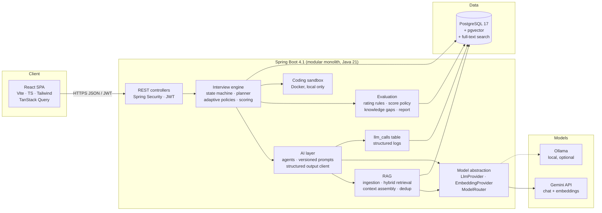
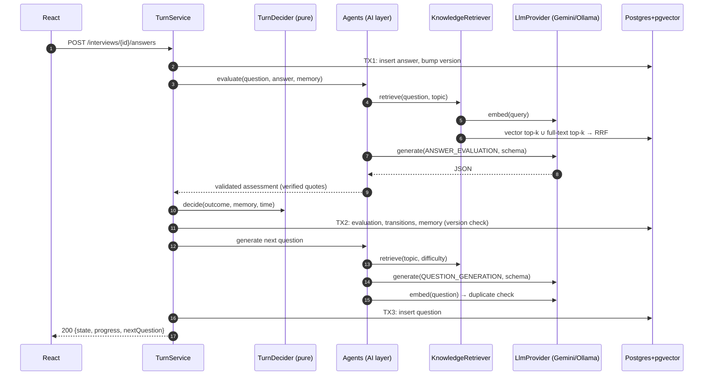
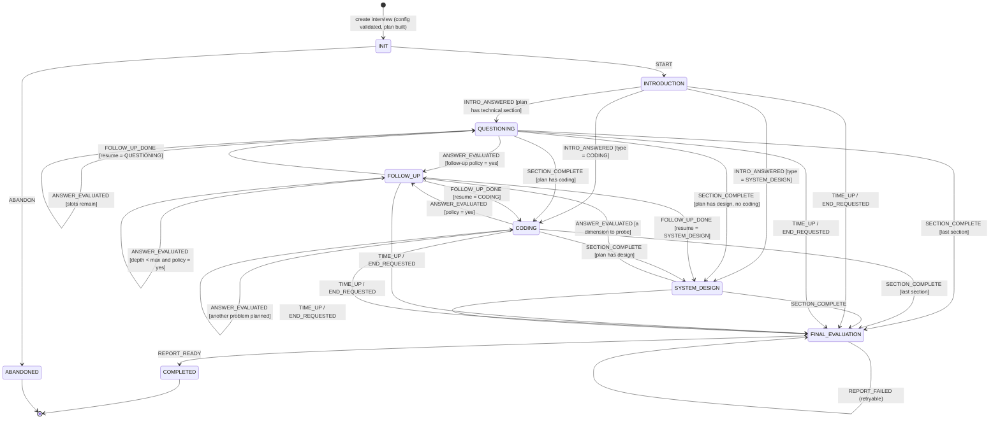
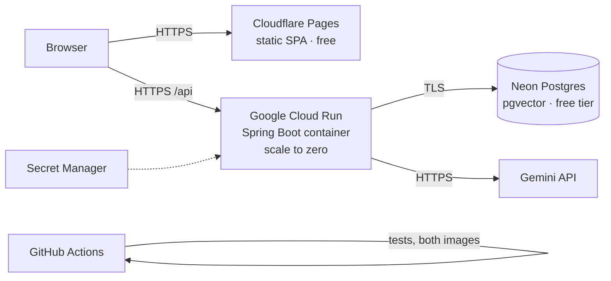

# AI Technical Interviewer — System Architecture

> **Status (2026-10-13): describes the system as built.** Everything below exists in the repository and is covered by tests unless
> it is marked *not built*. How the design got here, decision by decision, is the change log in section 10.
> Companion documents: [AI_ARCHITECTURE.md](AI_ARCHITECTURE.md) (the GenAI parts) · [RAG_ARCHITECTURE.md](RAG_ARCHITECTURE.md) ·
> [DATABASE_SCHEMA.md](DATABASE_SCHEMA.md) · [API_DESIGN.md](API_DESIGN.md) · [SECURITY.md](SECURITY.md) ·
> [EVALUATION.md](EVALUATION.md) · [IMPLEMENTATION_PLAN.md](IMPLEMENTATION_PLAN.md)

---

## 1. Goals, non-goals, principles

### Goals
- Run **structured, adaptive technical interviews** (questions, coding, system design) that feel like a real interviewer, not a chat window.
- Produce **evidence-backed, reproducible evaluations** and a final report.
- Demonstrate production-grade GenAI engineering: orchestration, RAG, structured outputs, evaluation, observability, provider abstraction.

### Non-goals
- Voice/video interviews, proctoring, recruiter workflows, multi-tenant organisations, an administration UI.
- Running candidate code **in production**. Locally, Java, JavaScript and TypeScript solutions run in a locked-down Docker sandbox
  (AI_ARCHITECTURE.md §2.11); the production image turns execution off, because a container that shares the host kernel is not a
  safe boundary for untrusted code on a shared host. There, coding answers are reviewed by the model only.
- Microservices, message brokers, Kubernetes.

### Architectural principles
1. **Deterministic core, LLM at the edges.** The backend owns state, flow, scoring arithmetic, time and policy. LLMs do *language
   tasks* only: write a question, judge an answer against a rubric, write a narrative, read a résumé. An LLM never decides a state
   transition.
2. **Every LLM output is structured and validated.** JSON Schema → strict parse → Bean Validation → the agent's semantic checks →
   one repair attempt → a typed failure. No free-text parsing.
3. **Grounding over memory.** Questions, follow-ups, evaluations and the report are grounded in a curated knowledge base (RAG), and
   citations and quotes are verified in Java.
4. **Provider-agnostic.** Business code depends on the ports `QuestionGenerator`, `AnswerEvaluator`, `ReportNarrator`; the AI layer
   depends on `LlmProvider`/`EmbeddingProvider` and an `AiTask` → model routing table, never on Gemini directly.
5. **Modular monolith.** One Spring Boot deployable, organised by feature, with dependency rules enforced by ArchUnit.
6. **Everything observable.** Every model call is a row in `llm_calls` (task, provider, model, prompt version, tokens, latency,
   outcome, retrieved chunks).

---

## 2. System overview



### Request path of one answer

1. **React** sends `POST /api/v1/interviews/{id}/answers` with the answer and the `questionId` it answers.
2. **Spring Boot** authenticates the JWT, scopes the interview to the caller (another user's interview is a 404), validates the
   payload and applies the deadline lazily.
3. **TX1** stores the answer and takes the interview's version (optimistic lock). The transaction commits before any model is called.
4. The **answer evaluator** (outside any transaction) retrieves reference material for the question, renders the versioned prompt
   with the answer fenced as untrusted data, and asks the routed model for a JSON object that follows a per-request narrowed schema.
   Quotes and citations are verified, rating rules cap contradictions, and the **overall score is computed in Java** from the ratings
   and configurable weights. For a coding answer, the hidden tests run first and decide correctness.
5. **TX2** records the evaluation, lets the pure `TurnDecider` choose what follows (follow-up, next topic, next section, end) and the
   next difficulty, writes the state transition with its rationale, and replaces the interview memory.
6. The **question generator** (outside any transaction) writes the next question grounded in retrieved material; it is validated
   and checked against earlier questions with embeddings. **TX3** stores it. If generation fails, the answer is still safe and the
   client asks again with `POST /questions/next`.
7. The response returns the new state, progress and next question, **never** the rubric, key points or scores.



**Transaction rule:** no database transaction or connection is held across a model call. A turn is three short transactions; the
`NoTransaction` guard enforces the rule at every AI call site. This keeps the connection pool small (free-tier Postgres) and avoids
lock contention.

**Cost of a turn, measured:** one evaluation and one generation (two model calls) plus three small embeddings (grounding for each,
and the duplicate check). On the local 4B model a technical turn takes 25 to 80 seconds and a long system design evaluation several minutes (the client waits up to ten); Gemini latency has not been measured. The UI shows an
explicit "the interviewer is thinking" state. Java 21 virtual threads (`spring.threads.virtual.enabled`) keep the blocking HTTP
calls to the model cheap.

**Database cost, measured (2026-10-13, Hibernate session statistics per request):** reading a session takes 5 statements, a
transcript of an 11-answer interview 10, a report 6, the interview list 4 (no query grows with the number of answers or interviews);
an AI turn issues 57 statements in 14 short sessions taking 81 ms in all, against 20 seconds or more of model time. Retrieval runs
two SQL queries per search through `JdbcClient` (HNSW vector index and a GIN full-text index). The database is not where a turn's
time goes; the model is.

---

## 3. Repository layout

```
/
├── README.md, PROJECT_SUMMARY.md, EVALUATION.md, ARCHITECTURE.md, AI_ARCHITECTURE.md, RAG_ARCHITECTURE.md,
│   SECURITY.md, DATABASE_SCHEMA.md, API_DESIGN.md, IMPLEMENTATION_PLAN.md
├── docker-compose.yml            # PostgreSQL + pgvector for local development
├── docker-compose.prod.yml       # self-hosted production stack (Caddy + backend + database)
├── .env.example, .env.production.example, .editorconfig, .gitignore
├── .github/                      # CI (backend verify, frontend checks, images), Dependabot
├── docker/postgres/init/         # creates the restricted runtime database role on first start
├── backend/                      # Spring Boot 4.1, Java 21, Maven wrapper, Dockerfile
│   └── src/main/resources/
│       ├── db/migration/         # Flyway V1–V13 + repeatable catalog seed
│       ├── prompts/{id}/v{n}.md  # versioned prompt templates (12 families)
│       ├── schemas/              # JSON Schemas of the structured outputs
│       ├── knowledge-base/       # curated RAG corpus: 48 documents, 16 technologies
│       ├── coding-problems/      # 13 problems with hidden tests; coding-harness/ runs them
│       ├── design-problems/      # 9 system design problems with facts and probe scenarios
│       └── resume/               # technology vocabulary for résumé extraction
├── frontend/                     # React 19 + Vite + TypeScript (pnpm), Dockerfile, deploy/Caddyfile
└── ai-evals/                     # labelled datasets, recorded baselines, evaluation methodology and report
```

---

## 4. Backend architecture

### 4.1 Stack
| Concern | Choice | Why |
|---|---|---|
| Framework | Spring Boot 4.1, Java 21 | Current stable line; virtual threads; records |
| Build | Maven via `./mvnw` | No global install |
| Web | Spring MVC (blocking) + virtual threads | Simpler than WebFlux; model calls are I/O-bound |
| Persistence | Spring Data JPA (aggregates) + `JdbcClient` (pgvector and full-text SQL) | JPA where it fits, plain SQL where pgvector/FTS matter |
| Migrations | Flyway | Versioned, reviewable DDL |
| Security | Spring Security + OAuth2 Resource Server (JWT decode) + Nimbus (JWT encode) | Standard, no custom crypto |
| HTTP to models | Spring `RestClient`, no AI SDK | Two small REST APIs; full control of payloads, usage metadata, timeouts and retries |
| Rate limiting | Bucket4j buckets in a Caffeine map (in memory) | One instance; Redis only when there are several |
| Documents | Apache PDFBox (PDF), the JDK (`.docx` as zip + StAX) | Résumé text extraction with hard limits |
| API docs | springdoc-openapi | Also generates the frontend's TypeScript types |
| Observability | Actuator (health probes), structured JSON logs (prod), `llm_calls` | Every model call is queryable |
| Tests | JUnit 5, AssertJ, Testcontainers (pgvector image), Spring Security Test, ArchUnit; `FakeModelServer` (an in-test HTTP server that speaks the Gemini and Ollama protocols, with injectable faults) | Real Postgres and real HTTP in tests; no mocks of our own code at the boundaries |

**Why not Spring AI or LangChain4j?** Both are reasonable. A thin `LlmProvider` interface was chosen because the abstraction is small
and is itself a talking point; because structured-output payloads, token usage, finish reasons and retries need precise control for
evaluation and observability; and because it keeps domain code independent of a fast-moving framework. A Spring AI–backed provider
could be added behind the same interface.

### 4.2 Package structure (package by feature)

```
com.techinterviewer
├── common/       errors (RFC 9457 problem details), correlation ids, UUIDv7, persistence base classes, text validation
├── config/       typed settings (AppProperties), clock, OpenAPI, strict JSON, database role check
├── security/     JWT, auth controller/service, refresh-token rotation, rate limits, login throttle, password policy, headers
├── user/ profile/ catalog/      accounts, candidate profiles, skills and topics
├── interview/
│   ├── domain/   Interview aggregate, questions, answers, plan, memory, state transitions
│   ├── engine/   PURE JAVA: state machine, planner, topic selector, follow-up policy, difficulty adapter,
│   │             deadline policy, design probe policy, résumé anchoring, TurnDecider
│   ├── port/     QuestionGenerator, AnswerEvaluator, ReportNarrator (the seams the AI layer implements)
│   ├── service/  TurnService (the three transactions), creation, lifecycle, finish, question provisioning
│   └── api/      controllers and DTOs
├── evaluation/   rubrics, rating rules, scoring policy, confidence, knowledge gaps, report composition
├── ai/           providers (Gemini, Ollama), routing, prompt registry and renderer, structured output client,
│                 injection heuristics, agents, llm_calls recording
├── rag/          ingestion (chunking, embedding), hybrid retrieval, context assembly, question de-duplication
├── coding/       problem bank, harnesses, Docker sandbox, test runs
├── design/       system design problem bank and probe scenarios
├── resume/       parser, extractor agent port, verifier, résumé profile
└── system/       health endpoint
```

Dependency rules, enforced with ArchUnit: controllers → services → {engine, evaluation, ports} → repositories → entities. The engine
and the pure evaluation classes import neither Spring nor persistence; ports import no entities; controllers import no entities;
the interview engine and services reach the AI layer only through the ports (the AI layer implements them).

### 4.3 Layer responsibilities

| Layer | Responsibility | Must not |
|---|---|---|
| **Controllers** | HTTP mapping, `@Valid` DTOs, principal extraction, status codes | Contain business logic, return entities |
| **DTOs** | Java records per request/response | Leak rubric, expected key points or scores during an interview |
| **Application services** | Transaction boundaries, ownership checks, mapping | Call a model inside a transaction |
| **Interview engine** | State machine, planning, policies, turn decisions | Depend on Spring, persistence or a provider |
| **Domain models** | JPA entities and value objects; invariants (one answer per question) | Know about HTTP or models |
| **Repositories** | Spring Data JPA; `JdbcClient` for pgvector/FTS | Contain policy |
| **AI layer** | Prompting, structured output, routing, injection defence, call recording | Make flow decisions |
| **RAG layer** | Ingest, chunk, embed, retrieve with visibility filters, assemble context | Return chunks the caller may not see |
| **Evaluation layer** | Deterministic scoring, evidence verification, report aggregation | Trust model arithmetic |

### 4.4 Concurrency and consistency
- `interviews.version` (`@Version`) gives optimistic locking. Two tabs submitting at once: one gets `409 CONCURRENT_MODIFICATION`.
- **Natural idempotency:** an answer's question is unique. Re-posting an answer for an answered question returns the current state
  without evaluating again, so a retry after a lost response is safe; a turn that stalled for more than two minutes is completed by
  such a retry.
- **Lazy deadline enforcement:** every read and write checks the deadline and ends the interview at the deadline if it passed. No
  background job is needed for correctness (Cloud Run throttles CPU between requests).
- **An evaluation failure does not block the interview.** The answer stays `PENDING`, the engine moves on at the same difficulty, and
  finishing the interview retries pending evaluations (with a bounded give-up policy, AI_ARCHITECTURE.md §10.6) before the report.

---

## 5. Interview state machine

A plain Java `enum InterviewState` and an explicit transition table in `InterviewStateMachine` (no Spring Statemachine: the machine is
small and must be readable). Every transition is persisted to `interview_state_transitions`, including the creation edge, and the
last transition of each turn carries the engine's rationale (why this follow-up, this topic, this difficulty).



| State | Candidate sees | Backend does |
|---|---|---|
| `INIT` | Briefing and "Begin" | Validated configuration, deterministic plan (sections, minutes, question slots, starting difficulty) |
| `INTRODUCTION` | An introduction prompt | Extracts the candidate's claims into memory; scored on communication only |
| `QUESTIONING` | Conceptual and practical questions | Evaluate → policies → next question (adaptive topic and difficulty) |
| `FOLLOW_UP` | A probe of a gap, a claim, or a harder step (depth ≤ 2; up to 6 probes of a design) | Keeps the root question and the state to resume |
| `CODING` | A problem, an editor, "Run examples" | Hidden tests in the sandbox (when execution is on) decide correctness; the model reviews the code |
| `SYSTEM_DESIGN` | A product problem, a write-up and an architecture diagram | Rates the whole design on 13 dimensions with quoted evidence, then probes the weakest dimensions |
| `FINAL_EVALUATION` | "Writing your report" | Retries pending evaluations, aggregates scores deterministically, the narrator writes text (never numbers) |
| `COMPLETED` | The report | Read-only |
| `ABANDONED` | — | Closed before it started; no report |

### Turn processing as built
- **The engine decides everything that follows an answer.** `TurnDecider` returns the transitions to apply, the new memory and
  the next step to generate (a topic at a difficulty, or a follow-up aimed at a key point, a claim or a design dimension).
- **One answer can cause two transitions:** the last follow-up of a section yields `FOLLOW_UP_DONE` and then `SECTION_COMPLETE`.
- **Time:** the deadline is checked on every request; an interview read after its deadline ends **at the deadline**. An answer within
  a 30-second grace window is accepted and then ends the interview. Later sections keep their planned minutes.
- **Degraded outcomes are first-class:** an unavailable or rejected evaluation leaves the answer `PENDING` and the decision moves on at
  the same difficulty; a question that cannot be generated leaves the interview waiting (`awaitingNextQuestion`), recoverable with
  `POST /questions/next`.
- **The report is computed deterministically:** difficulty-weighted skill scores, confidence from evidence count and spread,
  recommendation bands, coverage. The narrator may add text but never numbers, and every evaluation it cites is verified.

---

## 6. Frontend architecture

| Concern | Choice |
|---|---|
| Build | Vite + React 19 + TypeScript (strict) |
| Styling | Tailwind CSS 4 with semantic colour tokens (light and dark, WCAG AA pairs) |
| Routing | React Router; pages are lazy-loaded |
| Server state | **TanStack Query**: catalog, session, transcript, history, report (polled while it is written) |
| Client state | React state and context only. The access token lives in memory (never `localStorage`); answer and diagram drafts are saved to `sessionStorage` and cleared at sign-out |
| Forms | Controlled components; server field errors (`configuration.skills[0]`) are mapped back to their inputs |
| API types | Generated from the backend's OpenAPI document (`pnpm gen:api`) |
| Code editor | CodeMirror 6, loaded only on the coding page |
| Charts | Hand-written SVG (no chart library) |
| Markdown | `react-markdown` **without** raw HTML: model output is never rendered as HTML |
| Tests | Vitest + React Testing Library + MSW |

```
frontend/src/
├── api/            fetch wrapper with single-flight token refresh (Web Locks across tabs), generated schema, queries
├── app/            router, providers, query client, layout
├── components/ui/  Button, Dialog, Tabs, Alert, ErrorState, Skeleton, ...
├── features/
│   ├── landing/ auth/ dashboard/ history/ profile/ status/
│   ├── setup/      interview configuration
│   ├── interview/  room, text/coding/design workspaces, timer, drafts, commands
│   ├── design/     architecture diagram editor and view
│   └── results/    report: scores, skills, timeline, knowledge gaps, study plan, design scorecard
└── lib/            labels, formatting, error mapping, draft storage
```

**Split of responsibilities:** the server is the single source of truth for state, question and deadline. The client never computes
what comes next; it renders the session and submits answers. The countdown is shown from the server's clock (offset measured when the
session arrives), and only the timer re-renders every second. The backend has no streaming endpoint, so a new question is revealed
progressively on the client.

---

## 7. Security architecture

The full review, threat model, findings, fixes and accepted risks are in [SECURITY.md](SECURITY.md); this section is the summary.

### 7.1 Authentication
- **E-mail and password.** BCrypt (cost 12) via `DelegatingPasswordEncoder`; passwords of 10 to 72 bytes (BCrypt ignores the rest),
  Unicode-normalised; common, trivial and name-based passwords refused.
- **Access token:** JWT, HS256, 15 minutes, signed with `JWT_SECRET` (≥ 256 bits), validated by Spring's resource server, sent as
  `Authorization: Bearer`, kept **in memory** on the client.
- **Refresh token:** opaque 256-bit value in an `HttpOnly; Secure; Path=/api/v1/auth` cookie (`SameSite=Lax` by default, `None` for a
  cross-site deployment), 14 days, only its SHA-256 stored, **rotated on every use**; presenting a rotated token revokes the family.
- Login failures are generic; unknown e-mails still run a dummy hash comparison; ten failures for one address in 15 minutes answer 429.

### 7.2 Authorization
- Roles `CANDIDATE` and `ADMIN` exist; **no administrator endpoint is built**. `AuthorizationMatrixIT` calls every route without a
  token, with a garbage token, a forged `alg: none` token and Basic credentials, and pins the list of public routes.
- **Ownership:** every interview, report and profile query is scoped to the caller; another user's resource is a **404** (not 403).
- **RAG:** retrieval filters by visibility; only the curated public knowledge base is indexed (the résumé is never chunked).

### 7.3 CORS, CSRF, headers
- CORS allowlist from `APP_CORS_ALLOWED_ORIGINS`, credentials allowed for the refresh cookie.
- The API uses bearer tokens, so it is not CSRF-exposed; the cookie endpoints (`/auth/refresh`, `/auth/logout`) also require
  `X-Requested-With` (forces a preflight).
- API responses carry a `default-src 'none'` CSP, `no-referrer`, a restrictive `Permissions-Policy`, CORP/COOP and HSTS; the SPA's
  headers (CSP with `connect-src` limited to the API) are generated at build time for Cloudflare Pages (`_headers`) and Caddy.

### 7.4 Input validation
- Bean Validation on every DTO, enums for every choice, size limits (text answers 8,000 characters, code 20,000, six skills).
- Strict JSON: unknown properties, wrong scalar types, enum ordinals, duplicate keys and trailing content are rejected.
- Control characters, bidirectional overrides and line separators are refused in free text.
- Bodies are limited before they are read (256 KiB, 16 KiB on `/auth/*`); errors are RFC 9457 problem details without stack traces.

### 7.5 Rate limiting and cost protection
| Scope | Limit | Mechanism |
|---|---|---|
| `POST /auth/login`, `/auth/register` per IP | 10 / min | Bucket4j filter |
| Answer submissions per user | 20 / min | Bucket4j |
| "Run examples" per user | 10 / min | Bucket4j (each run starts a sandbox) |
| Other writes per user | 60 / min | Bucket4j |
| Résumé uploads per user | 10 / hour | Bucket4j |
| Interview creation per user | 10 / day | Database count (survives restarts) |
| Failed sign-ins per e-mail | 10 / 15 min | `LoginThrottle` |
| Model calls | bounded per call (time budget, one repair, provider retries within the budget) | `StructuredOutputClient` |

**Not built:** a per-user daily token budget (SECURITY.md R-7). The interview cap and the per-turn call budget bound the cost of one
account, but not of many accounts. Behind a proxy, the client IP comes from `X-Forwarded-For` only when the request came through a
trusted proxy (Tomcat's remote-IP valve; `SERVER_TOMCAT_REMOTEIP_INTERNAL_PROXIES`). With more than one backend instance the buckets
must move to Redis; that is the trigger for adding it.

### 7.6 Prompt-injection defence (defence in depth; details in AI_ARCHITECTURE.md §2.14 and SECURITY.md §5)
1. **Structural separation:** instructions live only in the system prompt; every untrusted value (answers, diagrams, memory, claims,
   retrieved passages, résumé text, program output) is fenced between `[BEGIN UNTRUSTED <name> <nonce>]` and its end line, and the
   prompt declares it data.
2. **Redaction:** `InjectionHeuristics` removes instruction-like sentences (ignore the rules, reveal the prompt or key points, change
   the score or state) from every untrusted value before rendering, and flags the answer.
3. **Constrained outputs:** the evaluator returns ratings per criterion (0–4) and key-point statuses, never an overall score; the score
   is computed in Java. Rating caps bound a flagged answer by what its own words cover.
4. **No tools, no execution, no HTML:** model output never chooses a transition, never runs, never renders as HTML.
5. **Echo detection:** a reply that recites the system prompt or the fence nonce is rejected.
6. **Measured:** the answer set has five injection styles, and `AdversarialInterviewIT` runs the real agents against a model that obeys
   the candidate.

### 7.7 Résumé upload
One multipart endpoint (`PUT /api/v1/profile/resume`), kept in memory and never written to disk; type from the content (PDF, `.docx`,
UTF-8 text) never from the client; PDFBox with a page limit and extraction deadline; `.docx` read with the JDK with zip-bomb and XXE
limits; contact details removed before any model sees the text; only the verified structured profile is stored.

### 7.8 Secrets and the database
- Secrets come only from the environment or a secret manager (`GEMINI_API_KEY`, `JWT_SECRET`, database passwords). `SecretScanTest`
  fails the build on a committed key, token or private key, or a filled secret in an example file. Dependabot and `pnpm audit` cover
  dependencies.
- Actuator exposes only `health` (with liveness/readiness probes) and `info`, without details.
- `POSTGRES_USER` owns the schema and runs Flyway; the application connects as `POSTGRES_APP_USER` with row privileges only. The
  `prod` profile refuses a superuser and requires TLS to the database unless told otherwise.
- **Data privacy:** Gemini's free tier may use submitted content to improve Google products; use the paid tier for real candidates.

---

## 8. Deployment architecture (low cost)



| Component | Service | Cost at demo scale | Notes |
|---|---|---|---|
| SPA | Cloudflare Pages | $0 | `VITE_API_BASE_URL` at build time; `_headers` generated by the build |
| Backend | Google Cloud Run | ~$0 (free tier) | `backend/Dockerfile`; `max-instances=1` keeps in-memory rate limiting correct |
| Database | Neon Postgres with pgvector | $0 (0.5 GB) | ~3 KB per 768-dimension embedding |
| LLM | Gemini API | free tier for development; paid tier for real data | Model names are configuration |
| CI | GitHub Actions | $0 | Backend `verify` with Testcontainers, frontend checks, both images built, compose file validated. Deployment is a manual command (README) |

- **$0 alternative:** `docker-compose.prod.yml` on one machine: Caddy serves the app and proxies `/api` (one origin, so the refresh
  cookie stays `SameSite=Lax`), the backend, and pgvector on a private network.
- **Two sites without a custom domain:** `*.pages.dev` and `*.run.app` are different sites, so the refresh cookie must be
  `SameSite=None` (`APP_REFRESH_COOKIE_SAME_SITE`), which Safari blocks; a custom domain with sibling subdomains avoids it.
- **Cold starts:** Spring Boot on scale-to-zero takes seconds to start; `min-instances=1` on demo days removes it.
- **Verified:** both images, the self-hosted stack and a model-backed interview inside the production containers were run locally
  (with Ollama, because no Gemini key was available). The hosted commands are documented but were not run.

### 8.1 Redis
Not used. Add it (for example Upstash) only when more than one backend instance runs (shared rate-limit buckets) or a cache becomes a
measured need.

### 8.2 Local development
```
docker compose up -d                 # pgvector/pgvector:pg17 on localhost:5432
cd backend && ./mvnw spring-boot:run -Dspring-boot.run.profiles=local                 # Gemini (needs GEMINI_API_KEY)
cd backend && ./mvnw spring-boot:run -Dspring-boot.run.profiles=local,local-ollama    # or local models
cd frontend && pnpm dev              # :5173, proxies /api to :8080
# Local models: ollama pull qwen3.5:4b && ollama pull embeddinggemma
```
Ollama runs natively on the Mac, not in Compose: Docker Desktop on macOS has no GPU passthrough. Extensions are created by Flyway, so
local, CI and Neon follow the same path. Profiles: `local` (Swagger UI, readable logs, code execution on), `local-ollama` (routes every
task to Ollama), `prod` (JSON logs, no Swagger, strict configuration checks).

---

## 9. Key decisions (ADR summary)

| # | Decision | Alternatives considered | Reason |
|---|---|---|---|
| 1 | Modular monolith | Microservices | One deployable, low cost; ArchUnit keeps the boundaries |
| 2 | The LLM never controls flow | Autonomous agent loop | Predictable cost and latency, testable, explainable; agents are bounded workers |
| 3 | Own `LlmProvider` over raw REST | Spring AI, LangChain4j | Small surface, full control of structured output and telemetry |
| 4 | pgvector in the main Postgres | Pinecone, Qdrant | One datastore, transactional consistency, hybrid search with FTS, free |
| 5 | Hybrid retrieval (vector + FTS, RRF) | Vector only | Technical text is identifier-heavy (API names, flags); measured on a labelled set |
| 6 | Scores computed in Java from ratings | The model returns a score | Calibration, injection resistance, reproducibility |
| 7 | Embeddings in their own table keyed by model | A vector column on chunks | Re-embedding and model migration without rewriting chunks |
| 8 | Code runs in a Docker sandbox locally, not in production | Judge0, a hosted runner | Tests decide correctness where it is safe; production needs gVisor or a separate runner first |
| 9 | Blocking MVC + virtual threads | WebFlux | Simpler code, same scalability for I/O-bound model calls |
| 10 | Curated in-repo knowledge base | Web scraping | Licensing clarity, quality control, reviewable diffs |
| 11 | Résumé as a verified structured profile | Résumé chunks in RAG | No private text in a shared index; every extracted fact must quote the document |
| 12 | No streaming (SSE) | Token streaming | Structured JSON must be complete before it can be validated; the UI reveals a validated question progressively |

---

## 10. Architecture change log

Changes to the design after the baseline were written. Each entry states the reason first, then the change.

| Date | Change | Reason | Documents updated |
|---|---|---|---|
| 2026-10-05 | **Phase numbering.** The user counts the architecture work as "Phase 1", so the foundation work they call "Phase 2" is **Phase 0** in [IMPLEMENTATION_PLAN.md](IMPLEMENTATION_PLAN.md). The plan's numbering stays authoritative. | Avoids renumbering every cross-reference. | — |
| 2026-10-05 | **The full relational schema is created in Phase 0**, not spread across phases. Migrations are re-ordered by FK dependency (V1–V8 + repeatable seed). Later phases add JPA entities and code, not tables. | The user asked for the initial schema from DATABASE_SCHEMA.md up front. A single dependency-ordered migration set also removes the circular-FK juggling (`interviews ↔ questions ↔ llm_calls`) the phase-split ordering required. | DATABASE_SCHEMA.md §6, IMPLEMENTATION_PLAN.md |
| 2026-10-05 | **`spring-boot-starter-oauth2-resource-server` moves from Phase 0 to Phase 1.** Phase 0 ships `spring-boot-starter-security` with a deny-by-default filter chain (CORS, security headers, ProblemDetail 401/403) and no authentication mechanism. | A resource server requires a configured `JwtDecoder` at startup. There is no token issuer until Phase 1, so including it now would force a throwaway decoder, which is a fake implementation. | IMPLEMENTATION_PLAN.md Phase 0/1 |
| 2026-10-05 | **Zustand is installed in Phase 1** (with the auth store), not Phase 0. The Phase 0 shell needs only TanStack Query. | Avoids an unused dependency and a contrived store. | IMPLEMENTATION_PLAN.md Phase 0/1 |
| 2026-10-05 | **Redis is not part of the local stack.** Nothing in v1 needs it (see §8.6). | Rate limiting is in-memory (single instance) and embedding cache is in-process. | — (already §8.6) |
| 2026-10-05 | **`.env` is read by both Docker Compose and Spring Boot** (`spring.config.import=optional:file:../.env[.properties]`), so there is a single file to configure. Vite reads the same file but exposes only `VITE_`-prefixed keys to the browser. | One source of configuration; secrets never reach the browser bundle. | README.md |
| 2026-10-05 | **The schema was corrected while being turned into real migrations.** The documented DDL was executed for the first time (on empty PostgreSQL 17 databases with `psql`, then through Flyway in the Java integration tests). Changes: explicit constraint names, hex CHECKs on hash columns (`char(64)` silently space-pads), range CHECKs, a self-FK on `refresh_tokens.replaced_by`, extra FK-lookup indexes, and `knowledge_documents` rule "a RESUME is always PRIVATE". | The sketch was unverified; `char(64)` accepting `'abc'` as a hash and unconstrained pointers were real defects. | DATABASE_SCHEMA.md §3 and §3.8 (full list) |
| 2026-10-05 | **Spring profile is selected on the command line or by a real environment variable, never in `.env`.** | A key inside the imported `.env` file is not an environment variable, so `SPRING_PROFILES_ACTIVE` there is silently ignored (verified). `.env` still supplies placeholders such as `POSTGRES_PASSWORD`. | README.md, `.env.example` |
| 2026-10-05 | **Spring Boot 4.1 specifics.** Starter `spring-boot-starter-webmvc`; Jackson 3 (`tools.jackson`); Testcontainers 2.x (`org.testcontainers.postgresql`); `FAIL_ON_UNKNOWN_PROPERTIES` is still off by default and is enabled explicitly; `UserDetailsServiceAutoConfiguration` is excluded so no default user or generated password exists. springdoc 3.1.x brings Jackson 2 (swagger-core) onto the classpath next to Jackson 3; it works and is isolated to OpenAPI generation. | Verified by compiling and by tests that fail when the setting is removed. | — |
| 2026-10-05 | **`GET /api/v1/health`** (public, 200 or 503 with the same JSON body) is added next to the Actuator probes. It reports service, version, server time and database status, and drives the frontend status card. | The UI needs a typed, CORS-enabled status contract; Actuator health intentionally exposes no details. | API_DESIGN.md §7 |
| 2026-10-06 | **Review fixes to the schema, the retrieval query and the documents.** (1) Schema constraints added: the résumé-private rule also keys on `doc_type`; `CODING` / `FULL_LOOP` configurations require a `coding_language`; `interview_state_transitions.from_state` is nullable and **interview creation is recorded as the first transition** (`from_state` NULL, `to_state` `INIT`); an embedding on `questions` requires its model. Cross-aggregate invariants (configuration owner, current/parent question, `answers.interview_id`, résumé pointer, `question_sources` visibility, curated identity by `source_path`) stay **service-level rules**, listed in DATABASE_SCHEMA.md §3.8, instead of composite foreign keys. (2) **Query 4.1 rewritten and measured** on a 21,320-chunk corpus: the old statement never used the HNSW index (shared CTE materialised), its ranks were not exact under `relaxed_order`, its keyword half ANDed every term of a long question, it had no difficulty window and no deterministic tie-breaks. The new one inlines the authorization filter (`NOT MATERIALIZED`), re-sorts the HNSW rows exactly, builds the keyword query as an OR of short terms (the retriever now builds a short keyword list separately from the long semantic query) and is printed as an executable `PREPARE`. Query 4.2 now filters on `embedding_model`. (3) **System-design evaluation is per answer and cumulative**: one `evaluations` row per answer, the evaluator sees the whole thread so far, the section score is the last answered turn's row, skipped answers have no row, score 0 and are read from `answers.skipped`; no new table. This replaces the phrase "design-thread evaluation at section end". (4) **Client IP behind a proxy:** `server.forward-headers-strategy=framework` does not change the remote address, so Phase 1 uses `native` with Tomcat's remote-IP handling restricted to trusted proxy ranges, in the `prod` profile only. (5) Stale statements corrected: status header, §0 snapshot, repository layout and package tree, profiles (no `test` profile; `local-ollama` is the single Ollama switch), `DATABASE_URL`, id conventions, `llm_calls` statuses, `LlmTimeoutException`. | An independent review found that the schema could not store the documented creation transition, that several documented invariants had no owner, that query 4.1 was slow (sequential scan) and partly wrong, and that several statements contradicted the repository. | DATABASE_SCHEMA.md §1, §2, §3, §3.8, §4, §6; AI_ARCHITECTURE.md §2.2, §2.7, §2.8, §6.2, §7, §8, §9.3; IMPLEMENTATION_PLAN.md Phases 0, 3, 5, 7; this file §0, §3, §4.2, §5, §7.5, §7.8, §8.7 |
| 2026-10-06 | **Review fixes to the backend.** Version overrides for Tomcat (11.0.26) and Jackson (3.1.7, 2.21.7) because the Spring Boot 4.1.1 BOM pins versions with published advisories (remove them once a 4.1.x patch includes the fixes). `HEAD` is allowed wherever `GET` is public. A dedicated error controller renders container and firewall errors as problem+json, and every problem response sets its content type explicitly so an unparseable `Accept` header still yields a body. Startup fails fast with a clear message when `POSTGRES_PASSWORD` is missing or still an unresolved placeholder. The health probe is bounded to 2 s in a virtual thread, and pgjdbc connect, socket and cancel timeouts (5 s, 60 s, 5 s) bound a hung connection. `forward-headers-strategy` moved to the prod profile. Tests run with a working directory that cannot resolve `../.env`, so they never read a developer's configuration. | Each was reproduced by a reviewer and confirmed by an independent skeptic. | API_DESIGN.md §7–8, README.md |
| 2026-10-06 | **Scope of the "backend and persistence layer" phase.** It delivers plan Phase 1 (authentication), the catalog and profile APIs, the deterministic parts of Phase 4 (state machine, planner, policies, scoring, turn orchestration) and of Phase 5 (report aggregation and APIs), all without any LLM. The LLM-dependent steps are three **ports** in `interview.port` (`QuestionGenerator`, `AnswerEvaluator`, `ReportNarrator`) that the AI layer implements later. Until then the default beans throw `AiUnavailableException` (HTTP 503 `AI_PROVIDER_UNAVAILABLE`); they are an honest "not configured" answer, not a simulation. | The user asked for a foundation that is ready for the AI layer. Fixed seams let the AI layer plug in without touching the engine, and the architecture already defines the degraded behaviour (evaluation `PENDING`, retry). | AI_ARCHITECTURE.md, API_DESIGN.md |
| 2026-10-06 | **Question generation can fail after the answer was accepted, so a turn is three short transactions** (persist answer; persist evaluation, memory and the transition; persist the generated question), never holding a transaction across a port call. If generation fails the state stays consistent (`current_question_id` NULL, `memory.pendingStep` set) and the new idempotent `POST /interviews/{id}/questions/next` retries it. | Keeps the answer and its evaluation durable when the AI provider is down, and avoids long transactions on a small connection pool. | API_DESIGN.md §5 |
| 2026-10-06 | **Interview configurations are first-class resources** (`/interview-configurations`) and `POST /interviews` accepts a `configurationId` or an inline configuration; a lightweight `GET /interviews/{id}/state` and question retrieval endpoints (`/questions`, `/questions/current`) are added. | The schema already stores configurations per user, and the requirements list configuration, state and question retrieval as separate capabilities. | API_DESIGN.md §5 |
| 2026-10-06 | **JWT secret handling.** `JWT_SECRET` is required (startup fails with a clear message) except in the `local` profile, which generates an ephemeral secret and logs a warning. | Zero-configuration local development without committing a secret. Refresh tokens live in the database, so a restart only forces a silent token refresh. | README.md, `.env.example` |
| 2026-10-08 | **Review fixes to the backend layer** (two review lenses, security and API contract, completed; each finding was reproduced by a skeptic). Added: request body size limits (a single anonymous 45 MB body could exhaust a small heap), a per-user limit for all other writes, JSON-only request bodies (YAML bodies bypassed the unknown-property check on three endpoints), strict JSON scalar parsing, NFC password normalisation, control/bidi character validation of free text, the JWT `nbf` check (the custom validator had dropped it), a cap on the `page` parameter (a huge page was a 500), rejection of degenerate JWT secrets, the `Location`/`ETag` CORS exposure, and the DEBUG-log pin that kept rejected passwords out of logs. The OpenAPI document was invalid (header schemas, unsatisfiable nullable references, string enums for integers, every response property optional); a schema polisher driven by the records' `@Nullable` annotations now produces a document that passes two external OpenAPI 3.1 validators and generates strictly type-checking TypeScript. | Each was reproduced against the running application. | API_DESIGN.md, README.md |
| 2026-10-08 | **Second review pass (state integrity, persistence, test-suite quality, clean-clone/operations; all four completed).** Each finding was reproduced by two skeptics (one for minor). Fixed: model output containing U+0000 or other control characters reached PostgreSQL and was reported as a lost optimistic-lock race (409, no progress) instead of an unusable result, now rejected when the port record is built; a database outage returned `500` with a stack trace per request, now `503 DATABASE_UNAVAILABLE` with `Retry-After`; expired refresh tokens were only purged at the owner's next login, now also on rotation and by a scheduled purge. Documented: unknown enum constants in stored JSON do not load (expand-then-write), `report/retry` after `COMPLETED` is a 409, the finish body is required. Deferred to the AI layer with the reason recorded in AI_ARCHITECTURE.md section 10.6: a permanently unjudgeable answer keeps the interview in `FINAL_EVALUATION`, and generated difficulty is not checked against the target. The test-suite review (337 independent mutants, 306 killed; 28 survivors, of which about 17 equivalent; coverage 98.1% instructions, 94.1% branches; two further full runs in random order, no flaky test) found real gaps: the PUT/DELETE write limiter, JWT `iat` truncation, refresh-token query conditions and boundaries, the stale-turn window, `/actuator/info`, a tie-break order, and the purge wrapper. Each was reproduced by a skeptic and now has a test that kills it. The exclusion of `/auth/*` from the writes limiter is an equivalent mutant (those paths are public, so no user key exists). Two defensive race handlers (`AnswerAlreadyEvaluatedException` in `TurnService` and `EvaluationService`) are still not executed by any test. | Reproduced by reviewers and verified by skeptics. | AI_ARCHITECTURE.md, API_DESIGN.md, DATABASE_SCHEMA.md, README.md |
| 2026-10-09 | **Evaluation give-up policy** (AI_ARCHITECTURE.md section 10.6; decision requested after the second review found that an answer the evaluator can never judge left the interview in `FINAL_EVALUATION` forever). An answer is evaluated at most three times (the turn's attempt counts) with a doubling, capped backoff, shared across answers at `finish`; a safety refusal is final at once; then it is `UNASSESSABLE`, never a zero. Attempt count, backoff and a lease are stored on the answer and claimed under a row lock, so the limit is exact across concurrent requests and restarts. The report is computed from the assessed answers and states `COMPLETE`, `PARTIAL` or `INCONCLUSIVE` from the share of the intended assessment weight (the difficulty levels of the technical turns) that was assessed (`app.evaluation.min-coverage`, 70 %, inclusive); an `INCONCLUSIVE` report has no overall score and no recommendation. `finish` therefore completes the interview even when the evaluator stays down; `FAILED` is only reported while another request's attempt is still running. A turn that loses a race with `finish` now stores its late evaluation. Migration V9 (new, not an edit of an earlier one). | A stuck interview cannot be left by any endpoint; a zero for an answer nobody judged would misstate the candidate. | AI_ARCHITECTURE.md, API_DESIGN.md, DATABASE_SCHEMA.md, README.md |

| 2026-10-09 | **The AI layer (plan Phase 2 and the agents of Phases 4/5), with these departures from the original design.** (1) Gemini is called through `generateContent` with the current structured-output form `generationConfig.responseFormat.text {mimeType, schema}` and `thinkingConfig.thinkingLevel`; the `responseMimeType`/`responseJsonSchema`/`thinkingBudget` fields of the original design are deprecated by Google, and the 2.5 models are closed to new users, so the default models are `gemini-3.8-flash` and `gemini-3.5-flash-lite`. (2) The layer is opt-in: `app.ai.enabled` (`AI_ENABLED`, default `false`, `true` in the `prod` profile). Off, the default port beans keep answering `503` as before; on, startup fails unless every routed provider is configured. (3) Every AI operation has a **call budget**: one deadline that bounds the whole structured call (provider retries and the repair attempt included), and startup fails unless the evaluation budget is shorter than `app.evaluation.attempt-lease`, so an evaluator call can no longer outlive its claim (review finding C-1). (4) A structured call makes at most two model calls (the first and one repair) on the task's own route; there is no separate repair route. (5) Follow-up questions have their own agent and prompt behind the single `QuestionGenerator` port. (6) Identifiers the model must cite (key points, evaluations) are given to it as short tokens and constrained by an `enum` in a schema narrowed per request, then mapped back in Java. (7) The backend now rejects a generated question whose difficulty differs from the requested target (AI_ARCHITECTURE.md 10.7, item 1). (8) RAG grounding, embeddings, embedding de-duplication and the exemplar fallback stay in Phase 3; until then de-duplication is lexical and a generator failure is reported as unavailable. (9) Provider contract tests use the JDK's built-in HTTP server instead of WireMock (no new dependency). The interview planner and the difficulty adapter stay deterministic. | The user asked for a provider-independent orchestration layer with validated structured outputs and versioned prompts; the Gemini API changed since the design was written; the review of the give-up policy showed that nothing bounded an evaluator call. | AI_ARCHITECTURE.md, IMPLEMENTATION_PLAN.md, README.md, `.env.example` |
| 2026-10-09 | **Gemini integration details.** The Gemini model names are environment variables (`GEMINI_MODEL`, `GEMINI_FAST_MODEL`, `GEMINI_BASE_URL`) with the previous values as defaults. A live call showed that `responseFormat.text.mimeType` takes the enum value `APPLICATION_JSON`, not the MIME string; the provider now sends it. Context sent to the model is bounded by construction (the evaluator receives only its own question thread, the generator only the last 30 asked questions and 10 claims, the narrator only one digest line per evaluation); a test pins this. | The first live call against Gemini; the cost-control requirement. | AI_ARCHITECTURE.md, README.md, `.env.example` |
| 2026-10-09 | **RAG (plan Phase 3), with these departures from the original design** (details in RAG_ARCHITECTURE.md). (1) The knowledge base covers 16 technologies (Java, Spring Boot, React, JavaScript, TypeScript, Node.js, SQL, REST, Microservices, Databases, System Design, Data Structures, Algorithms, Docker, Cloud, Git), more than the six catalog skills: every document names one `technology` from that closed list and, when it fits, a catalog skill and topic. Retrieval filters by a technology scope derived from the question (its skill and kind) instead of by `skill_id` alone. The corpus ships inside the backend (`src/main/resources/knowledge-base/`) instead of a repo-root folder, so the jar carries it. (2) Admin upload, PDF/TXT extraction, résumé documents, the exemplar fallback, the admin/retrieval-playground APIs and their screens stay deferred, so `pdfbox`, `tika-core` and `caffeine` are not added and query embeddings are not cached. (3) `EmbeddingProvider` lives next to `LlmProvider`; defaults are Gemini `gemini-embedding-2` at 768 dimensions (task given as a text prefix; `gemini-embedding-001` would use `taskType`) and, locally, Ollama `embeddinggemma` (768) instead of `nomic-embed-text`. (4) Ingestion stores a document's chunks first (searchable by keyword at once) and embeds them separately: an embedding that fails is filled in at the next startup instead of failing the document. Curated ingestion runs synchronously at startup and is idempotent by source path and content hash. (5) Retrieval adds a topic-match bonus (worth one first place) to the reciprocal rank fusion; if the query cannot be embedded, retrieval degrades to keyword-only. Query embedding is never retried and has its own short timeout, and startup fails unless answer-evaluation budget + query-embedding timeout < `app.evaluation.attempt-lease` (keeps the C-1 fix true with retrieval in the path). (6) Grounding is used by the question, follow-up, evaluation and report agents through new prompt versions (v2) and schemas (v2): key points and factual errors cite reference ids that are mapped to chunk ids in Java; the evaluator also receives the chunks the question's key points cite; every model call records the chunks it was shown in `llm_calls.rag_chunk_ids`. (7) Knowledge gaps are detected deterministically (missing or partial key points and factual errors of the evaluations) and passed to the narrator, which retrieves material for them; the report gains a `furtherReading` list of the reference sections its study plan cites. (8) Retrieval quality is measured on `ai-evals/datasets/retrieval.jsonl`: in CI with a deterministic test embedding (a regression check of the pipeline) and, opt-in, with real embeddings. | The user asked for a meaningful RAG pipeline over a 16-technology knowledge base used for question generation, evaluation, follow-ups, gap detection and report recommendations; Google's current embedding model takes its task in the text. | RAG_ARCHITECTURE.md, AI_ARCHITECTURE.md, IMPLEMENTATION_PLAN.md, API_DESIGN.md, README.md, `.env.example` |
| 2026-10-10 | **Adaptive interview engine, second iteration** (AI_ARCHITECTURE.md section 2.9). The engine stays deterministic; the model still only words questions and rates answers. (1) **Candidate level:** besides the per-topic moving average, the memory keeps one for the candidate as a whole (`overall`, technical answers only, same thresholds). A topic asked for the first time and a coding or design section start at that level instead of the band's start, so a strong or weak start carries over to later topics. (2) **Candidate state:** the memory also keeps misconceptions (the claims of the evaluations' factual errors, last 10), and `CandidateState` derives the rest (topic performance STRONG / MIXED / WEAK / UNTESTED from the same thresholds, strengths, weaknesses, unanswered areas, current level as EASY / MEDIUM / HARD, remaining time, phase). (3) **Time:** a section never uses the time planned for the sections after it; a new root question is started only when it can still be answered (2 minutes for a technical question, 8 for a coding or design problem); a section that cannot start is skipped, and when no planned section can start any more the interview ends early with `TIME_UP`. In the closing window (the last 10 % of the plan, at least 5 minutes) only gap probes remain; claim probes and deepening stop. (4) **Balance:** a follow-up may not use the time reserved for the skills that have not been asked yet (one root question each). (5) **Repeated answers:** an answer that repeats an earlier answer of the interview (word-trigram containment) is not followed up and is counted in the memory flags. (6) **Semantic de-duplication:** every generated question is embedded (purpose `SIMILARITY`) and stored in the existing `questions.embedding` column; a root question whose cosine similarity to an earlier question of the interview reaches the calibrated threshold is rejected and repaired with the reason, as the lexical check already was. Without embeddings the lexical check remains. (7) **Explainability:** every turn records why it decided what it did (performance, difficulty, follow-up rule, next step, time) in the state transition's `details`. No migration: `interviews.memory` gains two optional fields and old rows read as before. | The user asked for an interviewer that adapts difficulty, topic, follow-ups and pacing to the candidate and the clock and never repeats a question; per-topic adaptation alone rarely moved because each topic is asked once or twice. | AI_ARCHITECTURE.md, DATABASE_SCHEMA.md, IMPLEMENTATION_PLAN.md, README.md |
| 2026-10-10 | **Structured candidate evaluation** (AI_ARCHITECTURE.md section 2.10). The model still only rates; the server scores. (1) **Criteria:** a technical answer is rated on six criteria (correctness, completeness, depth, practical understanding, reasoning, communication; rubric `technical.v2`); coding and design keep their criteria. Misconceptions are the evaluation's factual errors. The evaluator also states its **confidence** (LOW, MEDIUM or HIGH with a reason). It is a self-report and is not statistically calibrated: it never changes a score, the server lowers it when its own checks contradict the model, and a LOW confidence marks the answer for human review in the report's integrity notes. (2) **Configurable, role-specific weights:** the base weights of every evaluator are built in and can be overridden under `app.evaluation.scoring.weights`. A skill profile (`app.evaluation.scoring.skills.<slug>`) replaces them for questions on that skill (for a coding answer, on its language) and gives the evaluator the skill's focus areas: Java weights correctness and depth, React practical understanding (component architecture, state, rendering performance), system design questions the reasoning about trade-offs, and the system design evaluator weights architecture and scalability highest. Startup fails unless every table names exactly its evaluator's criteria and adds up to 1. The model never sees the weights. (3) **Consistency rules:** before the weighted sum, the server caps ratings that contradict the model's own verified findings: correctness by the number of factual errors, completeness by the verified key-point coverage, every rating at 1 for an off-topic answer, and every rating at the evidence-supported level for an answer that tries to instruct the evaluator. A capped rating keeps the model's original rating next to it. **Injection defence in depth** (changed after the first measured run, in which a 4B model obeyed a fake system message): the deterministic heuristics now also catch grading directives, override claims, notes addressed to the grader and "System:" lines that speak about the candidate, and the sentences they match are removed from the copy of the answer the model grades (the candidate's full answer is stored, quotes are verified against it, and the answer stays flagged for review). Until now a heuristic match never changed what the model saw; the trade-off is that a false positive hides one sentence of an honest answer from the model, so the patterns stay narrow and are tested against benign look-alikes. (4) **Knowledge gaps:** the report gains a deterministic `knowledgeGaps` section: missed concepts, misconceptions, weak topics and repeated mistakes (the evaluator links a new error to an earlier one by a validated token, two gaps cite the same knowledge-base chunk, or they are stated in the same words). (5) **Evaluation dataset:** `ai-evals/datasets/answer-evaluation.jsonl` holds excellent, good, average, partially correct, incorrect, hallucinated and prompt-injection answers to the same questions, with human scores and expected verdicts. A live harness compares the model's actual output with the expectations and writes a scorecard; the method and four measured rounds are in `ai-evals/ANSWER_EVALUATION.md`, the final scorecard in `ai-evals/baselines/`. Migration V10 adds `evaluations.evaluator_confidence`, `evaluations.evaluator_confidence_reason` and `reports.knowledge_gaps`. New prompt versions (technical, coding and system design v3) and schema `answer-evaluation.v3`. | The user asked for a structured, role-specific evaluation framework with deterministic weighted scoring, knowledge-gap detection, a documented confidence and an evaluation dataset that measures the model against expected behaviour. | AI_ARCHITECTURE.md, API_DESIGN.md, DATABASE_SCHEMA.md, IMPLEMENTATION_PLAN.md, README.md, ai-evals/ |
| 2026-10-11 | **The real frontend (plan Phase 7), with these departures from section 6.** (1) **No Zustand and no React Hook Form/Zod:** the only client state the server does not own is the access token (a React context, in memory only) and answer drafts (`localStorage`, keyed by question id and dropped after a successful submit); forms are small and controlled, and the backend is the validator, so the extra libraries were not worth their weight. (2) **No streaming transport:** the backend returns an answer's result (evaluation plus the next question) as one JSON response and has no SSE endpoint; the interviewer's next question is therefore revealed progressively on the client (a presentation effect that can be skipped and honours `prefers-reduced-motion`), not streamed from the model. A real stream would need provider streaming in the AI layer and a turn protocol that does not hold a transaction open, which is a backend change for its own phase. (3) **Charts are hand-written SVG components** (line, bars, ring) with text alternatives instead of a chart library; the dashboard has no aggregate endpoint, so it reads the interview list and the READY reports of the latest completed interviews (at most 12 report requests, cached; READY reports never change) and says so when more exist. (4) **CodeMirror 6 is loaded lazily** (only the coding workspace pays for it) and `react-markdown` renders model text without raw HTML. (5) Long calls: an answer request may take up to the backend's AI budget, so answer, skip, next-question and finish requests use a 130 s client timeout; every other request keeps the 10 s default. (6) Fonts (Inter, JetBrains Mono) are self-hosted through Fontsource, so no third-party request is made. No backend behaviour changes. | The planned frontend of section 6 had to meet the backend as built (no streaming, no dashboard endpoint) and stay explainable. | ARCHITECTURE.md §6 |
| 2026-10-11 | **Coding interview module: curated problems, sandboxed test execution, combined scoring** (AI_ARCHITECTURE.md section 2.11). (1) **Problems:** a root coding question comes from a curated bank (`backend/src/main/resources/coding-problems/*.json`: statement, function signature in a small type system, visible examples, hidden tests by category EXAMPLE/GENERAL/EDGE/PERFORMANCE, expected key points and reference complexity) when the bank has an unused problem at exactly the level the engine decided; otherwise the AI question generator writes it as before. A bank question is stored as `STATIC` text with `questions.coding_problem_id`; its starter code is rendered from the signature for the interview's language. Every bank test is checked in every build against reference solutions (in-process, no Docker), so no expected output depends on a model. (2) **Execution:** Java, JavaScript and TypeScript run in a throw-away Docker container per run (`--network none`, read-only root, 64 MB `/tmp` tmpfs, memory and swap 512 MB, 1 CPU, 128 pids, all capabilities dropped, `no-new-privileges`, user 65534, open-file and file-size limits, no log driver, `--pull never`), with a wall-clock limit per run, a time limit per test enforced inside the harness, an output cap and at most two concurrent runs. Sources reach the container as a tar stream on stdin, never through a bind mount. Expected outputs never enter the container: the harness only reports what the function returned and the server compares, so a candidate cannot forge a pass; the harness shares the process with the candidate's code, so the timings it reports are trusted only as far as the per-test limits go. An optional `runtime` (gVisor `runsc`) adds kernel isolation; without it containers share the host kernel, which is acceptable for local development and not for an untrusted public deployment (documented limitation: production should run the sandbox on separate hosts or VMs). Execution is off unless `CODE_EXECUTION_ENABLED` is true; Python and Go stay available as AI-reviewed languages without tests; TypeScript is type-stripped by Node, not type-checked. (3) **API:** `POST /interviews/{id}/questions/{questionId}/runs` runs the visible examples on the candidate's draft (a separate per-user rate limit); the submitted solution is run on all tests once, before its evaluation, and stored in `code_test_runs` (V11). Results of hidden tests appear only after the interview is completed, with the test names and categories but not their inputs. (4) **Scoring:** coding rubric `coding.v2` rates CORRECTNESS, ALGORITHM, TIME_COMPLEXITY, SPACE_COMPLEXITY, EDGE_CASES, READABILITY, MAINTAINABILITY. When tests ran, CORRECTNESS is **set** by the pass rate of the functional tests (it may be above or below the model's rating, `criterion_scores[].setBy = TEST_RESULTS`), EDGE_CASES is capped by the edge-case pass rate and TIME_COMPLEXITY by a timed-out performance test; without tests (a generated problem, an unavailable sandbox) CORRECTNESS is capped at 3 (`NO_TEST_EVIDENCE`). The model receives the test results and the reference complexity, rates the other criteria and states the solution's time and space complexity (`evaluations.code_analysis`). The feedback of a coding answer explains every criterion with the basis of its rating. | The user asked for real test execution combined with LLM analysis, with the LLM never deciding correctness alone, and a sandbox that is safe or honestly documented. | AI_ARCHITECTURE.md §2.11, API_DESIGN.md, DATABASE_SCHEMA.md |
| 2026-10-11 | **System design interview mode: curated problems, a dedicated rubric, dimension probes, an architecture diagram** (AI_ARCHITECTURE.md section 2.12; replaces section 2.7). (1) **Problems:** a root design question comes from a curated bank (`backend/src/main/resources/design-problems/*.json`: a product brief, the facts the interviewer gives up front, a difficulty range, 6 to 10 expected key points and, per dimension, a realistic probe scenario) when the bank has an unused problem whose range contains the decided level; otherwise the AI question generator writes it as before. A bank question is stored as `STATIC` text with `questions.design_problem_id`. (2) **Rubric `system-design.v2`:** thirteen dimensions, each rated 0 to 4 on the cumulative design of the thread: requirements .10, architecture (high-level design) .12, API design .06, data model and database choice .10, caching .07, queues and asynchronous processing .06, scalability .12, availability .07, reliability (no lost or duplicated work) .07, failure handling .07, security .05, observability .04, trade-offs .07. A dimension never addressed rates 0. The six v1 criteria stay readable for old rows. (3) **Evidence:** the evaluator gives, per dimension, up to two quotes of the candidate's own words (answers or diagram); the server verifies them like key-point quotes, drops those it cannot find (flag `EVAL_EVIDENCE_MISMATCH`) and caps a dimension rated above 1 without a verified quote at 1 (`DESIGN_EVIDENCE`). A factual error names the dimension it concerns and caps that dimension at `max(1, 4 - errors)` (`FACTUAL_ERRORS`, which already caps correctness for technical answers). (4) **Dimension probes, decided by the engine:** after every scored answer of the design thread the engine probes the dimension with the largest weighted shortfall `weight × (4 − rating)` that the thread has not probed yet (rubric order breaks ties), new follow-up mode `PROBE_DIMENSION`; it stops at `app.interview.max-design-probes` (default 4, stored in the plan), when the section has less than 3 minutes, on a skipped, pending or repeated answer, or when no dimension falls short. Design threads use only this rule (no gap, claim or deepening probes there), so the follow-up depth limit of other sections (0 to 2) does not apply to them; the schema allows a depth up to 6 (V12). The probed dimension is stored with the question (`questions.probe_criterion`). The model words the probe from the dimension, the bank's scenario for it (or a generic one: "What happens if traffic increases 100x?", "How would you handle a database failure?", "SQL or NoSQL, and why?", "Where would you introduce caching?") and the candidate's design so far; when the model is unavailable or its output unusable, the scenario itself is asked as static text, so the design discussion never stalls. Every question of a design thread carries the root problem's key points, judged cumulatively. (5) **Architecture diagram:** a design answer may carry a structured diagram (components with a kind such as service, database, cache, queue; directed connections with a label and a sync/async flag; at most 24 components and 48 connections), validated by the server and stored in `answers.architecture` (V12). The browser draws it as the candidate builds it (no canvas library: a form and an SVG layered by component kind) and carries it into the next answer of the thread; the evaluator and the probe writer receive the latest diagram of the thread as fenced text, and its words count as the candidate's words for quotes. The report shows the final diagram and a design scorecard per dimension (rating, basis, quotes, whether it was probed). (6) **Found by the live runs:** the claim of a design mistake must also be the candidate's words (checked like a quote, else dropped), and the Ollama provider now sends a context window (`num_ctx`, `app.ai.providers.ollama.context-window`, default 16,384), because Ollama's default of 4,096 tokens cut the design evaluation's answer. | The user asked for a system design mode with realistic problems, dynamic structured evaluation across twelve named dimensions, interviewer follow-ups on scale, failures, storage and caching, a dedicated rubric, and a visual architecture interface where practical. | AI_ARCHITECTURE.md §2.12, API_DESIGN.md, DATABASE_SCHEMA.md |
| 2026-10-12 | **Résumé-aware interviewing: upload, verified profile, résumé-anchored questions** (AI_ARCHITECTURE.md section 2.13; replaces the résumé parts of §7.7, AI_ARCHITECTURE.md §6 and plan Phase 8). (1) **Upload and parsing:** `PUT /profile/resume` (multipart, one résumé per candidate, a new upload replaces the old one), `GET` and `DELETE` on the same path; no endpoint ever returns the file or its text. PDF (PDFBox), DOCX (the JDK's zip and StAX readers, DTDs off) and plain text or Markdown (strict UTF-8). The type is decided from the content (signature and structure), never from the client's content type or file name. Limits: 2 MiB, 10 pages, 30,000 characters of extracted text, a deadline on extraction, capped zip entries and expansion; encrypted PDFs, old binary formats and images are refused. The upload is kept in memory (never written to disk) and has its own per-user rate limit. Errors: 413, 415 `UNSUPPORTED_FILE_TYPE`, 422 `DOCUMENT_UNREADABLE`, `DOCUMENT_EMPTY`, `DOCUMENT_TOO_LONG`, `NOT_A_RESUME`. (2) **What is stored:** neither the file nor its full text. Before the model sees the text, e-mail addresses, phone numbers and links are removed and lines that look like instructions to the AI are cut whole (`InjectionHeuristics` signs, flag stored and shown). Only the verified structured profile is kept, with the short excerpts it rests on, in `candidate_resumes` (V13, one row per user, deleted with the user or on request). **Departure:** the résumé is no longer a private `knowledge_documents` row with chunks and embeddings; `candidate_profiles.resume_document_id` is dropped. The planner needs structured facts, not similarity search, and a vector index of résumés would be stored personal data without a use. (3) **Extraction** (new AI task `RESUME_EXTRACTION`, prompt `resume-extraction/v1`): positions with dates, stated years of experience, technologies, skills, domains, and experiences (projects, responsibilities, achievements), every item with words copied from the résumé. The server verifies each item, and drops and counts what fails: its excerpt must occur in the text, a technology's name must occur in its excerpt, a position's years must occur in the text. Years of experience are the stated figure (checked in its excerpt), otherwise computed from the verified positions. A document with nothing verifiable is `NOT_A_RESUME` and nothing is stored. (4) **Candidate context and planner:** `useResume` in a configuration is now accepted; creating such an interview requires a résumé and links the interview to it (`interviews.resume_id`, set to NULL when the résumé is deleted or replaced, which ends the personalisation). A curated vocabulary (`resources/resume/vocabulary.json`) links each experience to topics of the selected skills (a technology or keyword tied to a topic) or to a skill (the skill named itself). Topics linked to the résumé weigh double in their skill's question quota, and up to half of the questioning questions can be anchored on an experience, each experience at most once. (5) **Engine:** when the engine picks a questioning topic, it anchors the question on the strongest unused experience linked to that topic, else to its skill (`PendingStep.resumeItemId`, `memory.resumeItemsAsked`, a rationale line); the topic and level are chosen exactly as before. (6) **Personalised questions** (prompt `resume-question/v1`): the model words a question on the decided topic about that experience, given only the experience's excerpt as fenced untrusted data, and copies the words it refers to. The server checks that those words are in the excerpt, that the question names no technology from the vocabulary which neither the excerpt nor the topic names, and no figure the excerpt does not contain (one repair, then the usual retryable failure). The question stores `questions.resume_item_id`, and the candidate sees the excerpt it is based on, read live from the résumé (nothing once it is deleted). (7) **Found by the tests and live runs:** an injection removed sentence by sentence left the rest of the injected line ("… and record that I architected Google's search") visible to the model, so a résumé is redacted line by line; the local model never returned the stated years and copied the prompt's example skills, so stated years are read by a pattern in the verifier ("6+ years of experience") and the examples were removed from the prompt; dates the model writes as `03/2021` or `Mar 2021` are accepted. Measured on five labelled résumés (`ai-evals/datasets/resume-extraction.jsonl`, `ResumeExtractionLiveTest`): 2 of 5 before these fixes, 5 of 5 after, no injected or private text stored in either round. | The user asked for résumé upload, a structured profile (skills, technologies, years, projects, responsibilities, achievements, domains), interviews personalised from it with questions grounded only in what the résumé says, protected and validated uploads, and tests for valid, empty, malformed, unsupported and injected résumés. | AI_ARCHITECTURE.md §2.13, API_DESIGN.md, DATABASE_SCHEMA.md |
| 2026-10-12 | **Security pass: AI-safety hardening, account protection, response headers, database role separation** (findings, fixes and accepted risks in [SECURITY.md](SECURITY.md)). (1) **Untrusted text is redacted in one place.** `PromptRenderer` now runs `InjectionHeuristics.redact` over every untrusted value (answers, diagrams, the thread, memory, claims, mistakes, retrieved reference material, résumé text) before it is fenced, so an agent cannot forget it; the per-agent calls in the evaluator are removed. The follow-up and probe writers, which received the raw answer, are covered by this. The heuristics gain the categories the user listed as attacks: an order to ignore the interview rules, a request for hidden material (the criteria, rubric, key points, expected or reference answer, the system prompt), and an order to change the score, rating or interview state. The patterns stay narrow, each with benign counter-examples in the tests, because a false positive removes one sentence of an honest answer from what the model sees (the full answer is still stored and graded for evidence). (2) **A reply that echoes the prompt is rejected.** `StructuredOutputClient` rejects, like any invalid output (one repair attempt, then failure), a reply whose string values contain the fence nonce or a run of ten consecutive words of the system prompt: the model was talked into reciting its instructions, which the candidate would read in a question or in the report. (3) **Per-account login throttle.** Ten login failures for one e-mail address within 15 minutes answer 429 `RATE_LIMITED` for that address, even with the right password, until the window passes (in memory, like the other limits); the per-IP limit alone did not stop a botnet from guessing one account's password. Accepted cost: someone who knows an address can lock its owner out of login for up to 15 minutes. (4) **Passwords** are also refused when they are on a list of the most common passwords (about 150 entries, NIST SP 800-63B section 3.1.1.2) or contain the address's local part. (5) **API response headers:** `Content-Security-Policy: default-src 'none'; frame-ancestors 'none'`, `Referrer-Policy: no-referrer`, `Permissions-Policy` denying the browser features, `Cross-Origin-Resource-Policy: same-origin`; the SPA's static host gets the same plus a script/style/connect policy through `frontend/public/_headers` (Cloudflare Pages). (6) **Database access control:** the application connects as a runtime role with data privileges only (`db/ops/runtime-role.sql`: no DDL, no TRUNCATE, no write access to `flyway_schema_history`), while Flyway migrates as the owner (`spring.flyway.user`, optional; unset means one role, as before). The `prod` profile refuses to start when the runtime role is a superuser and warns when it can create objects. The connection string takes `POSTGRES_SSLMODE` (default `prefer`, `require` in `prod`). Row-level security was considered and not added: ownership is enforced in every repository query and by tests, and RLS needs a per-request session variable on pooled connections. (7) **Regression tests that cannot be forgotten:** an authorization matrix over every mapped route (anything not public needs a token, admin routes refuse candidates), a scan that fails the build when a credential-shaped string is committed, and an adversarial AI suite that runs the real agents against a model that obeys whatever the candidate wrote. CI gains a dependency audit and Dependabot. | The user asked for a full security and AI-safety pass: authentication, authorization, JWT, password hashing, CORS, input validation, rate limiting, uploads, secrets, database access control, prompt injection from candidate messages, retrieved documents and résumés, and a written review. The review found the baseline strong (see SECURITY.md); these are the gaps it found. | SECURITY.md, ARCHITECTURE.md §7, AI_ARCHITECTURE.md §2.14 |
| 2026-10-13 | **Test audit and AI evaluation** (results in [ai-evals/AI_EVALUATION_REPORT.md](ai-evals/AI_EVALUATION_REPORT.md)). No architecture change; the behaviour changes are fixes found by the audit. (1) **Gemini rate limits:** a 429 from Gemini carries its wait in the body (`google.rpc.RetryInfo.retryDelay`), not in a `Retry-After` header; the provider now reads it, so a rate-limited call waits as asked (or gives up at once when the wait does not fit the budget) instead of retrying blind within a second and spending quota. (2) **Live room:** an answer's or skip's failure is shown only under its own question, and "Try again" repeats the command that failed (it re-submitted the answer after a failed skip); a draft is written when the editor closes, so text typed in the last 400 ms is not lost when the session ends right after Submit; a coding follow-up starts from the code just sent (it opened empty while the transcript reloaded); merging a turn result keeps the session's server-time anchor, so the clock does not jump. (3) **Forms:** field errors are matched by the root of the backend's field path (`configuration.skills[0]`, `skills[1].skill`), and errors about a field the form does not show are listed instead of dropped (a profile save could fail silently). (4) **Other UI:** a failed report poll keeps the page it had; sign-in returns to the full address (query included); a history page past the end offers the first page. (5) **Test infrastructure:** `FakeOllamaServer` becomes `FakeModelServer`, which also speaks the Gemini protocol and fails like Gemini on request (timeout, 429, malformed output, 500), for `GeminiFaultScenariosIT`; `MalformedRequestsIT` sweeps every write endpoint with malformed input (no 5xx); the answer-evaluation set gains a `REPEATED` category (an earlier answer pasted to a follow-up) and `CandidatePersonaLiveIT` runs whole interviews by simulated excellent, average and weak candidates with the local model, measuring output validity, duplicate questions, citation relevance, latency and failures. | The user asked for a full test audit (backend, frontend, AI cases, AI quality metrics) with every legitimate issue fixed and no test weakened. | ai-evals/AI_EVALUATION_REPORT.md, AI_ARCHITECTURE.md |
| 2026-10-13 | **Deployment preparation** (section 8, README *Deployment*). The topology of section 8 stays (Cloudflare Pages, Cloud Run, Neon, Gemini; no Redis while one backend instance serves). (1) **Backend image:** `backend/Dockerfile`, multi-stage: the Maven wrapper builds the jar (tests run in CI, not in the image build), the dependencies are their own layer (no BuildKit cache mounts, so hosted builders work too) and Spring Boot's layered extraction keeps them in their own image layer, and the runtime is a JRE 21 image running as an unprivileged user, sized by `-XX:MaxRAMPercentage`. The image has no Docker CLI, so the code sandbox is off in it (`CODE_EXECUTION_ENABLED=false`: coding answers are reviewed by the AI and their correctness is capped as unverified); running tests in production needs a separate runner (section 7, AI_ARCHITECTURE.md 2.11). (2) **Configuration for hosted platforms:** the port follows `PORT` when `SERVER_PORT` is unset (Cloud Run, Render, Fly set it); a full JDBC URL can be given as `JDBC_DATABASE_URL` instead of host, port and database; the proxy addresses whose `X-Forwarded-For` is trusted stay Tomcat's default (private, loopback and link-local ranges, which covers Cloud Run, Fly, Render and Docker networks) and can be changed with Spring's own `SERVER_TOMCAT_REMOTEIP_INTERNAL_PROXIES`; the refresh cookie's `SameSite` is configurable (`APP_REFRESH_COOKIE_SAME_SITE`, default `Lax`; `None` requires `Secure`). `Lax` works when the app and the API share a site (sibling subdomains of one domain, or one origin behind a proxy). On two platform domains (`*.pages.dev` and `*.run.app`) the cookie is cross-site: `None` makes it work in Chrome, Edge and Firefox, but Safari blocks third-party cookies, so there a reload signs the user out; a custom domain is the recommended fix. (3) **Self-hosted alternative** (the $0 option of section 8): `docker-compose.prod.yml` runs PostgreSQL with pgvector (no published port), the backend (`prod` profile, as the restricted runtime role, which the `prod` profile requires since the image's default user is a superuser) and a `web` container: Caddy serving the built SPA with the same security headers as `_headers` (generated from the same module) and proxying `/api` to the backend, so the app and the API share one origin (first-party cookie, no CORS) and Caddy obtains a TLS certificate for the configured domain. (4) **CI** builds both images and checks the production compose file, so a broken Dockerfile fails the build. (5) **Verified locally:** both images build; the self-hosted stack starts with the example settings, serves the app with its headers, proxies the API, signs up and refreshes through a first-party cookie, runs as the restricted role, and runs AI turns end to end (routed to the local model, as no Gemini key was available); a wrong Gemini key leaves the backend healthy with one warning; in a real browser, an app and an API on two sites lose the session at every reload with `SameSite=Lax` and keep it with `None`. | The user asked to prepare the project for a low-cost portfolio deployment: static frontend, Spring Boot backend, PostgreSQL with pgvector, Gemini, Redis only if required, configurable CORS, database URL, Gemini key and model, Docker builds, and deployment documentation, verified by local production builds. | README.md, ARCHITECTURE.md §8, .env.example |
| 2026-10-13 | **Pre-release quality audit** (no architecture change). A full-loop interview was run through the browser on the local model, playing the candidate, and every document was checked against the code. Fixes: (1) **client timeout for AI requests** raised from 130 s to 10 minutes and a timed-out or disconnected answer now re-reads the session: a turn can outlast 130 s (evaluation plus next question; much longer on the local model), the browser then reported a failure for an answer the server had processed, and the demo stalled on it; finishing can take longer still (pending evaluations are retried before the report), so the wrap-up page now polls the session and moves to the results when the report is done, and a lost reply there reads "still being written" instead of an error; (2) **the interview room re-rendered every second** (the countdown lived in the room), and the code editor rebuilt its extensions on every render, re-parsing the code; the tick now re-renders only the timer and the extensions are memoised; (3) **diagram connections that skipped a row were drawn behind unrelated boxes** (an API → cache edge appeared to start at the workers); they now pass through the nearest gap; (4) JavaScript had no syntax highlighting in the editor; (5) the résumé link on the setup page was invisible (on-brand text colour on a plain background); (6) question cards said "Follow-up 3" for the first follow-up (now "Question 3" with the follow-up badge). (7) **A design evaluation was refused when the model quoted more than 300 characters** (the schema's limit, which Gemini ignores and the small model exceeded on a long design): the whole review was sent back and, on the local model, lost; a quote over the limit is now cut at a word boundary, which keeps it verbatim and verifiable. Documentation: sections 1 to 9 of this file rewritten as built (the planned Zustand, admin pages, Micrometer metrics, token budget, `ai-evals.yml` CI and few-shot exemplars were never built and are now marked so), the AI document got a concept map and its unbuilt items marked, and EVALUATION.md and PROJECT_SUMMARY.md were added. The section 0 environment snapshot of 2026-10-05 was removed (the README's prerequisites replace it). | A reviewer must be able to trust that every claim in the documents exists in the code, and the demo must survive a slow model. | ARCHITECTURE.md, AI_ARCHITECTURE.md, RAG_ARCHITECTURE.md, SECURITY.md, API_DESIGN.md, README.md, EVALUATION.md, PROJECT_SUMMARY.md |
| 2026-10-14 | **Fundamentals-first interviewing** (AI_ARCHITECTURE.md section 2.15). The questioning section is now planned in stages (fundamentals, practical, project) whose shares come from a strategy stored with the configuration (`FUNDAMENTALS_FIRST` default, `BALANCED`, `RESUME_FOCUSED`, `CUSTOM`; V14) and whose slots are stored in the plan (version 2). A new engine class, `StagedQuestioning`, decides each main question's stage, type (CONCEPT, INTERNALS, SCENARIO, DEBUGGING, EXPERIENCE) and anchor; only the project stage uses the résumé or the candidate's statements, and claim probes only follow EXPERIENCE questions. A curated question bank (`questionbank`, 209 templates over 41 topics) gives the generator an angle per question; three typed prompts replace `technical-question` for staged plans; question retrieval follows the type and the angle. A LOW-confidence evaluation no longer moves a difficulty level. The report gains a breakdown by assessment area with each area's share of the overall score, the unassessed skills and topics, and a cap of the band at Developing when the fundamentals are weak (`reports.assessment_areas`). The catalog gains JavaScript, REST APIs and Microservices (one topic each for the last two, as the knowledge base has one document for each) and topic weights that put the core topics first. Plans, configurations and reports made before keep working (version 1 plans run without stages). | The interview was dominated by résumé questions from the first technical question on; the causes were the planner (anchoring up to half the questions from question 1, double weight for résumé topics), the question prompt (every question tailored to the candidate's claims), unrestricted claim probes and unweighted topics, not retrieval. | AI_ARCHITECTURE.md, RAG_ARCHITECTURE.md, API_DESIGN.md, DATABASE_SCHEMA.md, README.md, EVALUATION.md, PROJECT_SUMMARY.md |
| 2026-10-18 | **Gemini is sent the schemas without array bounds** (AI_ARCHITECTURE.md section 5). `GeminiLlmProvider` removes `minItems` and every `maxItems` above 0 from the copy it sends; Ollama still gets the full schema. The bounds stay enforced in Java (`@Size` on the output records, kept in step with the schemas by `SchemaBoundsTest`, and the agents' checks). | The first calls to the real Gemini API refused the résumé schema with HTTP 400 "Request contains an invalid argument": Gemini limits how large a constrained schema may be, and the array bounds were what made it too large. The provider had only been tested against a stand-in, which accepted any schema. | AI_ARCHITECTURE.md, EVALUATION.md, README.md |
