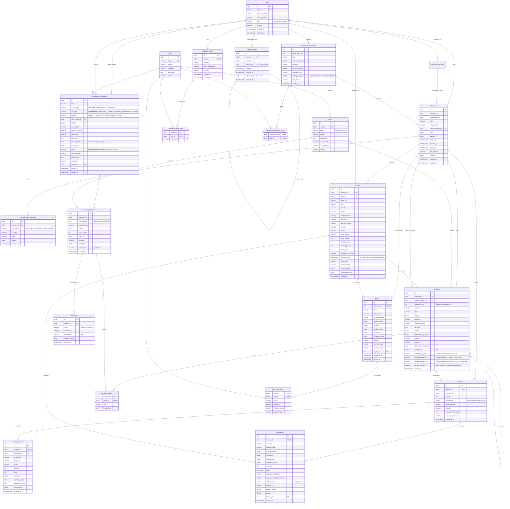

# Database Schema

> PostgreSQL 17 + `pgvector` (+ `citext`). Managed by Flyway. Neon-compatible.
> See [AI_ARCHITECTURE.md §6](AI_ARCHITECTURE.md) for how retrieval uses these tables.

---

## 1. Conventions

| Convention | Rule |
|---|---|
| Primary keys | `uuid` (time-ordered UUIDv7, generated in the application) for user-generated or externally referenced rows, including `llm_calls`: `questions`, `evaluations` and `reports` point at it, and the id exists before the call is recorded. `bigint GENERATED ALWAYS AS IDENTITY` for the seeded catalog tables (`skills`, `topics`) and for the internal per-interview audit trail `interview_state_transitions`, which is never exposed or referenced. |
| Enumerations | `varchar` + `CHECK` constraint (easier to evolve than native PG enums); mirrored by Java enums. The one open list, the coding languages (`java`, `python`, `typescript`, `go` in [API_DESIGN.md](API_DESIGN.md)), is validated by the API instead, so adding a language is a code change and not a migration (§3.8). |
| Timestamps | `timestamptz`, UTC, `created_at` default `now()`. |
| Flexible structures | `jsonb` only for value objects owned by one aggregate (plan, memory, rubric ratings). Anything queried relationally gets a column or table. |
| Deletes | `ON DELETE CASCADE` inside an aggregate; `SET NULL` for logs and soft pointers (`llm_calls.user_id/interview_id`, `knowledge_documents.created_by`, `interviews.resume_id` (V13), `interviews.current_question_id`, the `llm_call_id` references). References to catalog rows (`skills`, `topics`) and to a configuration used by an interview are restrictive (no cascade). |
| Concurrency | `interviews.version` for optimistic locking (`@Version`). |
| Naming | snake_case tables (plural) and columns. Constraints and indexes are always named: `pk_<table>`, `fk_<table>_<column or target>`, `uq_<table>_<columns>`, `ck_<table>_<rule>`, `ix_<table>_<columns>`. |

---

## 2. Entity-relationship diagram

The diagram lists every column of every table in table order, with its type family and `PK` / `FK` / `UK` flags (`UK` = a single-column unique constraint; composite unique constraints are noted as "unique with ..."). Relationship cardinalities follow the foreign keys: the parent side is optional (`|o`) when the FK column is nullable, and the child side is `o|` when the FK column is unique and `o{` otherwise. It is checked mechanically against `pg_catalog` of a database built from the migrations (§3).



---

## 3. Table reference (the executed Flyway migrations)

The migration files in `backend/src/main/resources/db/migration` are the source of truth. The `sql` blocks in §3.1 to §3.7 are those files, identical apart from the `-- Vn__name.sql` header line this document adds above each block; the match is checked mechanically (a script extracts every fenced `sql` block of §3.1 to §3.7, drops the header line and compares the rest with the file, byte for byte). The files apply cleanly to an empty PostgreSQL 17 + pgvector 0.8.7 database with `psql -v ON_ERROR_STOP=1`, and are applied by Flyway at application start and in the integration tests. The executable checks of the schema are the migration integration tests (`SchemaMigrationIT`); this document claims nothing about constraint behaviour beyond what the DDL itself says. Constraint and index names are explicit (`pk_`, `fk_`, `uq_`, `ck_`, `ix_`), so error messages and tests are stable.

### 3.1 Extensions
```sql
-- V1__extensions.sql
-- Extensions required by the schema (see DATABASE_SCHEMA.md).
-- vector: pgvector embeddings and similarity search. citext: case-insensitive unique emails.
CREATE EXTENSION IF NOT EXISTS vector;
CREATE EXTENSION IF NOT EXISTS citext;
```

### 3.2 Identity and profiles
Accounts and refresh tokens (`V2__identity.sql`):
```sql
-- V2__identity.sql
-- Identity: accounts and rotating refresh tokens.

CREATE TABLE users (
    id             uuid         NOT NULL,
    email          citext       NOT NULL,
    password_hash  varchar(100) NOT NULL,
    display_name   varchar(80)  NOT NULL,
    role           varchar(20)  NOT NULL,
    enabled        boolean      NOT NULL DEFAULT true,
    created_at     timestamptz  NOT NULL DEFAULT now(),
    updated_at     timestamptz  NOT NULL DEFAULT now(),
    CONSTRAINT pk_users PRIMARY KEY (id),
    CONSTRAINT uq_users_email UNIQUE (email),
    CONSTRAINT ck_users_role CHECK (role IN ('CANDIDATE', 'ADMIN'))
);

CREATE TABLE refresh_tokens (
    id          uuid        NOT NULL,
    user_id     uuid        NOT NULL,
    family_id   uuid        NOT NULL,
    token_hash  char(64)    NOT NULL,
    expires_at  timestamptz NOT NULL,
    revoked_at  timestamptz,
    replaced_by uuid,
    created_at  timestamptz NOT NULL DEFAULT now(),
    CONSTRAINT pk_refresh_tokens PRIMARY KEY (id),
    CONSTRAINT uq_refresh_tokens_token_hash UNIQUE (token_hash),
    CONSTRAINT ck_refresh_tokens_token_hash_hex CHECK (token_hash ~ '^[0-9a-f]{64}$'),
    CONSTRAINT fk_refresh_tokens_user FOREIGN KEY (user_id) REFERENCES users (id) ON DELETE CASCADE,
    CONSTRAINT fk_refresh_tokens_replaced_by FOREIGN KEY (replaced_by) REFERENCES refresh_tokens (id) ON DELETE SET NULL
);
CREATE INDEX ix_refresh_tokens_user ON refresh_tokens (user_id);
CREATE INDEX ix_refresh_tokens_family ON refresh_tokens (family_id);
CREATE INDEX ix_refresh_tokens_replaced_by ON refresh_tokens (replaced_by) WHERE replaced_by IS NOT NULL;

COMMENT ON COLUMN users.email IS 'citext: unique case-insensitively.';
COMMENT ON TABLE refresh_tokens IS 'Rotating refresh tokens. family_id links a rotation chain; reuse of a revoked token revokes the whole family. Only the SHA-256 hex of the raw token is stored.';
```

Candidate profiles (`V5__profiles.sql`; created after the knowledge base because the résumé is a `knowledge_documents` row):
```sql
-- V5__profiles.sql
-- Candidate profiles and self-reported skills.

CREATE TABLE candidate_profiles (
    id                  uuid         NOT NULL,
    user_id             uuid         NOT NULL,
    headline            varchar(120),
    years_experience    smallint,
    job_title           varchar(60),
    resume_document_id  uuid,                -- dropped in V13 (§7.5)
    created_at          timestamptz  NOT NULL DEFAULT now(),
    updated_at          timestamptz  NOT NULL DEFAULT now(),
    CONSTRAINT pk_candidate_profiles PRIMARY KEY (id),
    CONSTRAINT uq_candidate_profiles_user UNIQUE (user_id),
    CONSTRAINT fk_candidate_profiles_user FOREIGN KEY (user_id) REFERENCES users (id) ON DELETE CASCADE,
    CONSTRAINT fk_candidate_profiles_resume FOREIGN KEY (resume_document_id) REFERENCES knowledge_documents (id) ON DELETE SET NULL,
    CONSTRAINT ck_candidate_profiles_years_experience CHECK (years_experience BETWEEN 0 AND 60)
);
CREATE INDEX ix_candidate_profiles_resume ON candidate_profiles (resume_document_id) WHERE resume_document_id IS NOT NULL;  -- dropped with the column in V13

CREATE TABLE candidate_profile_skills (
    profile_id   uuid     NOT NULL,
    skill_id     bigint   NOT NULL,
    self_rating  smallint,
    CONSTRAINT pk_candidate_profile_skills PRIMARY KEY (profile_id, skill_id),
    CONSTRAINT fk_candidate_profile_skills_profile FOREIGN KEY (profile_id) REFERENCES candidate_profiles (id) ON DELETE CASCADE,
    CONSTRAINT fk_candidate_profile_skills_skill FOREIGN KEY (skill_id) REFERENCES skills (id),
    CONSTRAINT ck_candidate_profile_skills_self_rating CHECK (self_rating BETWEEN 1 AND 5)
);

COMMENT ON COLUMN candidate_profiles.job_title IS 'Not named current_role: that is a reserved word in PostgreSQL.';
```

### 3.3 Catalog (seeded; repeatable migration `R__seed_catalog.sql`)
```sql
-- V3__catalog.sql
-- Catalog: skills and topics. Rows are seeded by the repeatable migration R__seed_catalog.sql.

CREATE TABLE skills (
    id          bigint       GENERATED ALWAYS AS IDENTITY,
    slug        varchar(60)  NOT NULL,
    name        varchar(80)  NOT NULL,
    category    varchar(20)  NOT NULL,
    description text,
    active      boolean      NOT NULL DEFAULT true,
    CONSTRAINT pk_skills PRIMARY KEY (id),
    CONSTRAINT uq_skills_slug UNIQUE (slug),
    CONSTRAINT ck_skills_category CHECK (category IN ('LANGUAGE', 'FRAMEWORK', 'DATABASE', 'CLOUD', 'CONCEPT', 'TOOL'))
);

CREATE TABLE topics (
    id              bigint        GENERATED ALWAYS AS IDENTITY,
    skill_id        bigint        NOT NULL,
    slug            varchar(80)   NOT NULL,
    name            varchar(120)  NOT NULL,
    description     text,
    min_difficulty  smallint      NOT NULL DEFAULT 1,
    max_difficulty  smallint      NOT NULL DEFAULT 5,
    weight          numeric(4, 2) NOT NULL DEFAULT 1.0,
    CONSTRAINT pk_topics PRIMARY KEY (id),
    CONSTRAINT uq_topics_skill_slug UNIQUE (skill_id, slug),
    CONSTRAINT fk_topics_skill FOREIGN KEY (skill_id) REFERENCES skills (id),
    CONSTRAINT ck_topics_min_difficulty CHECK (min_difficulty BETWEEN 1 AND 5),
    CONSTRAINT ck_topics_max_difficulty CHECK (max_difficulty BETWEEN 1 AND 5),
    CONSTRAINT ck_topics_difficulty_order CHECK (min_difficulty <= max_difficulty),
    CONSTRAINT ck_topics_weight CHECK (weight > 0)
);
```

**Seed data (nine skills, 41 topics; six skills and 37 topics until 2026-10-14).** Topic slugs are the taxonomy the planner, the corpus front-matter, the question bank and the exemplar questions all share. Since 2026-10-14 the seed also sets each topic's `weight` (0.8 to 1.5): the core topics an interviewer asks first weigh more, so they get a skill's first questions (AI_ARCHITECTURE.md §2.15).

| Skill (`slug`) | Category | Topics (`slug`, difficulty range) |
|---|---|---|
| Java (`java`) | LANGUAGE | `core-language-oop` 1–3 · `collections` 1–4 · `generics` 2–4 · `exceptions` 1–3 · `streams-functional` 2–4 · `concurrency` 2–5 · `jvm-memory-gc` 3–5 |
| Spring Boot (`spring-boot`) | FRAMEWORK | `dependency-injection-proxies` 1–4 · `configuration-profiles` 1–3 · `web-mvc-rest` 1–4 · `data-jpa` 2–5 · `transactions` 2–5 · `security` 2–5 · `testing` 2–4 |
| PostgreSQL (`postgresql`) | DATABASE | `sql-fundamentals` 1–3 · `schema-design-normalization` 1–4 · `indexing` 2–5 · `query-planning` 3–5 · `transactions-isolation` 2–5 · `locking-concurrency` 3–5 |
| System Design (`system-design`) | CONCEPT | `scalability-fundamentals` 1–3 · `caching` 2–4 · `partitioning-replication` 3–5 · `messaging-async` 2–5 · `api-design-rate-limiting` 2–4 · `reliability-observability` 3–5 |
| React (`react`) | FRAMEWORK | `components-props-state` 1–3 · `hooks` 1–4 · `effects-data-fetching` 2–4 · `rendering-reconciliation` 2–5 · `performance` 3–5 · `state-management` 2–4 |
| TypeScript (`typescript`) | LANGUAGE | `type-system-basics` 1–3 · `narrowing-type-guards` 2–4 · `generics` 2–5 · `utility-mapped-conditional-types` 3–5 · `strictness-tooling` 1–3 |
| JavaScript (`javascript`) | LANGUAGE | `language-core` 1–4 · `async-event-loop` 2–5 |
| REST APIs (`rest-api`) | CONCEPT | `http-api-design` 1–4 (one topic: the knowledge base has one REST document) |
| Microservices (`microservices`) | CONCEPT | `architecture` 2–5 (one topic: the knowledge base has one microservices document) |

Role → default skill weighting used by the planner: `BACKEND` favours Java, Spring Boot, PostgreSQL, System Design. `FRONTEND` favours React, TypeScript (System Design optional). `FULL_STACK` favours none. Candidates still choose which skills to include.

`R__seed_catalog.sql` upserts these rows with `INSERT ... ON CONFLICT DO UPDATE` keyed on `skills.slug` and `(skill_id, slug)`. It never deletes rows, so re-running it is safe and leaves ids unchanged (it does consume identity values, which is harmless).

### 3.4 Interview aggregate
```sql
-- V6__interviews.sql
-- Interview aggregate: configuration, interview, audit trail, questions, grounding sources, answers.
-- questions.generation_llm_call_id is a plain column here; V8 adds its foreign key once llm_calls exists.

CREATE TABLE interview_configurations (
    id                uuid         NOT NULL,
    owner_user_id     uuid         NOT NULL,
    role              varchar(30)  NOT NULL,
    experience_level  varchar(20)  NOT NULL,
    difficulty        varchar(10)  NOT NULL,
    duration_minutes  smallint     NOT NULL,
    interview_type    varchar(20)  NOT NULL,
    coding_language   varchar(20),
    use_resume        boolean      NOT NULL DEFAULT false,
    created_at        timestamptz  NOT NULL DEFAULT now(),
    CONSTRAINT pk_interview_configurations PRIMARY KEY (id),
    CONSTRAINT fk_interview_configurations_owner FOREIGN KEY (owner_user_id) REFERENCES users (id) ON DELETE CASCADE,
    CONSTRAINT ck_interview_configurations_role CHECK (role IN ('BACKEND', 'FRONTEND', 'FULL_STACK')),
    CONSTRAINT ck_interview_configurations_experience_level CHECK (experience_level IN ('INTERN', 'JUNIOR', 'MID', 'SENIOR', 'STAFF')),
    CONSTRAINT ck_interview_configurations_difficulty CHECK (difficulty IN ('EASY', 'MEDIUM', 'HARD')),
    CONSTRAINT ck_interview_configurations_duration CHECK (duration_minutes IN (15, 30, 45, 60, 90)),
    CONSTRAINT ck_interview_configurations_type CHECK (interview_type IN ('TECHNICAL', 'CODING', 'SYSTEM_DESIGN', 'FULL_LOOP')),
    CONSTRAINT ck_interview_configurations_coding_language CHECK (interview_type IN ('TECHNICAL', 'SYSTEM_DESIGN') OR coding_language IS NOT NULL)
);
CREATE INDEX ix_interview_configurations_owner ON interview_configurations (owner_user_id);

CREATE TABLE interview_configuration_skills (
    configuration_id  uuid    NOT NULL,
    skill_id          bigint  NOT NULL,
    CONSTRAINT pk_interview_configuration_skills PRIMARY KEY (configuration_id, skill_id),
    CONSTRAINT fk_interview_configuration_skills_configuration FOREIGN KEY (configuration_id) REFERENCES interview_configurations (id) ON DELETE CASCADE,
    CONSTRAINT fk_interview_configuration_skills_skill FOREIGN KEY (skill_id) REFERENCES skills (id)
);

CREATE TABLE interviews (
    id                   uuid         NOT NULL,
    candidate_id         uuid         NOT NULL,
    configuration_id     uuid         NOT NULL,
    state                varchar(20)  NOT NULL,
    resume_state         varchar(20),
    current_question_id  uuid,
    plan                 jsonb        NOT NULL,
    memory               jsonb        NOT NULL DEFAULT '{}'::jsonb,
    started_at           timestamptz,
    deadline_at          timestamptz,
    ended_at             timestamptz,
    end_reason           varchar(20),
    version              bigint       NOT NULL DEFAULT 0,
    created_at           timestamptz  NOT NULL DEFAULT now(),
    updated_at           timestamptz  NOT NULL DEFAULT now(),
    CONSTRAINT pk_interviews PRIMARY KEY (id),
    CONSTRAINT fk_interviews_candidate FOREIGN KEY (candidate_id) REFERENCES users (id) ON DELETE CASCADE,
    CONSTRAINT fk_interviews_configuration FOREIGN KEY (configuration_id) REFERENCES interview_configurations (id),
    CONSTRAINT ck_interviews_state CHECK (state IN ('INIT', 'INTRODUCTION', 'QUESTIONING', 'FOLLOW_UP',
                                                    'CODING', 'SYSTEM_DESIGN', 'FINAL_EVALUATION', 'COMPLETED', 'ABANDONED')),
    CONSTRAINT ck_interviews_resume_state CHECK (resume_state IN ('QUESTIONING', 'CODING', 'SYSTEM_DESIGN')),
    CONSTRAINT ck_interviews_end_reason CHECK (end_reason IN ('PLAN_COMPLETE', 'TIME_UP', 'CANDIDATE_ENDED', 'ABANDONED'))
);
CREATE INDEX ix_interviews_candidate_created ON interviews (candidate_id, created_at DESC);
CREATE INDEX ix_interviews_configuration ON interviews (configuration_id);
CREATE INDEX ix_interviews_active ON interviews (state) WHERE state NOT IN ('COMPLETED', 'ABANDONED');

CREATE TABLE interview_state_transitions (
    id            bigint       GENERATED ALWAYS AS IDENTITY,
    interview_id  uuid         NOT NULL,
    from_state    varchar(20),
    to_state      varchar(20)  NOT NULL,
    event         varchar(30)  NOT NULL,
    details       jsonb,
    occurred_at   timestamptz  NOT NULL DEFAULT now(),
    CONSTRAINT pk_interview_state_transitions PRIMARY KEY (id),
    CONSTRAINT fk_interview_state_transitions_interview FOREIGN KEY (interview_id) REFERENCES interviews (id) ON DELETE CASCADE,
    CONSTRAINT ck_interview_state_transitions_from_state CHECK (from_state IN ('INIT', 'INTRODUCTION', 'QUESTIONING', 'FOLLOW_UP',
                                                    'CODING', 'SYSTEM_DESIGN', 'FINAL_EVALUATION', 'COMPLETED', 'ABANDONED')),
    CONSTRAINT ck_interview_state_transitions_to_state CHECK (to_state IN ('INIT', 'INTRODUCTION', 'QUESTIONING', 'FOLLOW_UP',
                                                    'CODING', 'SYSTEM_DESIGN', 'FINAL_EVALUATION', 'COMPLETED', 'ABANDONED')),
    CONSTRAINT ck_interview_state_transitions_creation CHECK (from_state IS NOT NULL OR to_state = 'INIT')
);
CREATE INDEX ix_interview_state_transitions_interview ON interview_state_transitions (interview_id, occurred_at);

CREATE TABLE questions (
    id                      uuid         NOT NULL,
    interview_id            uuid         NOT NULL,
    parent_question_id      uuid,
    sequence_no             int          NOT NULL,
    section                 varchar(20)  NOT NULL,
    kind                    varchar(20)  NOT NULL,
    topic_id                bigint,
    difficulty              smallint     NOT NULL,
    followup_depth          smallint     NOT NULL DEFAULT 0,
    prompt                  text         NOT NULL,
    details                 jsonb,
    expected_key_points     jsonb        NOT NULL DEFAULT '[]'::jsonb,
    rubric_id               varchar(40)  NOT NULL,
    source                  varchar(20)  NOT NULL,
    generation_llm_call_id  uuid,
    embedding               vector(768),
    embedding_model         varchar(80),
    asked_at                timestamptz  NOT NULL DEFAULT now(),
    CONSTRAINT pk_questions PRIMARY KEY (id),
    CONSTRAINT uq_questions_interview_sequence UNIQUE (interview_id, sequence_no),
    CONSTRAINT fk_questions_interview FOREIGN KEY (interview_id) REFERENCES interviews (id) ON DELETE CASCADE,
    CONSTRAINT fk_questions_parent FOREIGN KEY (parent_question_id) REFERENCES questions (id) ON DELETE CASCADE,
    CONSTRAINT fk_questions_topic FOREIGN KEY (topic_id) REFERENCES topics (id),
    CONSTRAINT ck_questions_section CHECK (section IN ('INTRODUCTION', 'QUESTIONING', 'CODING', 'SYSTEM_DESIGN')),
    CONSTRAINT ck_questions_kind CHECK (kind IN ('INTRO', 'TECHNICAL', 'FOLLOW_UP', 'CODING', 'SYSTEM_DESIGN')),
    CONSTRAINT ck_questions_difficulty CHECK (difficulty BETWEEN 1 AND 5),
    CONSTRAINT ck_questions_followup_depth CHECK (followup_depth BETWEEN 0 AND 2),  -- 0 AND 6 since V12 (design threads)
    CONSTRAINT ck_questions_source CHECK (source IN ('GENERATED', 'EXEMPLAR_FALLBACK', 'STATIC')),
    CONSTRAINT ck_questions_embedding_model CHECK ((embedding IS NULL) = (embedding_model IS NULL))
);
CREATE INDEX ix_questions_parent ON questions (parent_question_id) WHERE parent_question_id IS NOT NULL;

ALTER TABLE interviews ADD CONSTRAINT fk_interviews_current_question
    FOREIGN KEY (current_question_id) REFERENCES questions (id) ON DELETE SET NULL;
CREATE INDEX ix_interviews_current_question ON interviews (current_question_id) WHERE current_question_id IS NOT NULL;

CREATE TABLE question_sources (
    question_id  uuid      NOT NULL,
    chunk_id     uuid      NOT NULL,
    rank         smallint  NOT NULL,
    fused_score  real      NOT NULL,
    CONSTRAINT pk_question_sources PRIMARY KEY (question_id, chunk_id),
    CONSTRAINT fk_question_sources_question FOREIGN KEY (question_id) REFERENCES questions (id) ON DELETE CASCADE,
    CONSTRAINT fk_question_sources_chunk FOREIGN KEY (chunk_id) REFERENCES knowledge_chunks (id) ON DELETE CASCADE,
    CONSTRAINT ck_question_sources_rank CHECK (rank >= 1)
);
CREATE INDEX ix_question_sources_chunk ON question_sources (chunk_id);

CREATE TABLE answers (
    id                  uuid         NOT NULL,
    question_id         uuid         NOT NULL,
    interview_id        uuid         NOT NULL,
    content             text         NOT NULL,
    code_language       varchar(20),
    skipped             boolean      NOT NULL DEFAULT false,
    time_taken_seconds  int,
    evaluation_status   varchar(20)  NOT NULL DEFAULT 'PENDING',
    submitted_at        timestamptz  NOT NULL DEFAULT now(),
    CONSTRAINT pk_answers PRIMARY KEY (id),
    CONSTRAINT uq_answers_question UNIQUE (question_id),
    CONSTRAINT fk_answers_question FOREIGN KEY (question_id) REFERENCES questions (id) ON DELETE CASCADE,
    CONSTRAINT fk_answers_interview FOREIGN KEY (interview_id) REFERENCES interviews (id) ON DELETE CASCADE,
    CONSTRAINT ck_answers_content_length CHECK (char_length(content) <= 20000),
    CONSTRAINT ck_answers_time_taken CHECK (time_taken_seconds >= 0),
    CONSTRAINT ck_answers_evaluation_status CHECK (evaluation_status IN ('PENDING', 'COMPLETED', 'FAILED'))
);
CREATE INDEX ix_answers_interview ON answers (interview_id);
CREATE INDEX ix_answers_pending ON answers (interview_id) WHERE evaluation_status <> 'COMPLETED';

COMMENT ON TABLE interviews IS 'Aggregate root. version is the optimistic-locking counter; plan is immutable after creation; memory is rewritten after every evaluation.';
COMMENT ON COLUMN interviews.resume_state IS 'Section to return to after FOLLOW_UP.';
COMMENT ON COLUMN questions.expected_key_points IS 'Server-only; never sent to the client.';
COMMENT ON COLUMN questions.generation_llm_call_id IS 'References llm_calls(id); the foreign key is added in V8 because llm_calls is created last.';
COMMENT ON COLUMN answers.question_id IS 'Unique: the natural idempotency key for answer submission.';
COMMENT ON TABLE question_sources IS 'Retrieved chunks that grounded a generated question.';
```

### 3.5 Evaluation & reports
```sql
-- V7__evaluations_reports.sql
-- Evaluations and reports. llm_call_id columns are plain here; V8 adds their foreign keys once llm_calls exists.

CREATE TABLE evaluations (
    id                uuid          NOT NULL,
    answer_id         uuid          NOT NULL,
    evaluator         varchar(20)   NOT NULL,
    overall_score     numeric(5, 2) NOT NULL,
    criterion_scores  jsonb         NOT NULL,
    key_points        jsonb         NOT NULL,
    factual_errors    jsonb         NOT NULL DEFAULT '[]'::jsonb,
    candidate_claims  jsonb         NOT NULL DEFAULT '[]'::jsonb,
    summary           text          NOT NULL,
    flags             text[]        NOT NULL DEFAULT '{}',
    prompt_id         varchar(60)   NOT NULL,
    prompt_version    varchar(20)   NOT NULL,
    model             varchar(80)   NOT NULL,
    llm_call_id       uuid,
    created_at        timestamptz   NOT NULL DEFAULT now(),
    CONSTRAINT pk_evaluations PRIMARY KEY (id),
    CONSTRAINT uq_evaluations_answer UNIQUE (answer_id),
    CONSTRAINT fk_evaluations_answer FOREIGN KEY (answer_id) REFERENCES answers (id) ON DELETE CASCADE,
    CONSTRAINT ck_evaluations_evaluator CHECK (evaluator IN ('INTRO', 'TECHNICAL', 'CODING', 'SYSTEM_DESIGN')),
    CONSTRAINT ck_evaluations_overall_score CHECK (overall_score BETWEEN 0 AND 100)
);

CREATE TABLE reports (
    id               uuid          NOT NULL,
    interview_id     uuid          NOT NULL,
    status           varchar(20)   NOT NULL,
    overall_score    numeric(5, 2),
    recommendation   varchar(20),
    section_scores   jsonb,
    narrative        jsonb,
    integrity_notes  jsonb,
    coverage         jsonb,
    attempts         smallint      NOT NULL DEFAULT 0,
    error_message    varchar(500),
    prompt_version   varchar(20),
    llm_call_id      uuid,
    generated_at     timestamptz,
    created_at       timestamptz   NOT NULL DEFAULT now(),
    CONSTRAINT pk_reports PRIMARY KEY (id),
    CONSTRAINT uq_reports_interview UNIQUE (interview_id),
    CONSTRAINT fk_reports_interview FOREIGN KEY (interview_id) REFERENCES interviews (id) ON DELETE CASCADE,
    CONSTRAINT ck_reports_status CHECK (status IN ('PENDING', 'GENERATING', 'READY', 'FAILED')),
    CONSTRAINT ck_reports_overall_score CHECK (overall_score BETWEEN 0 AND 100),
    CONSTRAINT ck_reports_recommendation CHECK (recommendation IN ('STRONG', 'PROFICIENT', 'DEVELOPING', 'NOT_YET')),
    CONSTRAINT ck_reports_attempts CHECK (attempts >= 0)
);

CREATE TABLE report_skill_scores (
    report_id       uuid          NOT NULL,
    skill_id        bigint        NOT NULL,
    score           numeric(5, 2) NOT NULL,
    confidence      varchar(10)   NOT NULL,
    evidence_count  smallint      NOT NULL,
    avg_difficulty  numeric(3, 2) NOT NULL,
    CONSTRAINT pk_report_skill_scores PRIMARY KEY (report_id, skill_id),
    CONSTRAINT fk_report_skill_scores_report FOREIGN KEY (report_id) REFERENCES reports (id) ON DELETE CASCADE,
    CONSTRAINT fk_report_skill_scores_skill FOREIGN KEY (skill_id) REFERENCES skills (id),
    CONSTRAINT ck_report_skill_scores_score CHECK (score BETWEEN 0 AND 100),
    CONSTRAINT ck_report_skill_scores_confidence CHECK (confidence IN ('LOW', 'MEDIUM', 'HIGH')),
    CONSTRAINT ck_report_skill_scores_evidence_count CHECK (evidence_count >= 0),
    CONSTRAINT ck_report_skill_scores_avg_difficulty CHECK (avg_difficulty BETWEEN 1 AND 5)
);
CREATE INDEX ix_report_skill_scores_skill ON report_skill_scores (skill_id);

COMMENT ON COLUMN evaluations.overall_score IS 'Computed in Java from criterion ratings; never taken from the model.';
COMMENT ON COLUMN evaluations.llm_call_id IS 'References llm_calls(id); the foreign key is added in V8.';
COMMENT ON COLUMN reports.llm_call_id IS 'References llm_calls(id); the foreign key is added in V8.';
COMMENT ON TABLE report_skill_scores IS 'Relational (not JSONB) so progress-over-time queries per skill stay simple SQL.';
```

**Evaluation granularity.** There is exactly one `evaluations` row per answer (`uq_evaluations_answer`); the schema needs no thread-level table. For system design, each answer's evaluation is *cumulative*: the evaluator receives the whole thread so far (root question, earlier follow-ups with their answers, and the current answer) and rates the combined design on every rubric dimension, so the row of the last answered turn already reflects the whole thread and is the one the report takes as the section score ([AI_ARCHITECTURE.md §2.7](AI_ARCHITECTURE.md)). A **skipped** answer (`answers.skipped = true`) has no `evaluations` row (there is nothing to evaluate, and `prompt_id`, `prompt_version` and `model` are `NOT NULL`); the service stores it with `evaluation_status = 'COMPLETED'` so that `ix_answers_pending` and the "re-run pending evaluations" step ignore it, and the report aggregation scores it 0 by reading `answers.skipped`. Aggregation must therefore read `answers`, not only `evaluations`.

### 3.6 Knowledge base (RAG)
```sql
-- V4__knowledge_base.sql
-- Knowledge base (RAG): documents, chunks (with full-text search) and embeddings (pgvector, HNSW).

CREATE TABLE knowledge_documents (
    id                 uuid         NOT NULL,
    title              varchar(200) NOT NULL,
    source_type        varchar(20)  NOT NULL,
    doc_type           varchar(30)  NOT NULL,
    visibility         varchar(10)  NOT NULL,
    owner_user_id      uuid,
    skill_id           bigint,
    source_path        varchar(300),
    original_filename  varchar(255),
    mime_type          varchar(60)  NOT NULL,
    byte_size          int          NOT NULL,
    content_sha256     char(64)     NOT NULL,
    extracted_text     text         NOT NULL,
    status             varchar(20)  NOT NULL,
    error_message      varchar(500),
    chunk_count        int          NOT NULL DEFAULT 0,
    metadata           jsonb        NOT NULL DEFAULT '{}'::jsonb,
    created_by         uuid,
    created_at         timestamptz  NOT NULL DEFAULT now(),
    updated_at         timestamptz  NOT NULL DEFAULT now(),
    CONSTRAINT pk_knowledge_documents PRIMARY KEY (id),
    CONSTRAINT fk_knowledge_documents_owner FOREIGN KEY (owner_user_id) REFERENCES users (id) ON DELETE CASCADE,
    CONSTRAINT fk_knowledge_documents_skill FOREIGN KEY (skill_id) REFERENCES skills (id),
    CONSTRAINT fk_knowledge_documents_created_by FOREIGN KEY (created_by) REFERENCES users (id) ON DELETE SET NULL,
    CONSTRAINT ck_knowledge_documents_source_type CHECK (source_type IN ('CURATED', 'ADMIN_UPLOAD', 'RESUME')),
    CONSTRAINT ck_knowledge_documents_doc_type CHECK (doc_type IN ('REFERENCE', 'QUESTION_EXEMPLAR', 'DESIGN_REFERENCE', 'RESUME')),
    CONSTRAINT ck_knowledge_documents_visibility CHECK (visibility IN ('PUBLIC', 'PRIVATE')),
    CONSTRAINT ck_knowledge_documents_status CHECK (status IN ('PENDING', 'PROCESSING', 'READY', 'FAILED')),
    CONSTRAINT ck_knowledge_documents_private_has_owner CHECK (visibility = 'PUBLIC' OR owner_user_id IS NOT NULL),
    CONSTRAINT ck_knowledge_documents_resume_private CHECK ((source_type <> 'RESUME' AND doc_type <> 'RESUME') OR visibility = 'PRIVATE'),
    CONSTRAINT ck_knowledge_documents_content_sha256_hex CHECK (content_sha256 ~ '^[0-9a-f]{64}$'),
    CONSTRAINT ck_knowledge_documents_byte_size CHECK (byte_size >= 0),
    CONSTRAINT ck_knowledge_documents_chunk_count CHECK (chunk_count >= 0),
    CONSTRAINT uq_knowledge_documents_owner_sha256 UNIQUE NULLS NOT DISTINCT (owner_user_id, content_sha256)
);
CREATE INDEX ix_knowledge_documents_skill ON knowledge_documents (skill_id);
CREATE INDEX ix_knowledge_documents_created_by ON knowledge_documents (created_by) WHERE created_by IS NOT NULL;

CREATE TABLE knowledge_chunks (
    id            uuid         NOT NULL,
    document_id   uuid         NOT NULL,
    chunk_index   int          NOT NULL,
    heading_path  varchar(500),
    content       text         NOT NULL,
    token_count   int          NOT NULL,
    topic_id      bigint,
    difficulty    smallint,
    metadata      jsonb        NOT NULL DEFAULT '{}'::jsonb,
    content_tsv   tsvector GENERATED ALWAYS AS
                  (to_tsvector('english', coalesce(heading_path, '') || ' ' || content)) STORED,
    created_at    timestamptz  NOT NULL DEFAULT now(),
    CONSTRAINT pk_knowledge_chunks PRIMARY KEY (id),
    CONSTRAINT uq_knowledge_chunks_document_index UNIQUE (document_id, chunk_index),
    CONSTRAINT fk_knowledge_chunks_document FOREIGN KEY (document_id) REFERENCES knowledge_documents (id) ON DELETE CASCADE,
    CONSTRAINT fk_knowledge_chunks_topic FOREIGN KEY (topic_id) REFERENCES topics (id),
    CONSTRAINT ck_knowledge_chunks_difficulty CHECK (difficulty BETWEEN 1 AND 5),
    CONSTRAINT ck_knowledge_chunks_chunk_index CHECK (chunk_index >= 0),
    CONSTRAINT ck_knowledge_chunks_token_count CHECK (token_count >= 0)
);
CREATE INDEX ix_knowledge_chunks_tsv ON knowledge_chunks USING gin (content_tsv);
CREATE INDEX ix_knowledge_chunks_topic ON knowledge_chunks (topic_id);

CREATE TABLE embeddings (
    id              uuid         NOT NULL,
    chunk_id        uuid         NOT NULL,
    model           varchar(80)  NOT NULL,
    dimensions      smallint     NOT NULL,
    embedding       vector(768)  NOT NULL,
    content_sha256  char(64)     NOT NULL,
    created_at      timestamptz  NOT NULL DEFAULT now(),
    CONSTRAINT pk_embeddings PRIMARY KEY (id),
    CONSTRAINT uq_embeddings_chunk_model UNIQUE (chunk_id, model),
    CONSTRAINT fk_embeddings_chunk FOREIGN KEY (chunk_id) REFERENCES knowledge_chunks (id) ON DELETE CASCADE,
    CONSTRAINT ck_embeddings_dimensions CHECK (dimensions = 768),
    CONSTRAINT ck_embeddings_content_sha256_hex CHECK (content_sha256 ~ '^[0-9a-f]{64}$')
);
CREATE INDEX ix_embeddings_hnsw ON embeddings
    USING hnsw (embedding vector_cosine_ops) WITH (m = 16, ef_construction = 64);

COMMENT ON TABLE knowledge_documents IS 'RAG source documents. PUBLIC = curated/admin material visible to everyone; PRIVATE = owned by one user (resumes). NULLS NOT DISTINCT makes (NULL owner, sha) unique for curated documents too.';
COMMENT ON COLUMN knowledge_documents.extracted_text IS 'Kept so a document can be re-chunked without re-upload.';
COMMENT ON TABLE embeddings IS 'One vector per (chunk, model). Vectors from different models are never compared; searches filter by the active model.';
```

### 3.7 AI observability
```sql
-- V8__llm_calls.sql
-- AI observability: one row per LLM attempt. Created last because questions, evaluations and reports reference it.
-- Rows are kept for aggregate metrics when a user or interview is deleted (SET NULL).

CREATE TABLE llm_calls (
    id                  uuid          NOT NULL,
    interview_id        uuid,
    user_id             uuid,
    trace_id            varchar(64),
    task                varchar(40)   NOT NULL,
    provider            varchar(20)   NOT NULL,
    model               varchar(80)   NOT NULL,
    model_version       varchar(80),
    prompt_id           varchar(60),
    prompt_version      varchar(20),
    attempt             smallint      NOT NULL DEFAULT 1,
    status              varchar(20)   NOT NULL,
    finish_reason       varchar(20),
    input_tokens        int,
    output_tokens       int,
    thinking_tokens     int,
    latency_ms          int           NOT NULL,
    estimated_cost_usd  numeric(10, 6),
    rag_chunk_ids       uuid[],
    error_code          varchar(60),
    error_message       varchar(500),
    request_payload     jsonb,
    response_payload    jsonb,
    created_at          timestamptz   NOT NULL DEFAULT now(),
    CONSTRAINT pk_llm_calls PRIMARY KEY (id),
    CONSTRAINT fk_llm_calls_interview FOREIGN KEY (interview_id) REFERENCES interviews (id) ON DELETE SET NULL,
    CONSTRAINT fk_llm_calls_user FOREIGN KEY (user_id) REFERENCES users (id) ON DELETE SET NULL,
    CONSTRAINT ck_llm_calls_status CHECK (status IN ('OK', 'REPAIRED', 'INVALID_OUTPUT', 'RATE_LIMITED', 'TIMEOUT', 'BLOCKED', 'ERROR', 'FALLBACK')),
    CONSTRAINT ck_llm_calls_attempt CHECK (attempt >= 1),
    CONSTRAINT ck_llm_calls_latency CHECK (latency_ms >= 0),
    CONSTRAINT ck_llm_calls_tokens CHECK (input_tokens >= 0 AND output_tokens >= 0 AND thinking_tokens >= 0)
);
CREATE INDEX ix_llm_calls_interview ON llm_calls (interview_id, created_at);
CREATE INDEX ix_llm_calls_user_day ON llm_calls (user_id, created_at);
CREATE INDEX ix_llm_calls_task_time ON llm_calls (task, created_at DESC);
CREATE INDEX ix_llm_calls_created ON llm_calls (created_at DESC);

ALTER TABLE evaluations ADD CONSTRAINT fk_evaluations_llm_call
    FOREIGN KEY (llm_call_id) REFERENCES llm_calls (id) ON DELETE SET NULL;
ALTER TABLE questions ADD CONSTRAINT fk_questions_generation_llm_call
    FOREIGN KEY (generation_llm_call_id) REFERENCES llm_calls (id) ON DELETE SET NULL;
ALTER TABLE reports ADD CONSTRAINT fk_reports_llm_call
    FOREIGN KEY (llm_call_id) REFERENCES llm_calls (id) ON DELETE SET NULL;

COMMENT ON TABLE llm_calls IS 'One row per LLM attempt. request_payload/response_payload are opt-in and nulled after 30 days; rows themselves are retained for aggregate metrics.';
COMMENT ON COLUMN llm_calls.rag_chunk_ids IS 'Chunks supplied as context. Deliberately not a foreign key so the log survives chunk deletion.';
```

### 3.8 Differences from the original sketch, and what the schema does not enforce

The first version of this document was written without executing it. Executing it found no syntax errors, but these corrections were made while turning it into migrations:

| Change | Reason |
|---|---|
| Every constraint and index is explicitly named; the sketch's `ix_chunks_*` and `ix_transitions_interview` became `ix_knowledge_chunks_*` and `ix_interview_state_transitions_interview` | Stable names for error handling and tests; PostgreSQL's generated names (`*_key`, `*_check`) are less stable across edits |
| `refresh_tokens.replaced_by` now has a self-referencing FK (`ON DELETE SET NULL`) | It was an unconstrained uuid, so a rotation chain could point at nothing |
| `CHECK (... ~ '^[0-9a-f]{64}$')` on `refresh_tokens.token_hash`, `knowledge_documents.content_sha256`, `embeddings.content_sha256` | `char(64)` silently space-pads shorter input, so `'abc'` was accepted as a hash |
| `ck_interviews_resume_state`, `ck_interview_state_transitions_from_state` / `_to_state` | These columns hold state names but had no constraint |
| `ck_knowledge_documents_resume_private` | A résumé must never be `PUBLIC` (retrieval authorization depends on `visibility`) |
| Range checks: `topics.weight > 0`, `answers.time_taken_seconds >= 0`, `question_sources.rank >= 1`, `report_skill_scores` score / evidence / difficulty, `reports.attempts`, `llm_calls` attempt / latency / tokens, `knowledge_documents` size / chunk count, `knowledge_chunks` index / token count | Negative or out-of-range values are always bugs |
| Removed `ix_questions_interview (interview_id, sequence_no)` | Duplicate of the index behind `uq_questions_interview_sequence` |
| Added indexes: `interview_configurations(owner_user_id)`, `interviews(configuration_id)`, partial `interviews(current_question_id)`, partial `questions(parent_question_id)`, `question_sources(chunk_id)`, `knowledge_documents(skill_id)`, partial `knowledge_documents(created_by)`, partial `candidate_profiles(resume_document_id)`, `report_skill_scores(skill_id)`, partial `refresh_tokens(replaced_by)`, `llm_calls(created_at DESC)` | Cascade and `SET NULL` maintenance and the documented lookups (admin LLM log, per-skill progress, daily creation limit) would otherwise scan sequentially. The remaining un-indexed FKs point at catalog rows or `llm_calls` rows, which are never deleted |

**Added after an independent review (2026-10-06)**

| Change | Reason |
|---|---|
| `ck_knowledge_documents_resume_private` is now `(source_type <> 'RESUME' AND doc_type <> 'RESUME') OR visibility = 'PRIVATE'` | It looked only at `source_type`, so an admin upload with `doc_type = 'RESUME'` and `visibility = 'PUBLIC'` was accepted, and retrieval selects by `doc_type` |
| `ck_interview_configurations_coding_language`: `interview_type` `CODING` and `FULL_LOOP` require a `coding_language` | A coding round without a language was representable. The allowed values are validated by the API, not by a `CHECK`, so a new language needs no migration; `answers.code_language` is validated against the configured language by the service |
| `interview_state_transitions.from_state` is nullable, guarded by `ck_interview_state_transitions_creation` (`from_state IS NOT NULL OR to_state = 'INIT'`) | **Decision:** the creation of an interview is recorded as its first transition (`from_state` NULL, `to_state` `INIT`, event `CREATE`), so the audit trail described in [ARCHITECTURE.md §5](ARCHITECTURE.md) is complete from the first row. Any other transition still needs a `from_state` |
| `ck_questions_embedding_model`: `(embedding IS NULL) = (embedding_model IS NULL)` | A vector without its model cannot be compared safely: both models are 768-d, so a mixed comparison raises no error and returns a meaningless number (query §4.2 now filters on the model) |
| §4.1 rewritten and executed against a 21,320-chunk corpus | The documented statement never used the HNSW index (the shared `allowed` CTE was materialised), its ranks were not exact under `relaxed_order`, its keyword half ANDed every term of a natural-language question, and it had no difficulty window |
| §4.2 filters on `embedding_model` | It compared the candidate with every embedded question regardless of model, contradicting "vectors from different models are never compared" |
| ER diagram (§2) completed and checked against the catalog | 13 columns and one relationship (`llm_calls` to `reports`) were missing and two relationships (`refresh_tokens` self-reference, `interviews.current_question_id`) had the wrong cardinality. A script compares every entity, attribute (name, type family, `PK` / `FK` / `UK` flag, order), composite unique constraint and relationship with `pg_catalog` of a database built from the migrations |
| The sentence "all verified by the test script" was removed | That script was not part of the repository |

**Invariants the schema does not enforce (service-level rules).** These relate rows of different aggregates or owners. Composite foreign keys were considered (`UNIQUE (id, owner)` on each parent plus a composite FK) and rejected for now: they add three extra unique indexes (on `knowledge_documents`, `interview_configurations` and `questions`) and interact with the `ON DELETE SET NULL` pointers (`resume_document_id`, `current_question_id`), for rules that the single code path writing each table has to compute anyway. Each rule is therefore enforced by the service that writes the row and covered by a test in the phase that introduces that write path:

| Rule | Written by |
|---|---|
| `interviews.configuration_id` references a configuration whose `owner_user_id` equals `interviews.candidate_id` | interview creation (Phase 4) |
| `interviews.current_question_id` and `questions.parent_question_id` reference questions of the same interview; a root question has `parent_question_id` NULL and `followup_depth` 0, a follow-up has a parent and depth of at least 1 | interview engine (Phase 4) |
| `answers.interview_id` equals the `interview_id` of the answered question (`question_id`) | answer submission (Phase 4); the service sets both from the question |
| `interviews.resume_id` references a résumé of the interview's candidate (V13; replaces the dropped `candidate_profiles.resume_document_id` rule) | interview creation service (`InterviewCreationService`, tested by `ResumeInterviewIT`) |
| `question_sources.chunk_id` references a chunk the interview's candidate may see (`READY`, `PUBLIC` or owned by that candidate); rows are written only from retrieval results | question generation (Phase 4) |
| `evaluations.evaluator` matches the kind of the answered question; `answers.evaluation_status = 'COMPLETED'` means either an `evaluations` row exists or the answer was skipped | evaluation service (Phase 4) |
| `CURATED` documents are identified by `source_path`: the loader looks the document up by `(source_type = 'CURATED', source_path)`, updates it in place, and uses `content_sha256` only to detect a change. The schema has no unique index on `source_path`, so two `CURATED` rows with the same path would be accepted, and a `CURATED` row could have no path | `CuratedCorpusLoader` (Phase 3) |
| State-dependent columns of `interviews` (`started_at`, `deadline_at`, `ended_at`, `end_reason` against `state`) and of `reports` (`status` against `overall_score`, `generated_at`) | engine and report service |

**Retention rules.** `llm_calls.rag_chunk_ids` carries no foreign key, so the call log survives chunk deletion. `question_sources`, by contrast, is the live link from a question to the chunks that grounded it and cascades with its chunk (`fk_question_sources_chunk`): deleting a résumé must erase every derived row, and the loader replaces the chunks of a changed document. After such a re-chunk, the rank and fused score of the vanished chunks are gone for finished interviews; which chunks were supplied to each call remains visible in `llm_calls.rag_chunk_ids`, and the admin trace uses that column.

Known limits, deliberately unchanged: `embeddings.dimensions` is redundant with `vector(768)` but records the model's output size for the re-index job.

---

## 4. Key queries

Every statement in this section is printed as a `PREPARE` so that it runs unchanged in `psql`. Spring's `JdbcClient` uses the same text with `:name` placeholders in place of `$n`. Nullable bind parameters are always wrapped in an explicit `CAST` (PostgreSQL cannot infer the type of a bare `NULL` bind). The statements were executed from this file against a scratch database built with the migrations above.

### 4.1 Hybrid retrieval (vector + full text, fused with RRF)
Executed through `JdbcClient` in `VectorSearchDao` / `KeywordSearchDao` (two statements in the code so each half is testable); fusion in Java (`ReciprocalRankFusion`). Shown here as one statement for clarity.

| Bind | Name | Type | Meaning |
|---|---|---|---|
| `$1` | `userId` | uuid | the caller; drives the authorization filter |
| `$2`, `$3` | `skillId`, `topicId` | bigint or `NULL` | optional metadata filters |
| `$4` | `docTypes` | text[] | allowed `doc_type` values |
| `$5`, `$6` | `minDifficulty`, `maxDifficulty` | smallint | difficulty window; bind `1` and `5` for "no window". Chunks with `NULL` difficulty (untagged material) always pass |
| `$7` | `model` | text | the active embedding model |
| `$8` | `queryVec` | text | the query embedding as a vector literal, `'[0.1,0.2,...]'` |
| `$9` | `keywordTerms` | text[] | a **short** list of significant terms (topic, sub-topic, identifiers); see below |
| `$10` | `k` | int | rows to return |

It must run inside a transaction: `SET LOCAL` only takes effect within one (outside a transaction PostgreSQL warns and ignores it). `SET` cannot take bind parameters, so the code calls `set_config('hnsw.ef_search', '200', true)` (the `true` makes it transaction-local).

```sql
BEGIN;
SET LOCAL hnsw.ef_search = 200;
SET LOCAL hnsw.iterative_scan = relaxed_order;    -- pgvector >= 0.8: keep scanning when filters remove rows
SET LOCAL plan_cache_mode = force_custom_plan;    -- a generic plan cannot use the HNSW index (see below)
EXECUTE hybrid_retrieval(:'user_id', :skill_id, NULL, ARRAY['REFERENCE', 'QUESTION_EXEMPLAR'], 2, 4,
                         'gemini-embedding-001', :'query_vec', ARRAY['volatile', 'visibility', 'memory model'], 10);
COMMIT;
```

```sql
PREPARE hybrid_retrieval (uuid, bigint, bigint, text[], smallint, smallint, text, text, text[], int) AS
-- $1 userId   $2 skillId or NULL   $3 topicId or NULL   $4 docTypes   $5 minDifficulty   $6 maxDifficulty
-- $7 embedding model   $8 query vector as text '[0.1,...]'   $9 keyword terms   $10 k
WITH allowed AS NOT MATERIALIZED (            -- authorization + metadata filters, inlined into both halves
    SELECT c.id, c.content_tsv
    FROM knowledge_chunks c
    JOIN knowledge_documents d ON d.id = c.document_id
    WHERE d.status = 'READY'
      AND (d.visibility = 'PUBLIC' OR d.owner_user_id = $1)
      AND (CAST($2 AS bigint) IS NULL OR d.skill_id = CAST($2 AS bigint))
      AND (CAST($3 AS bigint) IS NULL OR c.topic_id = CAST($3 AS bigint))
      AND d.doc_type = ANY($4)
      AND (c.difficulty IS NULL OR c.difficulty BETWEEN $5 AND $6)
),
vec_raw AS MATERIALIZED (                     -- HNSW scan; MATERIALIZED + the re-sort below keep the ranks exact
    SELECT e.chunk_id, e.embedding <=> CAST($8 AS vector) AS distance
    FROM embeddings e
    JOIN allowed a ON a.id = e.chunk_id
    WHERE e.model = $7
    ORDER BY e.embedding <=> CAST($8 AS vector)
    LIMIT 20
),
vec AS (
    SELECT chunk_id, 1 - distance AS similarity,
           row_number() OVER (ORDER BY distance + 0, chunk_id) AS rnk
    FROM vec_raw
),
kw_query AS (                                 -- OR of the significant terms; each term is parsed on its own
    SELECT string_agg('(' || tq::text || ')', ' | ')::tsquery AS q
    FROM (SELECT plainto_tsquery('english', t) AS tq FROM unnest($9) AS t) s
    WHERE numnode(tq) > 0
),
kw_raw AS (
    SELECT a.id AS chunk_id, ts_rank_cd(a.content_tsv, kq.q) AS score
    FROM kw_query kq
    JOIN allowed a ON a.content_tsv @@ kq.q
    ORDER BY score DESC, a.id
    LIMIT 20
),
kw AS (
    SELECT chunk_id, row_number() OVER (ORDER BY score DESC, chunk_id) AS rnk
    FROM kw_raw
)
SELECT chunk_id,
       coalesce(1.0 / (60 + vec.rnk), 0) + coalesce(1.0 / (60 + kw.rnk), 0) AS rrf_score,
       vec.similarity,
       vec.rnk AS vector_rank,
       kw.rnk  AS keyword_rank
FROM vec FULL OUTER JOIN kw USING (chunk_id)
ORDER BY rrf_score DESC, chunk_id
LIMIT $10;
```

**How it works, and why it is written this way**
- **One filter, two halves.** `allowed` carries the authorization rule (`PUBLIC` or owned by the caller), `READY` status, the optional skill/topic, the document types and the difficulty window. It is referenced twice, so it is declared `NOT MATERIALIZED`: PostgreSQL then inlines it into both halves. A materialised CTE referenced twice forces the vector half into a sequential scan of `embeddings` plus a full sort, and the HNSW index is never used.
- **Vector half.** The `ORDER BY embedding <=> query LIMIT 20` is what lets PostgreSQL drive the HNSW index; the filters are applied to the rows it returns and `hnsw.iterative_scan` keeps scanning until 20 rows survive. `relaxed_order` can emit neighbours slightly out of order across scan batches, so the ranks are assigned in an outer step, after a `MATERIALIZED` CTE, with `ORDER BY distance + 0` (the pgvector-documented pattern: the `+ 0` stops the planner from reusing the index order). Ranks are therefore exact for the rows returned. `strict_order` is not used because it discards late neighbours and its recall depended heavily on `ef_search` in the measurements below. When the filters are selective, the planner chooses an exact scan of the allowed rows instead of HNSW; both paths return correct results (the exact path has full recall).
- **Keyword half.** The caller passes a short list of terms, not the question. Each term is parsed by itself with `plainto_tsquery` (a multi-word term such as `'memory model'` stays an AND group) and the terms are OR-ed. `websearch_to_tsquery` or `plainto_tsquery` of a whole natural-language question ANDs every lexeme and matches nothing as soon as no single chunk contains all of them. Empty lists and stopword-only terms simply produce an empty keyword half. `ts_rank_cd` is computed for every matching row, so the list must stay short and selective: that is why the retriever builds the keyword terms separately from the long semantic query ([AI_ARCHITECTURE.md §6.2](AI_ARCHITECTURE.md)).
- **Deterministic ranks.** Every ordering ends in `chunk_id`, so ties in distance, `ts_rank_cd` or RRF score always resolve the same way, and the same call returns the same rows in the same order.
- **Plan cache.** With a long-lived prepared statement PostgreSQL may switch to a generic plan, which cannot see the parameter values and plans the vector half as a sequential scan of the allowed rows. `plan_cache_mode = force_custom_plan` removes that risk. The similarity threshold from [AI_ARCHITECTURE.md §6.2](AI_ARCHITECTURE.md) is applied in Java on the returned `similarity`.

**Verified behaviour.** Method: a scratch `pgvector/pgvector:pg17` database (PostgreSQL 17.11, pgvector 0.8.7) with `V1` to `V8` applied, loaded with 21,320 chunks in 410 documents (360 `PUBLIC` and `READY`, 30 `PRIVATE` résumés of three users, 20 `PUBLIC` documents that are `PENDING`, `PROCESSING` or `FAILED`), two skills, four users and 25,740 random 768-d embeddings (all chunks for `gemini-embedding-001`, 4,420 also for `nomic-embed-text`), with `ix_embeddings_hnsw` exactly as created by `V4`. The statements were extracted from this file and executed as printed. Timings come from a busy laptop (Docker Desktop, Apple silicon), so they are given as ranges.
- **Filters.** 12 filter combinations × 5 queries (60 runs): no returned row violated authorization, `READY` status, skill, topic, document type, difficulty window or model. The check has teeth: removing any one predicate makes it report violations (authorization 281 rows, status 89, skill 475, topic 165, document type 678, difficulty 285, model 99). A résumé chunk of user A queried with its own vector ranks first (similarity 1.0) for A and never appears for B, C or an admin; chunks of `PENDING`, `PROCESSING` and `FAILED` documents never appear even when their own vector is the query; a `nomic-embed-text` vector finds its chunk only with `model = 'nomic-embed-text'`.
- **Plan.** With broad filters the vector half runs as `Index Scan using ix_embeddings_hnsw on embeddings e` (`Order By: (embedding <=> '[...]'::vector)`, `Filter: model = ...`), reading 29 index rows to produce 20 that survive the joins; with selective filters (topic, one document type, one difficulty) the planner takes the exact path (bitmap scan of the allowed rows + top-N heapsort). A forced generic plan degrades to a sequential scan of the allowed rows, hence `force_custom_plan`; with `plan_cache_mode = auto` the custom plan was kept after 8 executions.
- **Recall and order.** Against a brute-force exact scan (index scans disabled), over 5 filter profiles × 20 random queries (100 runs, 2,000 returned vector ranks): recall@20 is 0.993 and all 100 result lists are exactly ordered by distance (monotone, ranks 1 to 20). Minority-model and selective profiles are included (recall 0.985 to 1.0 per profile). With `ef_search = 80` recall is 0.976; `strict_order` gives 0.993 at 200 but 0.933 at 80; taking the rank straight from the index order under `relaxed_order` (no re-sort) produced non-monotone ranks in 2 of 100 runs at `ef_search = 80`, which is what the materialised re-sort prevents.
- **Keyword half.** The 11-term question *how does the volatile keyword guarantee visibility of shared variable updates between threads in the java memory model* matched 0 of 21,320 chunks as `websearch_to_tsquery` or `plainto_tsquery` (every lexeme ANDed) and 13,328 as the OR of its 11 terms; a planted chunk containing 8 of the 11 terms ranked first. A rare identifier (`ConcurrentSkipListMap`, 3 chunks) uses `Bitmap Index Scan on ix_knowledge_chunks_tsv` (about 1 ms). Common terms match thousands of chunks and `ts_rank_cd` is computed for each, so the OR of 11 common words costs 24 to 46 ms against 3 to 9 ms for the whole statement with a 3-term list: keep the list short.
- **Cost.** The previous statement (materialised `allowed`, `Seq Scan` of `embeddings` plus a full sort) took 15 to 36 ms; the vector half of this one takes 1 to 4 ms.
- **Determinism.** Adjacent rows with equal `rrf_score` came out ordered by `chunk_id` (20 of 20 ties), and repeating a call returned identical rows. Empty, stopword-only and punctuation-laden term lists (`'@Transactional'`, `'a & b | !c'`) run without error and simply leave the keyword half empty or narrower.
- **RRF by hand.** Six chunks of one skill, query vector `(1,0,...)`, terms `alpha` and `beta`. Vector ranks follow the cosines 1, 0.71, 0.45, 0.32, 0, -1; `ts_rank_cd` is 0.3, 0 (no match), 0.2, 0 (no match), 0.2, 0.1, so chunks 3 and 5 tie and the tie-break gives them keyword ranks 2 and 3. The scores below were computed independently with exact fractions and equal the SQL output to 19 digits:

| Chunk | Vector rank | Keyword rank | RRF by hand (k = 60) | Decimal |
|---|---|---|---|---|
| 1 | 1 | 1 | 1/61 + 1/61 = 2/61 | 0.032787 |
| 3 | 3 | 2 | 1/63 + 1/62 = 125/3906 | 0.032002 |
| 5 | 5 | 3 | 1/65 + 1/63 = 128/4095 | 0.031258 |
| 6 | 6 | 4 | 1/66 + 1/64 = 65/2112 | 0.030777 |
| 2 | 2 | none | 1/62 | 0.016129 |
| 4 | 4 | none | 1/64 | 0.015625 |

Limits: the HNSW index holds every model's vectors and the `model` filter is applied to the rows it returns, so a second model that stays in the table for long would be better served by a partial index per model; `hnsw.max_scan_tuples` (default 20,000) caps an iterative scan, which is why very selective filters are left to the exact path.

### 4.2 Semantic dedup of a candidate question within an interview
```sql
PREPARE dedup_check (uuid, text, text) AS
SELECT max(1 - (embedding <=> CAST($2 AS vector))) AS max_similarity
FROM questions
WHERE interview_id = $1
  AND embedding_model = $3;      -- only vectors of the same model are comparable; no match = accept
```
`$1` interview id, `$2` candidate embedding as text, `$3` the model that produced it. Reject the candidate if the result reaches `app.rag.deduplication.min-similarity` (measured per model: 0.90 for `gemini-embedding-2`, 0.80 for `embeddinggemma`; AI_ARCHITECTURE.md §2.9). As built, `EmbeddingQuestionDeduplicator` orders by distance and takes the nearest row, so the repeat it reports names the earlier question; `NULL` (no question of this interview was embedded with that model) means accept. `ck_questions_embedding_model` guarantees that a question has an embedding exactly when it has a model, so filtering on the model also excludes questions without a vector. A model switch in the middle of an interview therefore behaves like "no embedded questions yet" instead of comparing vectors from different spaces. At 30 questions per interview a sequential scan is optimal; no index is needed.

Verified on an interview with four questions (two `gemini-embedding-001` vectors at cosine 1.0 and 0.71 to the candidate, one `nomic-embed-text` vector, one question without a vector): the other model's vector and the vector-less question are ignored; an interview without embedded questions, or a model nobody used, returns `NULL`; the schema rejects an embedding without a model.

### 4.3 Daily token budget
```sql
PREPARE daily_token_budget (uuid) AS
SELECT coalesce(sum(coalesce(input_tokens, 0) + coalesce(output_tokens, 0)), 0) AS tokens_today
FROM llm_calls
WHERE user_id = $1
  AND created_at >= date_trunc('day', now() AT TIME ZONE 'UTC') AT TIME ZONE 'UTC';   -- start of the current UTC day
```
Token counts are nullable (a failed call has none), and `date_trunc('day', now())` alone would use the session time zone, so the budget window is pinned to the UTC day.

Verified: a row one second before UTC midnight is excluded, one at UTC midnight is included, `NULL` token counts count as 0, other users' calls are ignored, and the result is identical under the session time zones `UTC`, `Pacific/Kiritimati` and `America/Los_Angeles`.

---

## 5. JSONB value objects

**`interviews.plan`** (immutable after creation)
```json
{
  "version": 1,
  "sections": [
    {"section": "INTRODUCTION",  "minutes": 4,  "slots": 1},
    {"section": "QUESTIONING",   "minutes": 24, "slots": 6, "topicQuotas": {"java/concurrency": 2, "spring-boot/transactions": 2, "postgresql/indexing": 2}},
    {"section": "CODING",        "minutes": 16, "slots": 1},
    {"section": "SYSTEM_DESIGN", "minutes": 14, "slots": 1}
  ],
  "difficulty": {"start": 3, "min": 2, "max": 4},
  "maxFollowUpDepth": 2
}
```

**`interviews.memory`** (updated after every evaluation by `MemoryUpdater`)
```json
{
  "topicStats": {"java/concurrency": {"asked": 2, "ema": 71.5, "level": 3, "lastScore": 78}},
  "demonstratedKeyPoints": ["java/concurrency:happens-before"],
  "candidateClaims": [{"text": "Migrated a monolith to Kafka-based events", "probed": false, "sourceAnswerId": "…"}],
  "answerSummaries": [{"questionId": "…", "topic": "java/concurrency", "summary": "…", "score": 78}],
  "flags": {"INJECTION_SUSPECTED": 0},
  "sectionProgress": {"QUESTIONING": {"slotsUsed": 3, "startedAt": "…"}},
  "overall": {"asked": 4, "ema": 68.2, "level": 4, "lastScore": 78},
  "misconceptions": [{"claim": "volatile makes count++ atomic", "topic": "java/concurrency"}]
}
```
`overall` (the candidate-wide moving average and level over every technical answer) and `misconceptions` (claims of the evaluations' factual errors, at most 10) were added on 2026-10-10 (AI_ARCHITECTURE.md §2.9) without a migration: both are optional, so memories written before read as "no overall yet" and "no misconceptions". The flag `REPEATED_ANSWER` in `flags` counts answers that repeat an earlier answer; it is an engine signal, not an evaluation flag.

**`evaluations.criterion_scores`** (one entry per rubric criterion; AI_ARCHITECTURE.md §2.10)
```json
[{"criterion": "CORRECTNESS", "rating": 2, "weight": 0.35, "rationale": "…", "modelRating": 4, "cappedBy": "FACTUAL_ERRORS"},
 {"criterion": "DEPTH", "rating": 3, "weight": 0.25, "rationale": "…"}]
```
`weight` is the weight the score was computed with (the question's skill profile), so a row is self-describing even after the configuration changes. `modelRating` and `cappedBy` appear only when a consistency rule lowered the model's rating; rows written before 2026-10-10 never have them.

**`evaluations.factual_errors`**: `[{"claim": "…", "correction": "…", "sourceChunkIds": ["…"], "repeats": "…"}]`; `repeats` (optional) is the claim of the earlier mistake of the interview that the evaluator linked this one to.

**`reports.knowledge_gaps`** (READY reports from 2026-10-10 on; computed without a model)
```json
{
  "missedConcepts": [{"concept": "count++ is a read-modify-write …", "status": "MISSING", "topic": {"key": "java/concurrency", "name": "Java / Concurrency"}, "questionId": "…"}],
  "misconceptions": [{"claim": "volatile makes count++ atomic", "correction": "…", "topic": {"key": "…", "name": "…"}, "questionId": "…"}],
  "weakTopics": [{"topic": {"key": "java/collections", "name": "Java / Collections"}, "score": 22.5, "evidenceCount": 1}],
  "repeatedMistakes": [{"description": "…", "kind": "MISCONCEPTION", "basis": ["EVALUATOR_LINK"], "questionIds": ["…", "…"], "topics": [{"key": "…", "name": "…"}]}]
}
```

**`interview_state_transitions.details`** of the last transition of a turn also holds the engine's rationale (`performance`, `difficulty`, `followUp`, `next`, `time`, and `section` / `skipped` when a section ended or was skipped), as short text. No API returns it.

---

## 6. Migrations, seeding, retention

| Migration | Contents |
|---|---|
| `V1__extensions.sql` | `vector`, `citext` |
| `V2__identity.sql` | users, refresh_tokens (self-referencing `replaced_by`) |
| `V3__catalog.sql` | skills, topics |
| `V4__knowledge_base.sql` | knowledge_documents, knowledge_chunks, embeddings (HNSW + GIN indexes) |
| `V5__profiles.sql` | candidate_profiles (résumé FK to knowledge_documents), candidate_profile_skills |
| `V6__interviews.sql` | interview_configurations (+ skills), interviews, interview_state_transitions, questions, question_sources, answers |
| `V7__evaluations_reports.sql` | evaluations, reports, report_skill_scores |
| `V8__llm_calls.sql` | llm_calls, plus the deferred FKs from evaluations, questions and reports |
| `V9__evaluation_give_up.sql` | evaluation give-up policy: answer attempt columns, `reports.outcome` (§7.1) |
| `V10__structured_evaluation.sql` | `evaluations.evaluator_confidence` and `evaluator_confidence_reason`, `reports.knowledge_gaps` (§7.2) |
| `V11__coding_tests.sql` | `questions.coding_problem_id`, `code_test_runs`, `evaluations.code_analysis` (§7.3) |
| `V12__system_design.sql` | `questions.design_problem_id`, `questions.probe_criterion`, follow-up depth up to 6, `answers.architecture` (§7.4) |
| `V13__resumes.sql` | `candidate_resumes`, `interviews.resume_id`, `questions.resume_item_id`; drops `candidate_profiles.resume_document_id` (§7.5) |
| `V14__interview_strategy.sql` | `interview_configurations.strategy`, `fundamentals_share`, `practical_share`, `project_share`; `questions.question_type`, `questions.template_id`; `reports.assessment_areas` (§7.6) |
| `R__seed_catalog.sql` | repeatable: the nine skills and their topics, with weights (§3.3) |

**All tables are created in Phase 0** (change log: [ARCHITECTURE.md §10](ARCHITECTURE.md)). Versions follow FK dependency order, so no migration needs a table created later; `llm_calls` comes last because `questions`, `evaluations` and `reports` reference it, and it references `interviews`. Later phases add JPA entities and code, and only add migrations for genuine schema changes.

- **Seeding:** catalog via repeatable SQL; curated knowledge via `CuratedCorpusLoader`, not SQL, because chunking/embedding is application logic. The loader keys each document on `source_path` and uses `content_sha256` only to detect a change, so a second run creates nothing and an edited file re-chunks only its own document (§3.8).
- **Retention:** `llm_calls.request_payload/response_payload` nulled after 30 days; deleting a user cascades to profiles, interviews (questions, answers, evaluations, reports), and private documents (chunks, embeddings); `llm_calls` rows are kept for aggregate metrics with `user_id`/`interview_id` set null; public documents a deleted admin created are kept with `created_by` set null; `question_sources` rows disappear with their chunk (§3.8).
- **Sizing (Neon free 0.5 GB):** one 768-d `vector` ≈ 3 KB + HNSW overhead; 10k chunks ≈ 60–80 MB including text and indexes. Interviews are small (tens of KB each).
- **Scaling notes:** if the corpus grows large, switch to `halfvec(768)` (half the storage) and/or denormalise `skill_id`/`visibility` onto `embeddings` for tighter filtered scans.

---

## 7. JPA mapping notes

The entities map the tables above and are checked against the real schema on every startup (`spring.jpa.hibernate.ddl-auto=validate`); Hibernate never generates DDL. Decisions worth knowing:

- **Ids and relations.** Entities hold plain id columns (`candidateId`, `interviewId`, `skillId`, ...) instead of cross-aggregate `@ManyToOne` relations, and aggregates are loaded through repositories, so there are no lazy-loading surprises (open-in-view is off). Ids are application-generated UUIDv7; `BaseEntity` (and `AssignedIdEntity` for composite keys) implement `Persistable`, so saving a new entity is one `INSERT` with no preceding `SELECT`. `skills`, `topics` and `interview_state_transitions` use the database identity ids.
- **Enums** are stored as strings and equal the `CHECK` lists exactly; `EnumSchemaConsistencyTest` parses the migrations and fails the build when a Java enum and a `CHECK` list drift apart or an enum is added without being classified.
- **JSON columns** (`plan`, `memory`, `expected_key_points`, `criterion_scores`, `details`, `narrative`, ...) are typed records written by Hibernate's own Jackson 3 format mapper over the application's `JsonMapper`; a stored document that breaks an invariant fails to load instead of loading half valid, and unknown properties are ignored on read so a rollback can read newer rows. Unknown enum constants are not tolerated, in JSON documents and in the `flags` text array alike: a release that adds a constant to a stored enum must first ship a reader that knows it (expand, then write).
- **Special types.** `citext` (email) and `char(64)` hash columns have explicit mappings; `evaluations.flags` is `text[]` of enum names; numerics map to `BigDecimal` rounded the way the database stores them.
- **Left to the AI layer, deliberately unmapped:** `questions.embedding`/`embedding_model`, `knowledge_chunks.content_tsv`, the `embeddings` table and the `llm_calls` entity (they are written through `JdbcClient` where vectors and full-text are involved).
- **`*_llm_call_id` columns are real foreign keys** to `llm_calls`: the AI layer must insert the call row first, or store the question/evaluation/report without a link.
- **Behaviour encoded in the entities:** a skipped answer is created `COMPLETED` (nothing to evaluate) and has no evaluation row, so reports must read `answers.skipped`; an interview configuration is immutable; an interview's state changes only through `Interview.applyTransition`, which refuses a transition whose source state is not the current one and clears the open question; a report moves only along `PENDING/FAILED → GENERATING → READY/FAILED`; a knowledge document that is `PRIVATE` always has an owner and a résumé is always private.
- **Access rules in the repositories.** Finders for user-owned data are scoped by the owner (`findByIdAndCandidateId`, ...); a few id-only finders exist for use after the aggregate was already loaded through a scoped one, and say so in their Javadoc.

### 7.1 Evaluation give-up policy (migration V9)

`answers.evaluation_status` is `PENDING`, `COMPLETED` or `UNASSESSABLE` (the earlier `FAILED` was never written and is gone). Three columns carry the retry state, so the limit and the backoff survive restarts and concurrent requests: `evaluation_attempts smallint` (attempts claimed so far), `next_evaluation_at timestamptz` (no attempt may start before it: the backoff after a failed attempt, or the lease of an attempt in progress) and `evaluation_failure` (`PROVIDER_FAILURE`, `INVALID_OUTPUT` or `SAFETY_BLOCK`: the outcome of the latest attempt, null while it runs; for an `UNASSESSABLE` answer, why it was given up). A check requires a reason for every `UNASSESSABLE` answer. `ix_answers_pending` now covers `evaluation_status = 'PENDING'` only. All changes to an answer's evaluation state go through `CandidateAnswerRepository.findByIdAndInterviewIdForUpdate` (a row lock).

`reports.outcome` is `COMPLETE`, `PARTIAL` or `INCONCLUSIVE` (default `COMPLETE`, which is what every earlier report was); a check forbids an overall score and a recommendation on an `INCONCLUSIVE` report. The `coverage` document gained `assessedWeight`, `intendedWeight` and `unassessable` (a list of question id, sequence number, section and reason); documents stored before it still load, as fully assessed. The meaning of `overall_score`, `section_scores` and `report_skill_scores` is unchanged: they are computed from the assessed answers, which is every answer unless `coverage.unassessable` says otherwise.

### 7.2 Structured evaluation (migration V10)

`evaluations.evaluator_confidence` (`LOW`, `MEDIUM`, `HIGH`, checked) and `evaluator_confidence_reason` (at most 500 characters) hold how sure the evaluator said it was, after the server lowered it where its own checks disagreed (AI_ARCHITECTURE.md §2.10). It is the model's estimate and not a calibrated probability, and it never changes `overall_score`; a check requires both columns or neither. Both are null for the introduction and for every evaluation written before the migration. An evaluation that ends LOW also carries the flag `LOW_EVALUATOR_CONFIDENCE` in `flags` (a `text[]` without a check, so no migration was needed for the constant).

`reports.knowledge_gaps` (jsonb, nullable) is the deterministic knowledge-gap analysis of a READY report (§5); null for earlier reports and for reports that are not READY. The new members of `criterion_scores` (`modelRating`, `cappedBy`) and `factual_errors` (`repeats`) are optional and need no migration; earlier rows read without them.

### 7.3 Coding tests (migration V11)

`questions.coding_problem_id` (varchar 60, nullable) names the curated problem a coding question was taken from (`backend/src/main/resources/coding-problems/<id>.json`); a check allows it only on a `CODING` question with `source = 'STATIC'` (a bank problem is server text, not a model's). The problems themselves are files, not rows: they are versioned with the code and validated at startup (AI_ARCHITECTURE.md §2.11).

`code_test_runs` holds the sandboxed run of a submitted solution against every test of its problem: at most one per answer (`uq_code_test_runs_answer`, which also settles two concurrent runs of the same answer), written once before the answer's evaluation and never changed; cascades with the answer and the interview. `status` is checked (`COMPLETED`, `COMPILATION_ERROR`, `TIMED_OUT`, `CRASHED`, `OUTPUT_LIMIT`), `0 <= passed <= total`. `outcomes` (jsonb) lists per test its id, name, category, visibility, status, time, message and the shortened returned value; the test inputs and expected values are deliberately not copied, they stay in the bank. `compile_output` and `candidate_output` are shortened to 4,000 characters. Entity `CodeTestRun`; the evaluation's scoring rules read it in the transaction that stores the evaluation.

`evaluations.code_analysis` (jsonb, nullable) is the evaluator's reading of a coding solution: `approach`, `timeComplexity`, `spaceComplexity`. Null for other answers and for evaluations before the migration. The new `criterion_scores[].setBy` (the measurement that decided a rating, `TEST_RESULTS`) is optional JSON and needed no migration.

### 7.4 System design (migration V12)

`questions.design_problem_id` (varchar 60, nullable) names the curated design problem a SYSTEM_DESIGN question was taken from (`backend/src/main/resources/design-problems/<id>.json`); a check allows it only on a `SYSTEM_DESIGN` question with `source = 'STATIC'`. `questions.probe_criterion` (varchar 30, nullable) is the design dimension a follow-up of a design thread probes, chosen by the engine; a check allows it only on a `FOLLOW_UP` of the `SYSTEM_DESIGN` section. Its values are the application's `Criterion` names and are not listed in a check, because the names may grow without a migration (like `criterion_scores`). The engine reads the probed dimensions of a thread so it never asks about one twice (AI_ARCHITECTURE.md §2.12).

`ck_questions_followup_depth` allows 0 to 6: a design thread is a discussion of up to `app.interview.max-design-probes` probes (at most 6); the application keeps every other thread at its configured depth of 0 to 2.

`answers.architecture` (jsonb, nullable) is the diagram sent with a design answer: `{components: [{id, kind, name, notes}], connections: [{from, to, label, async}]}`, validated by the application (sizes, unique ids and names, connections between existing components) and never changed. Null for every other answer and for design answers without a diagram. Mapped as the value object `ArchitectureDiagram` on `CandidateAnswer`. The new `criterion_scores[].evidence` (the verified quotes a design rating rests on) and `factual_errors[].criterion` are optional JSON and needed no migration.

### 7.5 Résumés (migration V13)

> Supersedes the original design in which a résumé was a `PRIVATE` `knowledge_documents` row with chunks and embeddings (AI_ARCHITECTURE.md §2.13, ARCHITECTURE.md §10). `knowledge_documents` still accepts `RESUME` as a type; nothing writes it.

```sql
CREATE TABLE candidate_resumes (
    id                      uuid          NOT NULL,
    user_id                 uuid          NOT NULL,            -- UNIQUE: one résumé per user; ON DELETE CASCADE
    file_name               varchar(120)  NOT NULL,            -- cleaned, for display only
    file_type               varchar(10)   NOT NULL,            -- PDF | DOCX | TEXT, decided from the content
    size_bytes              int           NOT NULL,            -- 1 to 2 MiB
    page_count              smallint,                          -- PDFs only, 1 to 10
    text_chars              int           NOT NULL,            -- length of the extracted text, which is not stored
    profile                 jsonb         NOT NULL,            -- the verified profile (ResumeProfile)
    injection_suspected     boolean       NOT NULL DEFAULT false,
    extraction_llm_call_id  uuid,                              -- ON DELETE SET NULL
    model                   varchar(80)   NOT NULL,
    prompt_version          varchar(20)   NOT NULL,
    created_at              timestamptz   NOT NULL DEFAULT now()
);
ALTER TABLE interviews ADD COLUMN resume_id uuid;          -- FK candidate_resumes ON DELETE SET NULL
ALTER TABLE questions ADD COLUMN resume_item_id varchar(10); -- CHECK: NULL, or kind = 'TECHNICAL' and ~ '^x[0-9]{1,2}$'
ALTER TABLE candidate_profiles DROP COLUMN resume_document_id;
```

`profile` holds `yearsOfExperience {years, basis, evidence}`, `positions [{title, organization, start, end, evidence}]` (months as `YYYY-MM`), `technologies`, `skills`, `domains` (`[{name, evidence}]`), `experiences [{id, kind, text, context, technologies}]` and `droppedItems`. Every text in it is an excerpt of the résumé that the verifier found there. The file and the full text are never stored, and `llm_calls` does not capture payloads, so deleting the row deletes everything kept of the résumé.

A new upload deletes the user's row and inserts a new one (a new id), so an interview never reads a profile other than the one it was planned from. `interviews.resume_id` is mapped `updatable = false`: the database sets it to NULL when the résumé is deleted or replaced, and a later save of the interview must not restore the old id. `questions.resume_item_id` is the experience id the engine anchored the question on; it means nothing without the résumé and is kept with the interview's record. The interview's plan (`plan.resume`) and memory (`memory.resumeItemsAsked`) hold experience ids and topic links only, never résumé text; both are optional JSON and needed no migration.

### 7.6 Interview strategies, question types and assessment areas (migration V14)
```sql
ALTER TABLE interview_configurations ADD COLUMN strategy varchar(20) NOT NULL DEFAULT 'FUNDAMENTALS_FIRST';
    -- CHECK FUNDAMENTALS_FIRST | BALANCED | RESUME_FOCUSED | CUSTOM; RESUME_FOCUSED requires use_resume
ALTER TABLE interview_configurations ADD COLUMN fundamentals_share smallint NOT NULL DEFAULT 60;
ALTER TABLE interview_configurations ADD COLUMN practical_share smallint NOT NULL DEFAULT 25;
ALTER TABLE interview_configurations ADD COLUMN project_share smallint NOT NULL DEFAULT 15;
    -- CHECK each 0 to 100 and the three add up to 100
ALTER TABLE questions ADD COLUMN question_type varchar(12);
    -- CHECK CONCEPT | INTERNALS | SCENARIO | DEBUGGING | EXPERIENCE; only in the QUESTIONING section;
    -- a résumé-anchored question is EXPERIENCE
ALTER TABLE questions ADD COLUMN template_id varchar(60);   -- CHECK: only a TECHNICAL question with a question type
ALTER TABLE reports ADD COLUMN assessment_areas jsonb;
```

The configuration stores the shares its strategy uses (a preset's, or the candidate's for `CUSTOM`), so a preset changed later does not change an old configuration. Existing configurations got the defaults, `FUNDAMENTALS_FIRST` with 60/25/15; the interviews already created from them keep the plan they were given. The stage slots live in the plan (`plan.sections[].stages`, plan version 2) and the main questions decided per stage in the memory (`memory.stageQuestions`), both optional JSON. `questions.question_type` is decided by the engine; a follow-up carries its thread's type, a claim probe `EXPERIENCE`; `NULL` outside the technical section and for questions asked before V14. `questions.template_id` names the question-bank template (`resources/question-bank/<skill>.json`) a question was written from. `reports.assessment_areas` holds `{areas: [{area, planned, score, evidenceCount, confidence, shareOfOverall, lowConfidenceAnswers}], skillsNotAssessed: [{key, name}], topicsNotAssessed: [{key, name}], recommendationCap}`; `NULL` for reports made before V14 (AI_ARCHITECTURE.md §2.15).
