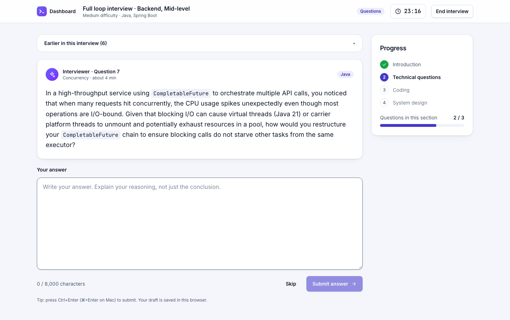
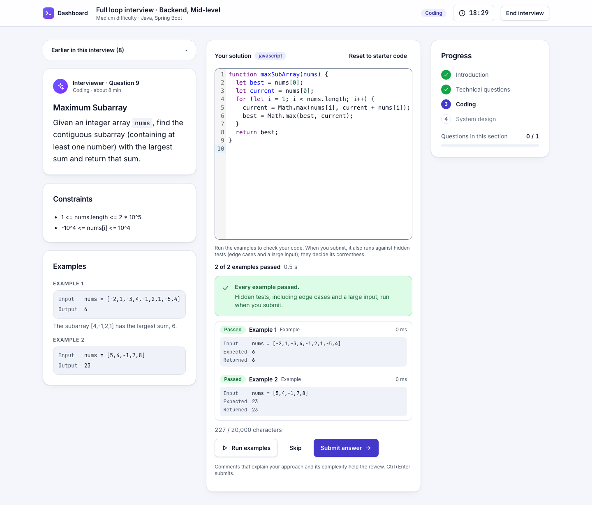
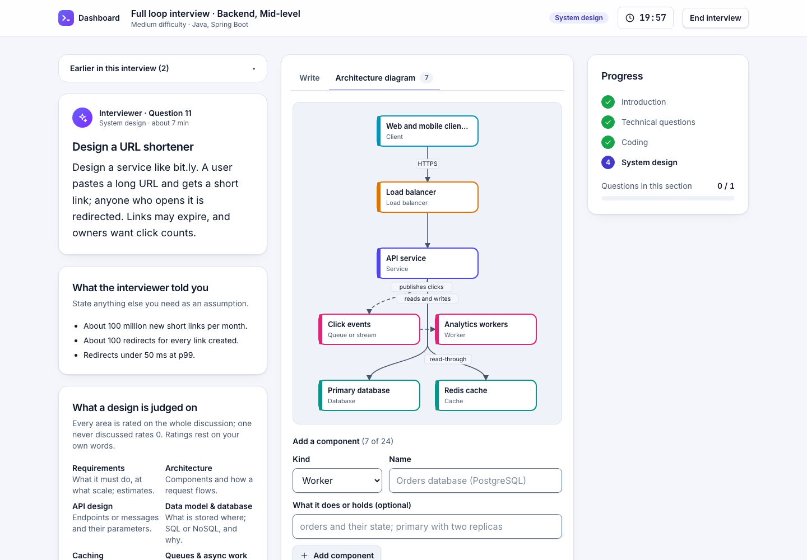
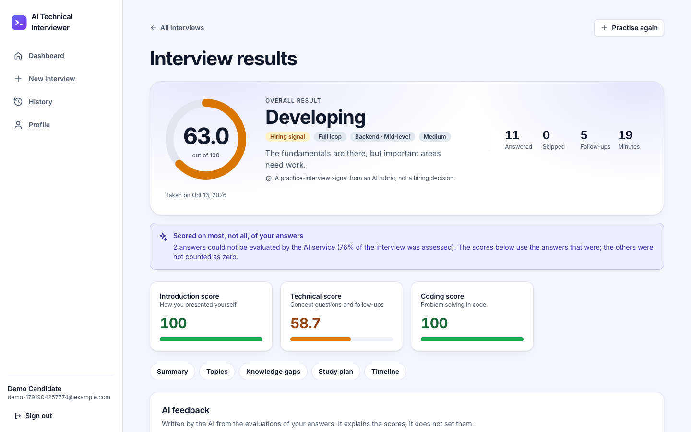
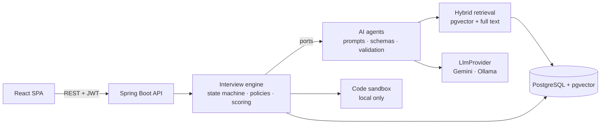

# AI Technical Interviewer

An adaptive mock-interview platform for software engineers. A candidate picks a role, skills and a format; an AI interviewer asks
technical questions, follows up on gaps, sets a coding problem that runs against hidden tests, discusses a system design, and writes
an evidence-backed report. Built with **Spring Boot 4 (Java 21), React 19, PostgreSQL + pgvector and Gemini** (Ollama locally).

The point of the project is the engineering around the model: **the LLM does language work, deterministic code makes every
decision.** Questions and evaluations are grounded in a curated knowledge base, every model output is schema-validated and
verified, scores are computed in Java, and the AI is measured against labelled datasets.

| Interview | Coding (hidden tests in a sandbox) |
|---|---|
|  |  |
| **System design (write-up + architecture diagram)** | **Report** |
|  |  |

## What a candidate gets

1. **Setup:** role, level, difficulty, length (15–90 minutes), format (technical, coding, system design or a full loop), one to six
   of nine technologies, an interview approach (fundamentals first by default, balanced, résumé-focused, or custom shares), and
   optionally a résumé for the questions about the candidate's own projects.
2. **A live interview** with a server-side clock, run the way IT-services interviews are: an introduction, then the **fundamentals of
   every chosen technology** ("How does HashMap handle collisions?", "What makes a React component re-render?"), then **practical
   scenarios and debugging**, then **the candidate's own projects**. Questions adapt after every answer: a strong answer is taken
   one level deeper on the same subject, a half-right one gets a follow-up on the missing point.
3. **Coding:** a problem from a bank of 13, an editor, "Run examples"; on submit, hidden tests (edge cases, a large input) decide
   correctness where code execution is enabled (locally), and the model reviews complexity, edge cases and readability.
4. **System design:** a realistic product (URL shortener, chat, payments, …), a write-up and an architecture diagram; the interviewer
   probes the weakest dimension ("what happens at 100x traffic?").
5. **A report:** scores per skill, section and assessment area (fundamentals, practical application, problem solving, project depth,
   communication) with the share of the score each area carries and what was not assessed; every answer's feedback with the criteria,
   missed concepts, misconceptions, a study plan with further reading from the knowledge base, and a recommendation, which weak
   fundamentals cap however good the project answers were. Scores and recommendation are computed, not generated.

## How the GenAI parts work

| | What it is here | Read more |
|---|---|---|
| **Agents** | Five bounded agents (question, follow-up, evaluator, report narrator, résumé extractor), each one versioned prompt + one JSON Schema + one validator. A pure-Java engine composes them; no agent chooses what happens next | [AI_ARCHITECTURE.md §1](AI_ARCHITECTURE.md) |
| **RAG** | 48 curated documents over 16 technologies, chunked and embedded into pgvector; hybrid retrieval (vector + full-text, reciprocal rank fusion) grounds questions, evaluations and the report; citations are verified | [RAG_ARCHITECTURE.md](RAG_ARCHITECTURE.md) |
| **Structured outputs** | Hand-written schemas narrowed per request, constrained decoding on Gemini and Ollama, strict parsing, semantic checks (quotes must be in the answer), one repair attempt | [AI_ARCHITECTURE.md §5](AI_ARCHITECTURE.md) |
| **Adaptive questioning** | Stage (fundamentals, practical, project), question type, topic, difficulty, follow-up and pacing decided by deterministic policies from the validated ratings; a curated bank of 209 question templates gives the generator its angle; each turn's reasons are stored | [AI_ARCHITECTURE.md §2.9, §2.15](AI_ARCHITECTURE.md) |
| **Model abstraction** | `LlmProvider` / `EmbeddingProvider` over plain REST (no AI SDK); a router maps each task to a provider, model and time budget from configuration | [AI_ARCHITECTURE.md §7](AI_ARCHITECTURE.md) |
| **Prompt engineering** | Prompts are versioned files; untrusted text is fenced and redacted; every call records its prompt version, tokens, latency and retrieved chunks | [AI_ARCHITECTURE.md §4](AI_ARCHITECTURE.md) |
| **AI evaluation** | Labelled sets for answers (40), designs, retrieval (78 queries), duplicates and résumés; live runners with pass criteria; simulated candidates | [EVALUATION.md](EVALUATION.md) |
| **AI safety** | Injection redaction and flags, scores computed in Java, rating caps, prompt-echo rejection, no tools; an adversarial suite with a model that obeys the candidate | [SECURITY.md §5](SECURITY.md) |



## Status, honestly

- **Built and tested:** everything above. 2,769 backend unit tests, 1,259 integration tests against real PostgreSQL (Testcontainers),
  300 frontend tests, all green on 2026-10-14; CI builds both Docker images. A full-loop interview was run end to end in a browser
  before release, and a fundamentals-first interview over the API on 2026-10-14 (EVALUATION.md).
- **Measured on a local 4B model only.** The evaluator passes 13 of 15 criteria on the labelled answers; its main weakness is
  inventing mistakes in correct answers (36 %). **Gemini, the production model, has not been measured**: a free-tier key allowed only a smoke test and the résumé set on `gemini-3.5-flash-lite` (both passed, after a schema fix; EVALUATION.md).
- **Deployment** is prepared for Cloudflare Pages + Cloud Run + Neon, or one machine with Docker Compose; the self-hosted stack was
  run locally, the hosted commands were not.
- **Not built:** an admin UI, a per-user token budget, streaming responses, code execution in production (the sandbox is local only).

| Document | What is in it |
|---|---|
| [PROJECT_SUMMARY.md](PROJECT_SUMMARY.md) | The project in two pages: decisions, challenges, limitations, talking points |
| [ARCHITECTURE.md](ARCHITECTURE.md) | System design, state machine, security and deployment architecture, change log |
| [AI_ARCHITECTURE.md](AI_ARCHITECTURE.md) | Agents, prompts, structured outputs, adaptive engine, evaluation and safety design |
| [RAG_ARCHITECTURE.md](RAG_ARCHITECTURE.md) | Knowledge base, chunking, embeddings, hybrid retrieval, measurements |
| [EVALUATION.md](EVALUATION.md) | How the AI is measured and the latest results |
| [SECURITY.md](SECURITY.md) | Threat model, findings, fixes, accepted risks |
| [API_DESIGN.md](API_DESIGN.md) · [DATABASE_SCHEMA.md](DATABASE_SCHEMA.md) · [IMPLEMENTATION_PLAN.md](IMPLEMENTATION_PLAN.md) | REST API, schema, build plan |

| Layer | Technology |
|---|---|
| Frontend | React 19, TypeScript, Vite, Tailwind CSS 4, React Router, TanStack Query, CodeMirror 6 |
| Backend | Java 21, Spring Boot 4.1, Maven (wrapper), Spring Security (JWT), JPA/Hibernate, Flyway, springdoc OpenAPI |
| Database | PostgreSQL 17 + pgvector (Docker Compose locally, Neon in the cloud) |
| AI | Gemini (production) or Ollama (local) through a provider abstraction; no AI SDK (REST + Jackson) |

---

## Prerequisites

| Tool | Version | Check | Notes |
|---|---|---|---|
| Docker Desktop | current, with Compose v2 | `docker compose version` | Runs PostgreSQL and the integration tests. |
| JDK | 21 | `java -version` | Maven is **not** needed: the project ships the Maven wrapper (`./mvnw`). |
| Node.js | 22.22+, 24.15+ or 26+ (even-numbered releases) | `node -v` | pnpm refuses to install on an older Node (`engine-strict`). |
| pnpm | 12 (pinned in `frontend/package.json`) | `pnpm -v` | Install with `npm install -g pnpm`. |

You do **not** need a local PostgreSQL, Maven, Redis or a Gemini key to run the application locally.

For a deployment (see *Deployment*) you also need, depending on the option: a [Gemini API key](https://aistudio.google.com/apikey); for the hosted option, accounts at [Neon](https://neon.tech), [Google Cloud](https://cloud.google.com/run) (with the `gcloud` CLI) and [Cloudflare](https://pages.cloudflare.com) (its `wrangler` CLI runs through `npx`), and `psql` for one setup step; for the self-hosted option, a Linux machine with Docker and a domain name pointing at it.

**If `docker` is not found** (Docker Desktop is installed but its CLI is not on your PATH), add it and reopen the terminal:

```bash
echo 'export PATH="$PATH:/Applications/Docker.app/Contents/Resources/bin"' >> ~/.zshrc
```

Docker Desktop must be running (whale icon in the menu bar) before you start the database.

---

## Run it locally

Run everything from the repository root unless a step says otherwise.

**1. Create your local configuration**

```bash
cp .env.example .env
```

The defaults work as they are. `.env` is git-ignored. If you change `POSTGRES_PASSWORD`, do it before the first `docker compose up` (see Troubleshooting) and use only letters, digits, `.`, `_` and `-`: the file is read by two parsers (Docker Compose and Spring) that disagree about `\`, `$`, `#` and quotes.

**2. Start PostgreSQL + pgvector**

```bash
docker compose up -d
docker compose ps
```

Wait until the `db` service shows `healthy` (a few seconds). The first run downloads the `pgvector/pgvector:pg17` image.

**3. Start the backend** (new terminal)

```bash
cd backend
./mvnw spring-boot:run -Dspring-boot.run.profiles=local
```

The first run downloads Maven and the dependencies. Flyway creates the whole schema on startup. The backend is ready when you see `Started TechInterviewerApplication`.

With the `local` profile you do not need to configure anything for authentication: the backend generates a throw-away signing key (and logs a warning), so logins stop working after a restart. Any other profile, and any real deployment, needs `JWT_SECRET` in `.env` (generate one with `openssl rand -base64 48`).

**4. Start the frontend** (another terminal)

```bash
cd frontend
pnpm install
pnpm dev
```

**5. Open the app**

| What | URL |
|---|---|
| Web app (shows live backend and database status) | http://localhost:5173 |
| Health endpoint | http://localhost:8080/api/v1/health |
| Swagger UI (local profile only) | http://localhost:8080/swagger-ui.html |
| OpenAPI document (local profile only) | http://localhost:8080/v3/api-docs |
| Liveness / readiness | http://localhost:8080/actuator/health/liveness, `/actuator/health/readiness` |

Quick check from the terminal:

```bash
curl -s localhost:8080/api/v1/health
# {"status":"UP","service":"tech-interviewer","version":"0.1.0-SNAPSHOT","serverTime":"...","database":"UP"}
```

**Stop everything:** `Ctrl+C` in the backend and frontend terminals, then `docker compose down` (add `-v` to also delete the database data).

**Turn on the AI layer** (optional; without it the interview runs but every AI step answers "unavailable")

- With Gemini (the production provider):
  1. Create a key at https://aistudio.google.com/apikey. Never paste it into a source file, a commit, an issue or the frontend.
  2. Copy `.env.example` to `.env` (git-ignored) and set `AI_ENABLED=true` and `GEMINI_API_KEY=<your key>`. The key is read only by the backend, which makes every Gemini call server-side; the browser never sees it and the `VITE_*` variables must not hold it.
  3. Optional: `GEMINI_MODEL` (questions, evaluation, report; default `gemini-3.8-flash`) and `GEMINI_FAST_MODEL` (follow-ups; default `gemini-3.5-flash-lite`) choose the models. Per-task settings (temperature, output tokens, thinking level, time budget) live under `app.ai.routes` in `application.yml`.
  4. Start the backend as in step 3. On a free-tier key Gemini may answer `429` (quota) or `503` (high demand); the backend retries with backoff within each task's time budget, and the interview shows "AI unavailable, try again" if it still fails.
- With a local model: install [Ollama](https://ollama.com), run `ollama pull qwen3.5:4b && ollama pull embeddinggemma`, and start the backend with both profiles: `./mvnw spring-boot:run -Dspring-boot.run.profiles=local,local-ollama`. A 4B model on a laptop takes 10 to 50 seconds per model call, so a turn (evaluation plus the next question) takes 25 to 80 seconds, and a long system design can exceed the evaluation's time budget (the answer then stays pending and is retried when the interview ends). The local model is for development: its evaluations have measured weaknesses (it invents mistakes in about a third of correct answers; see [EVALUATION.md](EVALUATION.md)), and Gemini has not been measured yet.

If the layer is on but cannot work (no key, a route to a provider that is not configured), the backend refuses to start and lists every problem. Every model call is recorded in the `llm_calls` table (task, model, prompt version, status, tokens, latency, and the knowledge chunks the prompt contained).

**Code execution** (on in the `local` profile when Docker runs; off otherwise): coding solutions in Java, JavaScript and TypeScript are run against the problem's tests in a throw-away container per run (no network, read-only file system, unprivileged user, no capabilities, 512 MB, 1 CPU, 128 processes, time and output limits). At startup the backend pulls `eclipse-temurin:21-jdk-alpine` and `node:24-alpine` when they are missing (or run `docker pull` yourself first). `CODE_EXECUTION_ENABLED=false` turns it off, `DOCKER_COMMAND` points to the Docker CLI when it is not on the `PATH`, and `SANDBOX_RUNTIME=runsc` uses gVisor where it is installed. Without execution, "Run examples" is unavailable and solutions are reviewed by the AI with their correctness capped as unverified. **Do not expose code execution to untrusted users with Docker's default runtime**: containers share the host kernel and the backend needs a Docker daemon; see [AI_ARCHITECTURE.md §2.11](AI_ARCHITECTURE.md).

**System design interviews** need nothing extra. A design problem comes from a curated bank of nine realistic products (URL shortener, chat, food delivery, payments, video streaming, social feed and others) with the facts an interviewer gives up front; the candidate writes the design and builds an architecture diagram next to it. The interview engine then probes the dimension where the design loses the most weighted points (caching, failure handling, "what happens at 100x traffic?", …), and the design is rated on thirteen dimensions, each resting on quotes of the candidate's own words. `app.interview.max-design-probes` (default 4) bounds the probes; see [AI_ARCHITECTURE.md §2.12](AI_ARCHITECTURE.md).

**Résumé-aware interviews** need the AI layer. On the profile page a candidate uploads a résumé (PDF, Word `.docx` or text, at most 2 MB); its type is decided from the content, contact details and lines addressed to the AI are removed, a model extracts the positions, years of experience, technologies, skills, domains, projects, responsibilities and achievements, and the server keeps only what the résumé's own words support. The file and its text are not stored. With "Personalise with my résumé" on the setup page, the planner links the experiences to the interview's topics through a curated vocabulary and the engine anchors the questions of the project stage on them (after the fundamentals and the practical questions; most of the interview with the résumé-focused approach), each experience once ("Can you explain how you handled message delivery guarantees in the Kafka-based system you implemented?"); the server checks that the question invents no technology or figure. See [AI_ARCHITECTURE.md §2.13](AI_ARCHITECTURE.md).

**Knowledge base (RAG).** With the AI layer on, RAG is on too (`RAG_ENABLED=false` switches it off). At startup the backend loads the 48 curated documents of `backend/src/main/resources/knowledge-base/` into PostgreSQL, splits them into about 230 chunks and embeds them with Gemini `gemini-embedding-2` (or `embeddinggemma` in the `local-ollama` profile). The first startup makes a few embedding calls; later startups only compare content hashes and call no model. If the embedding model is unavailable, the chunks are still stored and found by keyword, and they are embedded at the next startup. To add material, put a Markdown file with front matter in the folder of its technology (format in [RAG_ARCHITECTURE.md §3](RAG_ARCHITECTURE.md)) and restart. The startup log reports what changed: `Knowledge base: 48 created, … 0 malformed; 228 chunks embedded …`.

**How the interview is structured.** The technical questions run in stages: the fundamentals of every chosen technology first (concepts and internals, without the résumé), then practical scenarios and debugging, then the candidate's own work. The approach chosen on the setup page sets each stage's share (fundamentals first 60/25/15 by default, balanced 40/30/30, résumé-focused 20/20/60, or custom); a curated question bank (`backend/src/main/resources/question-bank`, 209 templates over 41 topics) gives each question its angle, and the model words it at the decided level. The report shows how much of the score each area carries, and caps the recommendation at Developing when the fundamentals are weak. Details: [AI_ARCHITECTURE.md §2.15](AI_ARCHITECTURE.md).

**How the interview adapts.** There is no question list. After every answer the engine updates what it knows about the candidate (per-topic and overall level, strengths, weaknesses, misconceptions, coverage, time left) and decides the next step: a strong answer raises the level of the next question, a weak one lowers it, a half-right one gets a targeted follow-up on the missing point; skills take turns so every skill is asked before any is asked twice; follow-ups never use the time kept for skills not asked yet or for later sections; near the end only gap probes remain, and a question that could not be answered in the time left is not started. Every generated question is embedded and compared with the earlier ones, and an answer that repeats an earlier answer is not followed up. Each turn stores its reasons (performance, difficulty, follow-up rule, next step, time) with the state transition. Details: [AI_ARCHITECTURE.md §2.9](AI_ARCHITECTURE.md).

---

## Try the API

Open Swagger UI at http://localhost:8080/swagger-ui.html (local profile), or use curl. The whole candidate journey, against a running backend:

```bash
B=localhost:8080/api/v1
# 1. Register (the refresh token travels in an HttpOnly cookie; the access token is in the body)
TOKEN=$(curl -s -c /tmp/jar -X POST $B/auth/register -H 'Content-Type: application/json' \
  -d '{"email":"ada@example.com","password":"correct-horse-battery","displayName":"Ada"}' | python3 -c 'import sys,json; print(json.load(sys.stdin)["accessToken"])')
AUTH="Authorization: Bearer $TOKEN"
# 2. Choose what to be interviewed on, then create and start the interview
CONFIG=$(curl -s -X POST $B/interview-configurations -H "$AUTH" -H 'Content-Type: application/json' \
  -d '{"role":"BACKEND","experienceLevel":"MID","skills":["java","spring-boot"],"difficulty":"MEDIUM","durationMinutes":30,"interviewType":"TECHNICAL"}')
INTERVIEW=$(curl -s -X POST $B/interviews -H "$AUTH" -H 'Content-Type: application/json' \
  -d "{\"configurationId\":\"$(echo $CONFIG | python3 -c 'import sys,json; print(json.load(sys.stdin)["id"])')\"}" | python3 -c 'import sys,json; print(json.load(sys.stdin)["id"])')
curl -s -X POST $B/interviews/$INTERVIEW/start -H "$AUTH"      # state INTRODUCTION with the first question
```

Then answer with `POST /interviews/{id}/answers` (`{"questionId":"...","content":"..."}`); with the AI layer on, each answer is evaluated and the response carries the next question, a follow-up when the answer left a gap. To end the interview call `POST /interviews/{id}/finish` with a JSON body (`-H 'Content-Type: application/json' -d '{"reason":"CANDIDATE_ENDED"}'`; a call without a body answers `415`), then read the report with `GET /interviews/{id}/report`.

Without the AI layer only the introduction question exists: after you answer it the interview reports `awaitingNextQuestion` and `POST .../questions/next` answers `503 AI_PROVIDER_UNAVAILABLE`; at `finish` each pending answer is tried three times (about six seconds in all), then given up, and the report has `outcome: INCONCLUSIVE`, no score and no recommendation, and lists the answers that could not be assessed. The endpoint reference is [API_DESIGN.md](API_DESIGN.md).

---

## Tests and quality checks

```bash
# Backend (from backend/)
./mvnw test        # about 2,690 unit tests, no Docker and no AI provider needed
./mvnw verify      # unit + about 1,250 integration tests; integration tests start PostgreSQL + pgvector with Testcontainers, so Docker must be running (a few minutes);
                   # CodeSandboxIT runs candidate code in real sandbox containers and pulls eclipse-temurin:21-jdk-alpine and node:24-alpine once
# Optional, against real models (Ollama on localhost, and/or GEMINI_API_KEY in the environment):
./mvnw test -Dexcluded.test.groups= -Dgroups=live -Dtest=LiveProviderSmokeTest       # every AI agent once
./mvnw verify -Dexcluded.test.groups= -Dgroups=live -Dtest=NoSuchTest -Dsurefire.failIfNoSpecifiedTests=false \
  -Dit.test='RetrievalQualityLiveIT,GroundedAgentsLiveIT'                            # retrieval quality and grounded agents (ollama pull embeddinggemma)
./mvnw test -Dexcluded.test.groups= -Dgroups=live -Dtest=QuestionDuplicatesLiveTest  # question de-duplication threshold for the embedding model
./mvnw test -Dexcluded.test.groups= -Dgroups=live -Dtest=AnswerEvaluationLiveTest    # the answer evaluator on the labelled answers; writes
                                                                                     # ai-evals/reports/ (LIVE_EVAL_PROVIDER=gemini, LIVE_EVAL_REPEATS=2)
./mvnw test -Dexcluded.test.groups= -Dgroups=live -Dtest=DesignEvaluationLiveTest    # the system design evaluator on its labelled designs
./mvnw test -Dexcluded.test.groups= -Dgroups=live -Dtest=ResumeExtractionLiveTest    # the résumé extractor and verifier on labelled résumés

# Frontend (from frontend/)
pnpm lint
pnpm format:check
pnpm typecheck
pnpm test
pnpm build
```

Security is reviewed in [SECURITY.md](SECURITY.md) (findings, fixes, accepted risks, how to check); its regression tests include an authorization matrix over every route, an adversarial prompt-injection suite that runs the real AI agents against a model that obeys the candidate, and a scan that fails the build when a credential is committed. Backend tests named `*Test` are unit tests (surefire); tests named `*IT` need Docker (failsafe). Tests never read your `.env`, never touch the development database and never call a real AI provider (except the opt-in `live` test above). The interview flows are tested end to end through HTTP with scripted stand-ins for the three AI steps (they live under `src/test` only), including a seeded simulation (`TurnSimulationIT`) of complete interviews of every type and duration with random answer quality, skips and outages. The adaptive behaviour is pinned by scripted candidates played through the engine (`AdaptiveInterviewScenarioTest`: strong, weak, mixed, repeated answers, little time, topic imbalance, follow-ups, difficulty changes). The AI layer itself is tested with a scripted provider, against local HTTP endpoints that speak the Gemini and Ollama formats, and in a whole interview (`AiInterviewFlowIT`) through the real Ollama provider against a test double of a model that also embeds (deterministic word hashing), so retrieval runs for real over pgvector. Retrieval quality is measured on the labelled set `ai-evals/datasets/retrieval.jsonl` in every build (`RetrievalQualityIT`) and with a real embedding model on demand; results are in [RAG_ARCHITECTURE.md §12](RAG_ARCHITECTURE.md). The scoring rules are pinned per answer category with scripted model output (`AnswerScorerTest`), and the real evaluator is measured on `ai-evals/datasets/answer-evaluation.jsonl` (and the design evaluator on `design-evaluation.jsonl`, the résumé extractor on `resume-extraction.jsonl`) on demand; method and results are in [ai-evals/ANSWER_EVALUATION.md](ai-evals/ANSWER_EVALUATION.md).

When the backend API changes, regenerate the frontend's TypeScript types while the backend is running: `cd frontend && pnpm gen:api`.

---

## Configuration

All configuration lives in the single root `.env` file, read by Docker Compose, the Spring Boot backend (when started from `backend/`) and Vite. Only `VITE_*` keys are exposed to the browser. See [.env.example](.env.example) for every key.

- The Spring profile is chosen on the command line (`-Dspring-boot.run.profiles=local`), **not** in `.env`: a key inside the imported file is not an environment variable. Without a profile the app runs with production-like defaults (no Swagger UI, restrictive CORS).
- `POSTGRES_PASSWORD` has no default: the backend and Compose both need it from `.env`, and the backend stops at startup with a message that names the missing variable.
- `SERVER_PORT` changes the backend port; the Vite proxy and `pnpm gen:api` follow it (restart `pnpm dev` after changing it, because the dev server reads `.env` only at startup). `VITE_DEV_API_PROXY_TARGET` overrides the proxy target only when it is not blank.
- `JWT_SECRET` has no default: outside the local profile the backend stops at startup with a message that names `JWT_SECRET` and the `openssl` command; the local profile generates a throw-away key and logs a warning. Degenerate values (all zeros, fewer than 32 bytes, not base64) are refused.
- Request limits are in `application.yml` under `app.limits` (largest request body: 256 KiB, 16 KiB on the public auth endpoints) and `app.rate-limit` (auth 10 per minute per IP, answers 20 per minute per user, code runs 10 per minute per user, other writes 60 per minute per user, 10 interviews per UTC day per user). Limits are per backend process.
- Answers the AI layer cannot evaluate are retried and then given up, not scored zero (`application.yml`, `app.evaluation`): `max-attempts` (3), `backoff-initial` (2s, doubled each time), `backoff-max` (10s), `attempt-lease` (90s) and `min-coverage` (0.70): when a smaller share of the intended assessment weight could be assessed, the report is `INCONCLUSIVE` (no score, no recommendation); otherwise it is `PARTIAL` and lists the answers it left out.
- Scoring is configured under `app.evaluation.scoring` in `application.yml`: the base weight tables per evaluator (built in, replaceable under `weights`) and a profile per skill (`skills.<slug>`: focus areas for the evaluator and weight tables that replace the base ones for questions on that skill; a coding answer uses the profile of its language). Every table must name exactly its evaluator's criteria and add up to 1, or the backend refuses to start; the tables in use are logged at startup.
- Code execution is configured under `app.execution`: `enabled` (`CODE_EXECUTION_ENABLED`), `docker-command` (`DOCKER_COMMAND`), `runtime` (`SANDBOX_RUNTIME`), `max-concurrent` (2), `queue-timeout` (15s), `run-timeout` (30s), `memory-mb` (512), `cpus` (1.0), `pids-limit` (128), `max-output-bytes` (1 MB) and the two images (`SANDBOX_JAVA_IMAGE`, `SANDBOX_NODE_IMAGE`). The problems are files in `backend/src/main/resources/coding-problems/`, validated at startup.
- The AI layer is configured under `app.ai` in `application.yml`: `enabled` (`AI_ENABLED`), the providers (`GEMINI_API_KEY`, `GEMINI_MODEL`, `GEMINI_FAST_MODEL`; `OLLAMA_ENABLED`, `OLLAMA_BASE_URL`) and one route per task (provider, model, temperature, output tokens, thinking level and a time budget for the whole operation, retries included). The answer-evaluation budget must stay below `app.evaluation.attempt-lease`. Prompts are versioned files in `src/main/resources/prompts/`, output schemas in `src/main/resources/schemas/`.
- RAG is configured under `app.rag`: `enabled` (`RAG_ENABLED`), the embedding model (`GEMINI_EMBEDDING_MODEL`; `OLLAMA_EMBEDDING_MODEL` in the `local-ollama` profile), batch size, timeouts (the query-embedding timeout plus the answer-evaluation budget must stay below the attempt lease) and the retrieval settings, including `min-similarity` (`RAG_MIN_SIMILARITY`), which depends on the embedding model (see RAG_ARCHITECTURE.md §12), and the question de-duplication threshold `deduplication.min-similarity` (`RAG_DEDUP_MIN_SIMILARITY`; measured: 0.90 for `gemini-embedding-2`, 0.80 for `embeddinggemma`).
- Production uses `SPRING_PROFILES_ACTIVE=prod` as a real environment variable (JSON logs, no Swagger UI, the AI layer on, TLS to the database) and must set `JWT_SECRET`, `APP_CORS_ALLOWED_ORIGINS` and `GEMINI_API_KEY`; the variables are listed under *Deployment*. The backend trusts `X-Forwarded-For` only from proxies on private, loopback and link-local addresses, which covers Cloud Run, Fly, Render and a Docker network; a proxy on a public address must be listed in `SERVER_TOMCAT_REMOTEIP_INTERNAL_PROXIES` (a regular expression), or every client shares its address for the per-IP limits.

---

## Docker

| File | What it is |
|---|---|
| `docker-compose.yml` | Local development: PostgreSQL 17 + pgvector only (the backend and the frontend run on your machine). |
| `backend/Dockerfile` | The backend image: built with the Maven wrapper (tests run in CI, not here), dependencies in their own layer, a JRE 21 runtime, an unprivileged user, the `prod` profile by default, a health check on `/actuator/health/liveness`. About 580 MB. |
| `frontend/Dockerfile` | The web image for the self-hosted option: the built app served by Caddy, which also proxies `/api` to the backend. About 90 MB. For a static host, deploy `frontend/dist/` instead. |
| `docker-compose.prod.yml` | The self-hosted production stack: `db`, `backend` and `web` on one machine (Option B below). |

```bash
docker build -t tech-interviewer-backend backend/
docker build -t tech-interviewer-web frontend/
```

The backend image has no Docker CLI, so candidate code is not executed in it (`CODE_EXECUTION_ENABLED=false`: coding answers are reviewed by the AI and their correctness is capped as unverified). Running candidate code in production needs a separate, isolated runner ([AI_ARCHITECTURE.md §2.11](AI_ARCHITECTURE.md)). On Apple Silicon, `docker build` makes an arm64 image; a cloud platform usually needs amd64: build there (`gcloud run deploy --source`) or use `docker buildx build --platform linux/amd64`.

---

## Deployment

Two low-cost options. Both use PostgreSQL with pgvector, Gemini, and no Redis (one backend instance keeps its rate limits in memory, ARCHITECTURE.md §8.1).

| | Option A: hosted (recommended) | Option B: self-hosted |
|---|---|---|
| Frontend | Cloudflare Pages (static) | Caddy container |
| Backend | Google Cloud Run (container, scales to zero) | backend container |
| Database | Neon (PostgreSQL + pgvector) | pgvector container |
| Cost at portfolio scale | $0 on the free tiers, plus Gemini: its free tier is too small for a whole interview (see *Gemini*) | the machine (an always-free cloud VM works), plus Gemini |
| You maintain | nothing but the configuration | the machine, its updates and backups |

### Environment variables

The backend reads these in production (the full list with comments is in [.env.example](.env.example); [.env.production.example](.env.production.example) is the template for Option B). Secrets go into the platform's secret store or `.env.production`, never into a file in the repository.

| Variable | Required | Meaning |
|---|---|---|
| `SPRING_PROFILES_ACTIVE` | yes | `prod` (the default of the backend image) |
| `JWT_SECRET` | yes, secret | signs access tokens: `openssl rand -base64 48` |
| `APP_CORS_ALLOWED_ORIGINS` | yes | the app's origin(s), comma-separated, e.g. `https://interviewer.pages.dev` (no path, no wildcard) |
| `POSTGRES_HOST`, `POSTGRES_PORT`, `POSTGRES_DB` | yes, or `JDBC_DATABASE_URL` | where the database is; port defaults to 5432 |
| `JDBC_DATABASE_URL` | alternative | a full JDBC URL without credentials, e.g. `jdbc:postgresql://<host>/<db>?sslmode=require`; replaces the three above. Leave it unset otherwise (an empty value is not "unset") |
| `POSTGRES_USER`, `POSTGRES_PASSWORD` | yes, password secret | the role that owns the schema and runs the migrations |
| `POSTGRES_APP_USER`, `POSTGRES_APP_PASSWORD` | recommended, password secret | the restricted role the application connects as (rows only); the `prod` profile refuses a superuser |
| `POSTGRES_SSLMODE` | no | `require` in `prod` (default); `disable` only on a private network |
| `GEMINI_API_KEY` | yes (with the AI layer), secret | the Gemini key; only the backend reads it |
| `GEMINI_MODEL`, `GEMINI_FAST_MODEL`, `GEMINI_EMBEDDING_MODEL` | no | models: `gemini-3.8-flash` (questions, evaluation, report), `gemini-3.5-flash-lite` (follow-ups), `gemini-embedding-2` |
| `AI_ENABLED`, `RAG_ENABLED` | no | `true` in `prod` |
| `APP_REFRESH_COOKIE_SAME_SITE` | depends | `Lax` (default) when the app and the API share a site; `None` when they are on two sites (see below) |
| `PORT` / `SERVER_PORT` | no | the platform's `PORT` is used; 8080 otherwise |
| `VITE_API_BASE_URL` | build time, frontend | the API's URL when it is on another origin (Option A); empty when it shares the app's origin (Option B). Public: never put a secret in a `VITE_` variable |

**One site or two.** The refresh cookie keeps a candidate signed in across reloads. With the app on `*.pages.dev` and the API on `*.run.app`, the two are different sites and the cookie is a third-party cookie: set `APP_REFRESH_COOKIE_SAME_SITE=None`, which works in Chrome, Edge and Firefox (checked in Chrome: with the default `Lax`, every reload signs the user out). **Safari blocks third-party cookies**, so Safari users are signed out at each reload. The fix is a custom domain with the app and the API on sibling subdomains (`app.example.com`, `api.example.com`): one site, so keep `Lax`. Option B serves both from one origin and needs nothing.

### Gemini

1. Create a key at https://aistudio.google.com/apikey. It is a backend secret: Cloud Run's secret store or `.env.production`, never the frontend.
2. The models are configuration (`GEMINI_MODEL`, `GEMINI_FAST_MODEL`, `GEMINI_EMBEDDING_MODEL`); per-task temperature, output tokens, thinking level and time budget are under `app.ai.routes` in `application.yml`.
3. The free tier has per-minute and per-day limits: on 2026-10-18 they were 5 requests a minute and 20 a day per model, while one interview makes dozens of calls (a question, an evaluation and often a follow-up per answer, then the report). So a free key runs out within the first interview; use a key with billing enabled. A rate-limited call waits as long as Gemini asks (its `retryDelay`) when that fits the task's time budget, otherwise the candidate sees "AI unavailable, try again"; nothing is lost and the interview catches up. On the free tier Google may use the prompts to improve its products (SECURITY.md R-11).
4. At its first start the backend embeds the knowledge base (about 230 chunks, a few calls). A wrong key does not stop the backend: it logs `Embedding the knowledge base stopped ... API key not valid`, retrieval falls back to keywords, and every AI step answers "unavailable" until the key is fixed.
5. The retrieval threshold (`RAG_MIN_SIMILARITY`, 0.30) was measured for `embeddinggemma`, not yet for `gemini-embedding-2`; the de-duplication threshold for Gemini (0.90) was measured (RAG_ARCHITECTURE.md §12).

### Option A: Neon + Cloud Run + Cloudflare Pages

**1. Database (Neon).** Create a project (choose a region near the Cloud Run region). From its connection details note the host (the direct one, not `-pooler`: the migrations take an advisory lock), the database name and the owner role. Create the application's restricted role and its grants once, as the owner:

```bash
OWNER_URL='postgresql://<owner>:<owner-password>@<host>/<db>?sslmode=require'
APP_PASSWORD=$(openssl rand -hex 24)
psql "$OWNER_URL" -c "CREATE ROLE interviewer_app LOGIN PASSWORD '$APP_PASSWORD' NOSUPERUSER NOCREATEDB NOCREATEROLE"
psql "$OWNER_URL" -v app_user=interviewer_app -f backend/src/main/resources/db/ops/runtime-grants.sql
```

The backend creates the extensions (`vector`, `citext`) and the schema itself at its first start.

**2. Secrets (Google Cloud Secret Manager).**

```bash
gcloud config set project <your-project>
printf %s "$(openssl rand -base64 48)" | gcloud secrets create jwt-secret --data-file=-
printf %s '<gemini key>'               | gcloud secrets create gemini-api-key --data-file=-
printf %s '<owner password>'           | gcloud secrets create db-owner-password --data-file=-
printf %s "$APP_PASSWORD"              | gcloud secrets create db-app-password --data-file=-
# Let Cloud Run's runtime service account read them (the default compute account unless you chose another):
for s in jwt-secret gemini-api-key db-owner-password db-app-password; do
  gcloud secrets add-iam-policy-binding $s --role roles/secretmanager.secretAccessor \
    --member "serviceAccount:$(gcloud projects describe <your-project> --format='value(projectNumber)')-compute@developer.gserviceaccount.com"
done
```

**3. Backend (Cloud Run).** Cloud Build builds `backend/Dockerfile` (amd64) and deploys it. The Pages address is known before the first deployment: `https://<pages-project>.pages.dev`.

```bash
gcloud run deploy tech-interviewer-api --source backend --region europe-west1 --allow-unauthenticated \
  --memory 1Gi --cpu 1 --min-instances 0 --max-instances 1 --cpu-boost --timeout 300 \
  --set-env-vars "SPRING_PROFILES_ACTIVE=prod,POSTGRES_HOST=<neon host>,POSTGRES_DB=<db>,POSTGRES_USER=<owner>,POSTGRES_APP_USER=interviewer_app,APP_CORS_ALLOWED_ORIGINS=https://<pages-project>.pages.dev,APP_REFRESH_COOKIE_SAME_SITE=None" \
  --set-secrets "JWT_SECRET=jwt-secret:latest,GEMINI_API_KEY=gemini-api-key:latest,POSTGRES_PASSWORD=db-owner-password:latest,POSTGRES_APP_PASSWORD=db-app-password:latest"
curl -s https://<service-url>/api/v1/health      # {"status":"UP",...,"database":"UP"}
```

`--max-instances 1` keeps the in-memory rate limits correct; `--min-instances 0` scales to zero (a cold start takes a few seconds; `--min-instances 1` removes it for a demo day, at a small cost); `--timeout 300` covers the longest AI step (the app waits up to 130 s).

**4. Frontend (Cloudflare Pages).** Build with the API's address and upload the result:

```bash
cd frontend
pnpm install --frozen-lockfile
VITE_API_BASE_URL=https://<service-url> pnpm build      # also writes dist/_headers with the API in the CSP's connect-src
npx wrangler pages deploy dist --project-name <pages-project>
```

Open `https://<pages-project>.pages.dev`, register, start an interview. Pages serves `index.html` for the app's routes and applies `dist/_headers` (security headers, long caching of the hashed assets). With a custom domain, add it to Pages and map `api.<domain>` to the Cloud Run service, then rebuild with the new `VITE_API_BASE_URL`, set `APP_CORS_ALLOWED_ORIGINS` to the app's new origin and `APP_REFRESH_COOKIE_SAME_SITE=Lax`, and redeploy the backend.

### Option B: one machine with Docker Compose

```bash
cp .env.production.example .env.production        # fill in every REQUIRED value; the file is git-ignored
docker compose -f docker-compose.prod.yml --env-file .env.production up -d --build
docker compose -f docker-compose.prod.yml --env-file .env.production ps     # db, backend, web: healthy / running
```

Always pass `--env-file .env.production`: without it Compose reads the development `.env`. `SITE_ADDRESS` is the domain (its DNS must point at the machine, ports 80 and 443 open): Caddy obtains and renews the certificate. The app and the API share that origin, so `VITE_API_BASE_URL` stays empty and the cookie stays `Lax`. To try the stack on your own machine first, set `SITE_ADDRESS=:80`, `APP_CORS_ALLOWED_ORIGINS=http://localhost` and open http://localhost. Updates: `git pull` and the same `up -d --build`; backups: `docker compose -f docker-compose.prod.yml exec db pg_dump -U interviewer interviewer > backup.sql`.

### Verified before release

On 2026-10-13, locally: both images build; the Option B stack starts with the example settings, serves the app with its security headers and client-side routes, proxies the API, signs up and stays signed in through a first-party cookie, connects as the restricted role, and runs AI turns end to end (routed to a local model: no Gemini key was available then; the first live Gemini calls, on 2026-10-18, found and fixed a schema Gemini refused, see EVALUATION.md); a wrong Gemini key leaves the backend healthy with a single warning; and in a real browser, an app and an API on two sites lose the session at every reload with `SameSite=Lax` and keep it with `None`. Option A's cloud commands were not run (no accounts were available).

---

## Project layout

```
.
├── docker-compose.yml        PostgreSQL + pgvector for local development
├── docker-compose.prod.yml   the self-hosted production stack (db, backend, web)
├── .env.example              every configuration key, with placeholders
├── .env.production.example   the production settings, all secrets empty
├── backend/                  Spring Boot application (com.techinterviewer); Dockerfile
│   ├── src/main/java/com/techinterviewer/
│   │   ├── common/           api conventions, problem+json errors, request correlation, ids, JSON/persistence base
│   │   ├── config/           typed configuration, OpenAPI, strict JSON, clock
│   │   ├── security/         JWT authentication, refresh rotation, rate and size limits, CORS, auth endpoints
│   │   ├── user/, profile/   accounts and candidate profiles
│   │   ├── catalog/          skills, topics and the interview options
│   │   ├── interview/        domain, engine (state machine, planner, policies), AI ports, services, REST API
│   │   ├── evaluation/       evaluations, scoring, report aggregation, report API
│   │   ├── coding/           coding problem bank, Docker sandbox, test harnesses and grading
│   │   ├── design/           system design problem bank and the probe scenarios of each design dimension
│   │   ├── resume/           résumé upload: parsing (PDF, .docx, text), verified profile, vocabulary linking it to topics
│   │   ├── ai/               AI layer: providers (Gemini, Ollama), routing, prompts, structured output, call log, agents
│   │   ├── rag/              knowledge base: corpus parsing, chunking, embeddings, ingestion, hybrid retrieval, context assembly,
│   │   │                     semantic de-duplication of questions
│   │   └── system/           health endpoint
│   └── src/main/resources/   db/migration (Flyway), prompts/ (versioned prompt templates), schemas/ (model output schemas),
│                             knowledge-base/ (curated RAG documents, one folder per technology),
│                             coding-problems/ and design-problems/ (curated problem banks, validated at startup),
│                             resume/vocabulary.json (technologies and keywords that link a résumé to the catalog)
├── ai-evals/                 AI evaluation: ANSWER_EVALUATION.md (method and results), datasets/ (retrieval, question
│                             duplicates, answer, design and résumé evaluation), baselines/ (recorded scorecards); live runs write
│                             reports/ (ignored)
├── frontend/                 React application (Vite); Dockerfile and deploy/Caddyfile for the self-hosted web server
│   └── src/{app,api,features,components,lib,test}   features: auth, landing, setup, interview, results, dashboard, history, profile
├── .github/workflows/ci.yml  backend and frontend CI, and the Docker images
└── *.md                      architecture and planning documents
```

API conventions (details in [API_DESIGN.md](API_DESIGN.md)): JSON under `/api/v1`, plain DTOs on success, RFC 9457 `application/problem+json` on every error the application sees, with a `code` and a `traceId`, and an `X-Request-Id` header on every response. Requests Tomcat rejects before the application runs, and refused CORS preflights, are the only exceptions.

---

## Database

The schema is owned by Flyway migrations in `backend/src/main/resources/db/migration`; Hibernate only validates and never generates DDL.

| Migration | Contents |
|---|---|
| V1 | `vector` and `citext` extensions |
| V2 to V8 | the core tables: identity, catalog, knowledge base + embeddings, profiles, interviews, evaluations and reports, LLM call log |
| V9 to V14 | the evaluation give-up policy, structured evaluation (criteria, knowledge gaps), coding test runs, system design (probes, diagrams), résumés, interview strategies (question types, templates, assessment areas) |
| `R__seed_catalog` | nine skills (Java, Spring Boot, PostgreSQL, System Design, React, TypeScript, JavaScript, REST APIs, Microservices), 41 topics and their weights; repeatable and idempotent |

Open a SQL shell: `docker compose exec db psql -U interviewer -d interviewer`

Rules: never edit a migration that has been applied (Flyway checksums it); add a new `V<n>__description.sql` instead. The full schema and ER diagram are in [DATABASE_SCHEMA.md](DATABASE_SCHEMA.md).

---

## Troubleshooting

| Symptom | Cause and fix |
|---|---|
| `docker: command not found` | Docker CLI not on PATH; see Prerequisites. |
| `Cannot connect to the Docker daemon` | Docker Desktop is not running. Start it and wait for it to finish starting. |
| `POSTGRES_PASSWORD` error from `docker compose` | `.env` is missing. Run `cp .env.example .env`. |
| Backend: `APPLICATION FAILED TO START` with `POSTGRES_PASSWORD is missing, blank or an unresolved placeholder` | The backend cannot see `.env`. Create it with `cp .env.example .env` in the repository root and start the backend from `backend/`. |
| Backend: `password authentication failed for user "interviewer"` | `.env` exists, but its password differs from the one PostgreSQL stored when the data volume was first created. Restore the original value, or reset the volume with `docker compose down -v && docker compose up -d` (this deletes local data). |
| Backend: `APPLICATION FAILED TO START` with `The JWT signing secret cannot be used: JWT_SECRET ...` | Set `JWT_SECRET` in `.env` (`openssl rand -base64 48`, at least 32 decoded bytes), or start with the local profile. |
| `413` with code `PAYLOAD_TOO_LARGE` | The request body is over the limit (16 KiB for `/auth/*`, 256 KiB elsewhere). Real requests are far smaller. |
| `429` with code `RATE_LIMITED` or `DAILY_INTERVIEW_LIMIT` | Wait for the number of seconds in the `Retry-After` header. The daily limit counts interviews per UTC day. |
| Backend: `Connection to localhost:5432 refused` | The database is not running or not healthy yet, or `POSTGRES_PORT` in `.env` differs from the port the container publishes. Run `docker compose ps`, wait for `healthy`, and restart the backend. |
| Port 5432 already in use | Another PostgreSQL is running. Set `POSTGRES_PORT=5433` in `.env`, then `docker compose up -d` again. |
| Port 8080 already in use | Stop the other process, or set `SERVER_PORT` in `.env` and restart both the backend and `pnpm dev` (the proxy follows it). |
| Port 5173 already in use (`Port 5173 is already in use`) | Stop the other process, or run `pnpm dev --port 5174`. Requests go through the Vite proxy and are same-origin, so no CORS setting needs to change. |
| The web app shows "Unreachable" | The backend is not running or not ready. Check steps 2 and 3 and the backend terminal. |
| Backend exits at startup with `app.cors.allowedOrigins[0] ... ${APP_CORS_ALLOWED_ORIGINS}` | The `prod` profile requires `APP_CORS_ALLOWED_ORIGINS` (for example `https://app.example.com`, no path, no wildcard). Set it in `.env` or the environment. |
| Browser CORS error | Only happens when the page calls the backend directly (`VITE_API_BASE_URL` is set) or in production. Add the page origin to `APP_CORS_ALLOWED_ORIGINS` and restart the backend. |
| `Migration checksum mismatch` | An applied migration was edited. Revert the edit and add a new migration. On a throwaway local database you can instead run `docker compose down -v`. |
| `./mvnw verify` fails with a Docker or Testcontainers error | Docker Desktop is not running. `./mvnw test` runs the unit tests without Docker. |
| Wrong Java version | `./mvnw` needs JDK 21: `/usr/libexec/java_home -V` lists what is installed, then `export JAVA_HOME=$(/usr/libexec/java_home -v 21)`. |
| Deployed: signed out after every page reload | The app and the API are on two sites and the refresh cookie is `SameSite=Lax`. Set `APP_REFRESH_COOKIE_SAME_SITE=None` on the backend, or serve both from one site (custom domain, or Option B). In Safari only a shared site works. |
| Deployed: backend exits with `same-site=None requires secure=true` | `SameSite=None` needs a `Secure` cookie; do not set `app.security.refresh-cookie.secure=false` in production. |
| Deployed: the browser blocks API calls (CORS or `connect-src`) | `APP_CORS_ALLOWED_ORIGINS` must hold the app's exact origin (`https://...`, no trailing slash), and the app must be built with the API's URL in `VITE_API_BASE_URL` (it also goes into the CSP of `dist/_headers`). Rebuild the frontend after changing it. |
| Deployed: `The application is connected to the database as the superuser ...` at startup | The `prod` profile refuses to run as a superuser. Create the restricted role (Option A step 1, or `POSTGRES_APP_USER` in Option B) and set `POSTGRES_APP_USER`/`POSTGRES_APP_PASSWORD`. |
| Deployed: `The server does not support SSL.` | The database has no TLS (a container on a private network): set `POSTGRES_SSLMODE=disable` there. Hosted databases need the default `require`. |
| Deployed: `Embedding the knowledge base stopped ... API key not valid` | `GEMINI_API_KEY` is wrong or missing. Fix the secret and restart; the backend embeds what is missing at the next start. |
| Deployed: "AI unavailable" under load on a free Gemini key | The free tier's per-minute or per-day quota is used up (`llm_calls` shows `RATE_LIMITED`). Wait, or use a paid key. |
| Cloud Run: `exec format error` or the container does not start | The image was built for arm64 (Apple Silicon). Deploy with `--source` (built by Cloud Build) or build with `--platform linux/amd64`. |
| Cloud Run: the first request takes several seconds | A cold start (`--min-instances 0`). Use `--min-instances 1` when that matters. |
